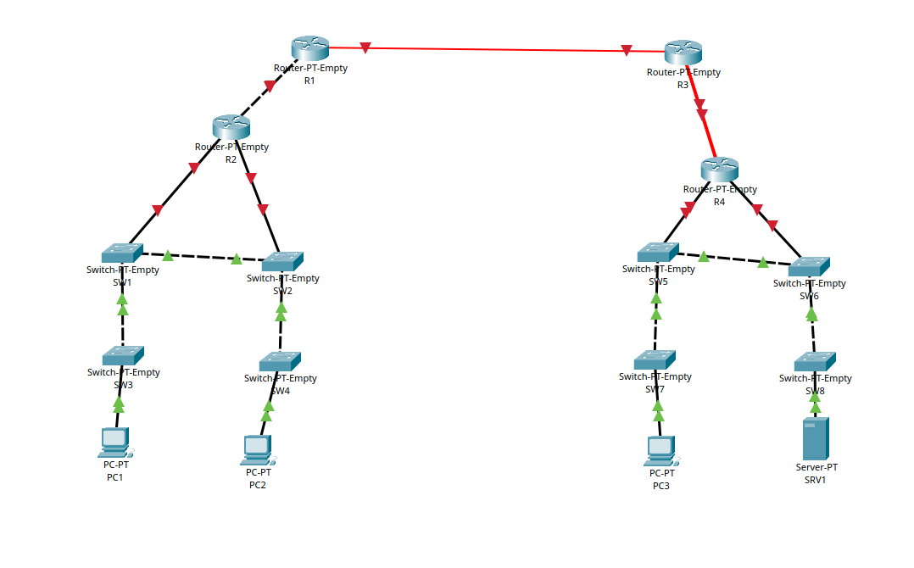

# Connecting Devices

- **Date:** 2026-10-02
- **Topic area:** Physical connectivity, interface types
- **Difficulty:** Easy

## Objective
Connect routers, switches, and end devices in Packet Tracer and get links to come up successfully.

## Topology

## What tripped me up
Figuring out which port/cable type to use where, specifically telling apart single-mode fiber, multi-mode fiber, and copper/UTP ports, since most devices come with ports built in rather than requiring manual module selection. For this lab, the exact Ethernet speed (Fast Ethernet vs. Gigabit Ethernet) didn't matter; any worked, since the lab was just about establishing a connection, not performance.

Also got confused by red/offline links between routers, and between routers and switches; initially assumed wrong port, wrong cable, or a powered-off device. Saw differing explanations online (some say it's missing IP config, others say it's the interface being administratively shut down by default). Haven't verified which is correct yet, flagging this to confirm later rather than recording it as settled.

## Things to note
- Fiber ports: single-mode vs. multi-mode matters for the cable type, not addressing or config
- Links between switches seem to come up automatically once physically connected; router ports don't, reason still unconfirmed (see above)
- Devices must be powered on to function or to be removed/modified; Packet Tracer prompts for this, which is a helpful guardrail
