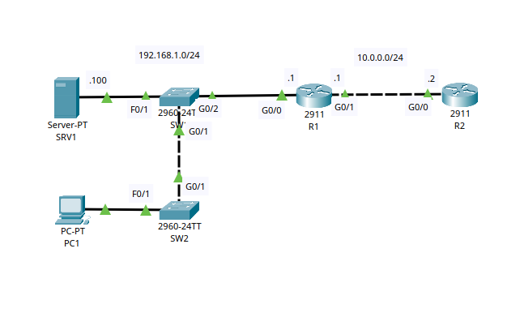
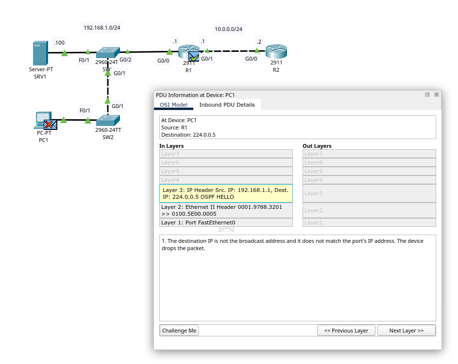
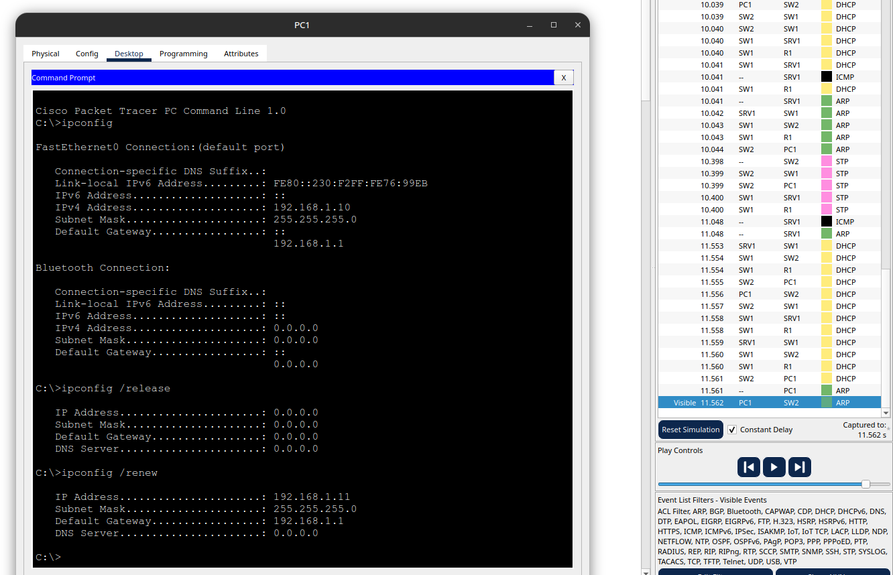

# OSI Model

**Date:** 2026-10-06
**Topic area:** OSI model, DHCP, simulation mode traffic analysis
**Difficulty:** Medium

## Objective
Use Packet Tracer's simulation mode to observe traffic at Layers 1-3 of the OSI model, then trigger and observe Layer 7 (DHCP) traffic by releasing and renewing the PC's IP address.

## Topology

Two networks connected through a router-to-router link.

- **Network 1:** 1 PC, 1 server, 2 switches, connected to Router 1
- **Network 2:** Router 1's second interface connects to Router 2

IP addresses were labeled on the topology for the router interfaces and server, but not for the PC. It still had an IP, it just wasn't displayed the way the other devices' were. I didn't catch this until I watched the video. The actual IP was findable using `ipconfig` in the PC's command prompt.

## Where I struggled
I misread the assignment. I noticed a packet being dropped and saw its destination IP didn't match the PC's actual IP (which I hadn't looked up yet, since it wasn't shown on the topology). I assumed the task was to fix that mismatch, so I tried manually changing the PC's IP to match the packet's destination. That failed with an error, and I gave up at that point.

The real task was simpler than I thought. I just needed to observe the Layer 1-3 traffic as it was, including the drop, then use `ipconfig /release` and `ipconfig /renew` in the PC's command prompt to trigger a DHCP request, which generates observable Layer 7 traffic in simulation mode. No manual IP correction was actually required.

Frames and packets were dropped at the PC and server during the Layer 1-3 observation. The simulation panel gave the reason as "no service to accept the frame."

I still don't know exactly what that means. My first guess was that it was because the PC lacked an IP, but that doesn't hold since the PC had an IP the whole time, it just wasn't shown on the topology and didn't match the packet's destination. My best guess now is that it has something to do with the destination not having an application or protocol available to accept that kind of traffic, but I haven't confirmed this. To actually find out, I'd need to click the dropped frame/packet in the event list and check the PDU Information Window for the stated reason.

## Things to note
- Just because a device's IP isn't labeled on the topology diagram doesn't mean it doesn't have one. Check with `ipconfig` on a PC instead of assuming.
- Toggling DHCP off then back on in a device's IP config (unchecking and rechecking "DHCP") does the same thing as running `ipconfig /release` and `ipconfig /renew` from the command line. Both force the device to drop its current lease and request a new one.
- `ipconfig /release` and `ipconfig /renew` run from the PC's command prompt, not the router CLI, and they generate observable DHCP traffic in simulation mode, which shows up as Layer 7 activity.

- Open question: what "no service to accept the frame" actually means for Layer 1-3 drops. Worth resolving through the PDU Information Window next time I revisit this.
