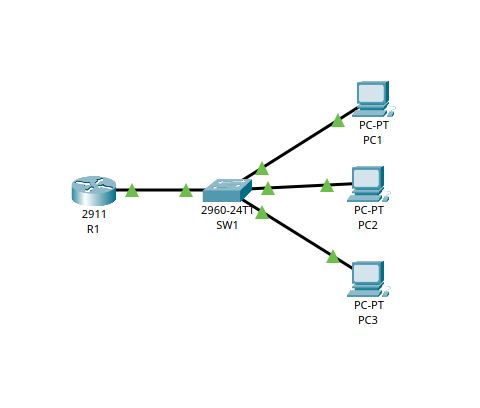
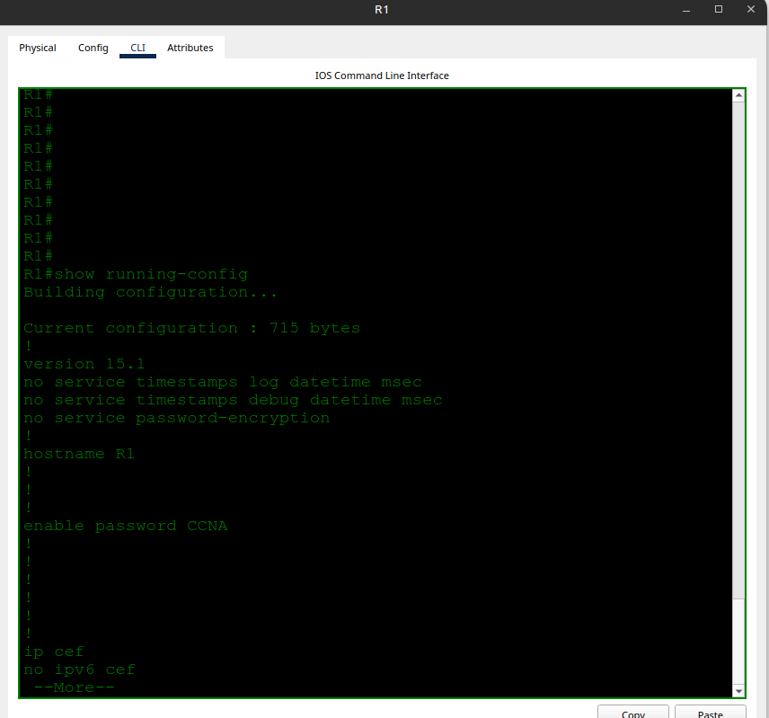
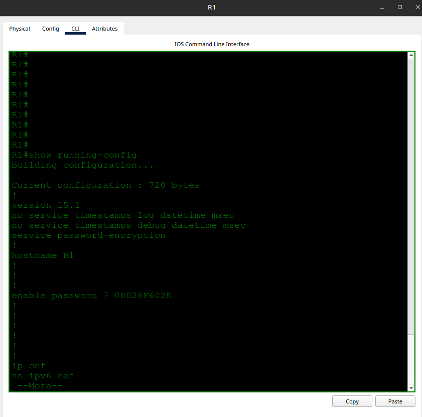
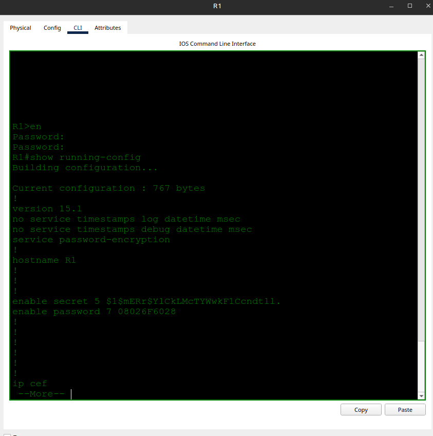

# Basic Device Security

- **Date:** 2026-10-07
- **Topic area:** Cisco IOS CLI, device hardening, password encryption
- **Difficulty:** Easy

## Objective
First hands-on use of the Cisco IOS CLI. Set hostnames on a router and switch, configure and compare `enable password` and `enable secret`, encrypt passwords, and save the configuration.

## Topology



## Key configuration

**Changing hostnames:**
```
Router> enable
Router# configure terminal
Router(config)# hostname R1
```
```
Switch> enable
Switch# configure terminal
Switch(config)# hostname SW1
```

**Unencrypted enable password on both devices:**
```
R1(config)# enable password CCNA
SW1(config)# enable password CCNA
```

**Test the password:**
```
R1# disable
R1> enable
Password:
R1#
```

**Encrypt current and future passwords on both devices:**
```
R1(config)# service password-encryption
```

**Enable secret on both devices:**
```
R1(config)# enable secret Cisco
SW1(config)# enable secret Cisco
```

**Save the configuration on both devices:**
```
R1# copy running-config startup-config
Destination filename [startup-config]?
Building configuration...
[OK]
```

## Verification
Every check below gave the same result on R1 and SW1. Screenshots are from R1.

**Before encryption:** `no service password-encryption` is set and the password appears in plain text.



**After encryption:** `service password-encryption` is set, and the password now shows as `enable password 7 08026F6028`.



**The password that grants access after enabling secret:** The device rejected `CCNA` three times (`% Bad secrets`) and accepted `Cisco`. Once `enable secret` is set, it takes over, and the old `enable password` is ignored.

```
R1> enable
Password: (CCNA, rejected x3)
% Bad secrets

R1> enable
Password: (Cisco, accepted)
R1#
```

**Encryption types:** `enable password` uses type 7 and `enable secret` uses type 5.



## Where I struggled
This was my first time in the IOS CLI, so I had a bunch of failed attempts getting commands right. One example was typing `hostname` with no name, which returned `% Incomplete command`. I also tried running commands that can't be run in global configuration mode (`show running-config` and `copy running-config startup-config`) and had to go back to privileged EXEC mode first.

When trying to update the startup-config on R1, I typed `yes` at the `Destination filename [startup-config]?` prompt, thinking it was asking for confirmation. IOS treated it as a filename and returned `%Error copying nvram:yes (Invalid argument)`. The prompt wants a destination, so pressing Enter accepts the default.

## Things to note
- The prompt shows the mode: `>` is user EXEC, `#` is privileged EXEC, `(config)#` is global configuration.
- `?` after a partial command lists what can complete it. `enable ?` showed `password` and `secret`.
- `% Incomplete command` means the command is valid but missing an argument.
- IOS accepts any unambiguous abbreviation (`en`, `conf t`, `enable s`). I wrote out the full commands in these notes.
- IOS prints nothing when a command succeeds. No error means it worked.
- The terminal doesn't echo passwords as you type them.
- `end` jumps from any config mode to privileged EXEC. `disable` drops from privileged EXEC to user EXEC.
- Type 7 is reversible obfuscation. Type 5 is a one-way hash, which is why `enable secret` is the safer choice.
- The running configuration lives in RAM. Saving it to the startup configuration is what makes it survive a reload.
