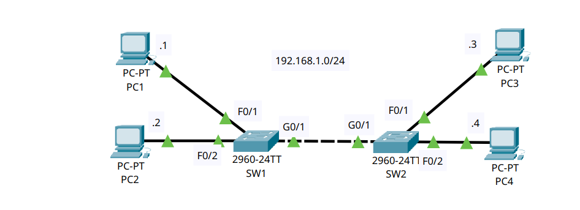
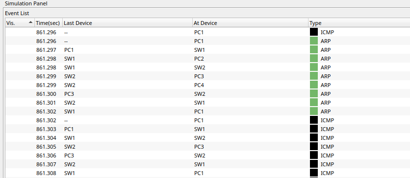
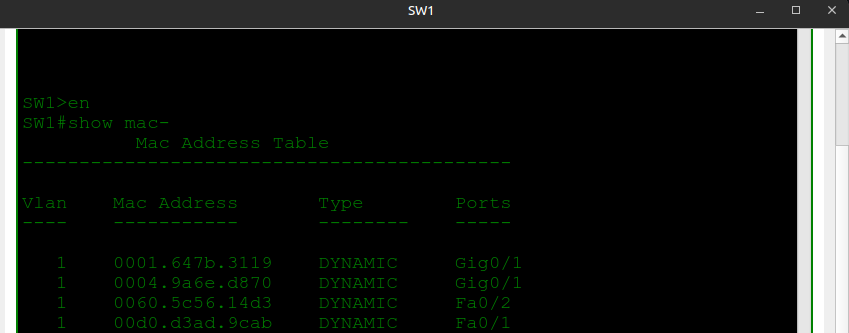
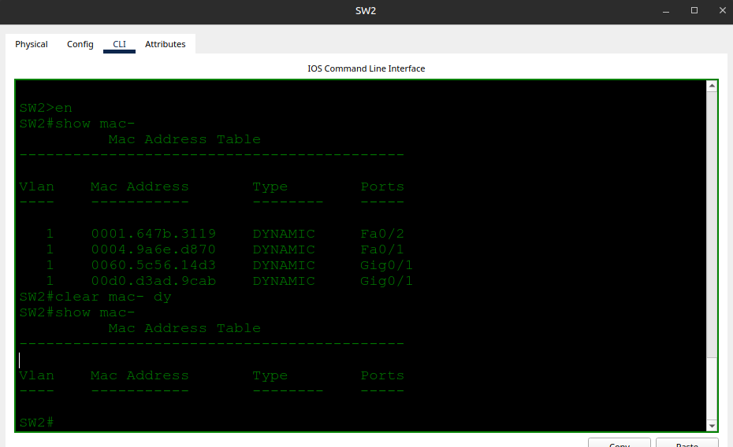

# Ethernet LAN Switching

- **Date:** 2026-10-10
- **Topic area:** Switching, MAC address learning, ARP, simulation mode
- **Difficulty:** Easy

## Objective
Predict, then observe in simulation mode, what messages a ping generates between PCs on different switches. Then let the switches learn the PCs' MAC addresses, read them from the MAC address table, and clear them.

## Topology


Both switches start with empty MAC address tables and all PCs start with empty ARP tables.

## Prediction
Pinging from PC1 to PC3 should produce this sequence:

1. **ARP request (broadcast).** PC1 doesn't know PC3's MAC address, so it broadcasts. Both switches flood it out every port except the one it arrived on, so PC2, PC3, and PC4 all receive it. Only PC3 answers, because the target IP is its own. PC2 and PC4 discard it.
2. **ARP reply (unicast).** PC3 replies directly to PC1. Both switches have already learned PC1's location from the broadcast, so they forward it out one port instead of flooding.
3. **ICMP echo request and reply (unicast), four times.** Both switches have now learned PC3's location from the ARP reply, so the pings go straight between PC1 and PC3.

## Key configuration

**Show the MAC address table on both switches:**
```
SW1# show mac address-table
```

**Clear the dynamic entries on both switches:**
```
SW1# clear mac address-table dynamic
SW1# show mac address-table
Mac Address Table
-------------------------------------------

Vlan    Mac Address       Type        Ports
----    -----------       --------    -----

```

## Verification

**Ping result:** PC1 to PC3, 4 of 4 replies received:
```
C:\>ping 192.168.1.3

Pinging 192.168.1.3 with 32 bytes of data:

Reply from 192.168.1.3: bytes=32 time=12ms TTL=128
Reply from 192.168.1.3: bytes=32 time=6ms TTL=128
Reply from 192.168.1.3: bytes=32 time=6ms TTL=128
Reply from 192.168.1.3: bytes=32 time=6ms TTL=128

Ping statistics for 192.168.1.3:
Packets: Sent = 4, Received = 4, Lost = 0 (0% loss),
Approximate round trip times in milli-seconds:
Minimum = 6ms, Maximum = 12ms, Average = 7ms
```

**Simulation mode:** The event list matched my prediction: the ARP broadcast, then the ARP reply, then the ICMP echo requests and replies.



I ran the ping once before using simulation mode, then cleared PC1's ARP table only. The switches' MAC tables and PC3's ARP table still held entries from that first ping. The traffic is the same as from a clean start, but the switches couldn't be seen learning in that run, so that part of the prediction comes from reasoning, not observation.

**MAC address tables:** The ping from PC1 to PC3 only taught the switches those two PCs, since PC2 and PC4 never sent anything. I pinged from PC2 to PC4 as well, so both switches learned all four MAC addresses. The tables differ, so both are shown.

**SW1:**



**SW2:**



MAC address of each PC, with the switch port it was learned on:

| PC | MAC address | SW1 port | SW2 port |
|----|-------------|----------|----------|
| PC1 | 00d0.d3ad.9cab | Fa0/1 | Gig0/1 |
| PC2 | 0060.5c56.14d3 | Fa0/2 | Gig0/1 |
| PC3 | 0004.9a6e.d870 | Gig0/1 | Fa0/1 |
| PC4 | 0001.647b.3119 | Gig0/1 | Fa0/2 |

Each PC shows up on a Fast Ethernet port on the switch it's plugged into and on `Gig0/1` (the link between the switches) on the other one, so the two tables agree with each other and with the topology.

**Clearing the table:** `clear mac address-table dynamic` on both switches left the table empty.

## Where I struggled
I ran the ping from PC1 to PC3 before using simulation mode and got 4 of 4 replies. I had expected 3 of 4, assuming the first ping would be lost while the ARP request was resolved. It wasn't: ARP finishes in a few milliseconds, well inside the ping timeout, and the PC sends the first echo request once it has PC3's MAC. The first reply took 12ms against 6ms for the rest, which is probably the ARP exchange. I haven't confirmed that.

Running the ping first also used up the empty tables the lab starts with, so I had to clear PC1's ARP table before the simulation would show the ARP exchange.

## Things to note
- A switch learns a MAC address from the source address of frames it receives. A device that only receives a frame, like PC2 and PC4 receiving the ARP broadcast, isn't learned until it sends something itself.
- A switch floods broadcasts and frames to unknown destinations out every port except the one they arrived on. Once it knows the destination, it forwards out one port only.
- An ARP request is a broadcast and is flooded to everyone. The ARP reply is unicast.
- One switch port can list several MAC addresses. On both switches, the port that connects to the other switch (Gig0/1) lists two, because the two PCs on the far side are reached through it.
- `clear mac address-table dynamic` removes learned entries only. Static entries stay.
- IOS accepts any unambiguous abbreviation (`show mac-`, `clear mac- dy`). I wrote out the full commands in these notes.
