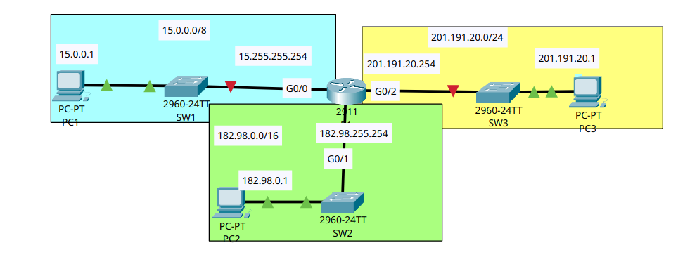
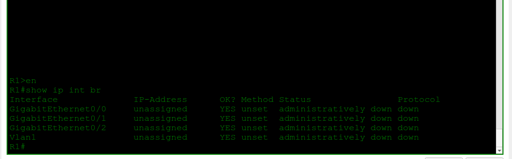
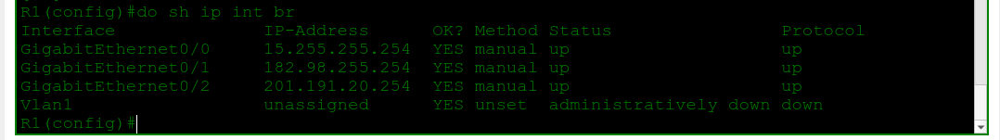
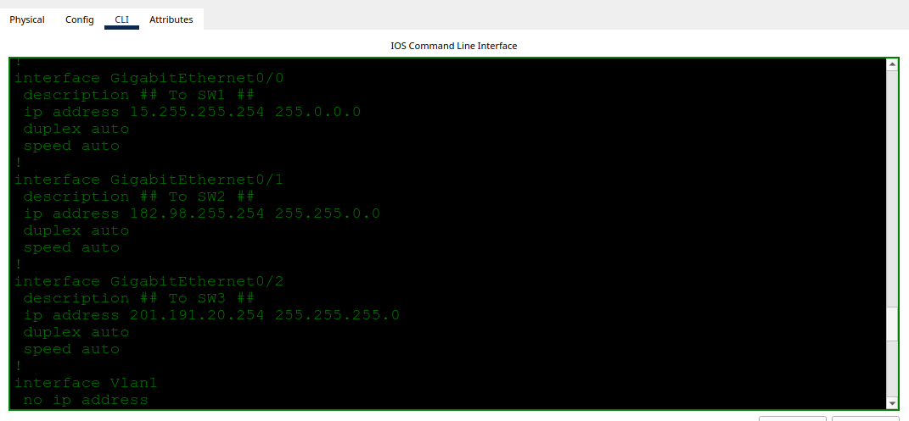
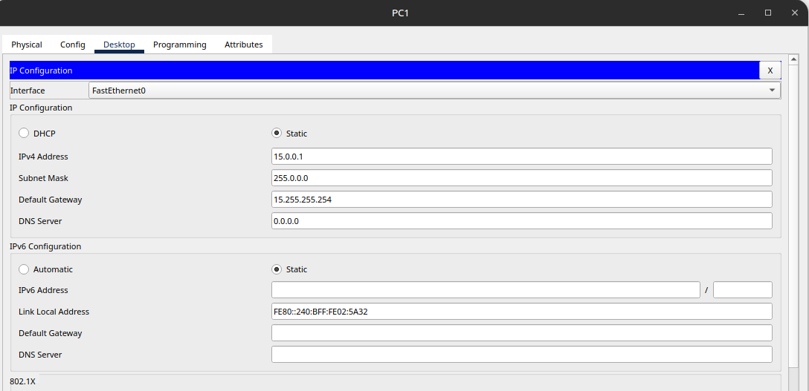

# IPv4 Addresses

- **Date:** 2026-10-14
- **Topic area:** IPv4 addressing, router interface configuration
- **Difficulty:** Easy

## Objective
Configure IPv4 addresses and descriptions on a router's interfaces, enable them, verify the configuration, assign addresses to the PCs, and test connectivity between three LANs.

## Topology


Three separate LANs, each with one switch and one PC, all connected to R1.

## Key configuration

**Hostname:**
```
Router> enable
Router# configure terminal
Router(config)# hostname R1
```

**Interface addresses, descriptions, and enabling each one:**
```
R1(config)# interface gigabitethernet0/0
R1(config-if)# ip address 15.255.255.254 255.0.0.0
R1(config-if)# description ## To SW1 ##
R1(config-if)# no shutdown

R1(config)# interface gigabitethernet0/1
R1(config-if)# ip address 182.98.255.254 255.255.0.0
R1(config-if)# description ## To SW2 ##
R1(config-if)# no shutdown

R1(config)# interface gigabitethernet0/2
R1(config-if)# ip address 201.191.20.254 255.255.255.0
R1(config-if)# description ## To SW3 ##
R1(config-if)# no shutdown
```

**Save the config:**
```
R1(config)# do write mem
Building configuration...
[OK]
```

## Verification

**Interfaces before configuration:** All three interfaces were unassigned and administratively down.




**Interfaces after configuration:** All three have their addresses, and both status and protocol are up.



`Vlan1` didn't change because I didn't configure it.


**Running configuration:** The descriptions and addresses match the topology.




**PC addresses:** I entered the IP address and subnet mask for each PC in Packet Tracer's IP configuration window, then checked with `ipconfig`. The screenshot is from PC1, and PC2 and PC3 looked the same.



| PC | IPv4 address | Subnet mask | Default gateway |
|----|--------------|-------------|-----------------|
| PC1 | 15.0.0.1 | 255.0.0.0 | 15.255.255.254 |
| PC2 | 182.98.0.1 | 255.255.0.0 | 182.98.255.254 |
| PC3 | 201.191.20.1 | 255.255.255.0 | 201.191.20.254 |

```
C:\> ipconfig

FastEthernet0 Connection:(default port)

Connection-specific DNS Suffix..:
Link-local IPv6 Address.........: FE80::240:BFF:FE02:5A32
IPv6 Address....................: ::
IPv4 Address....................: 15.0.0.1
Subnet Mask.....................: 255.0.0.0
Default Gateway.................: ::
15.255.255.254
```

The default gateways were already filled in with each router interface's address when I opened the IP configuration. I only entered the IP address and subnet mask.


**Connectivity:** Pinged PC2 and PC3 from PC1. Both worked, with the first request timing out each time.
```
C:\> ping 182.98.0.1

Pinging 182.98.0.1 with 32 bytes of data:

Request timed out.
Reply from 182.98.0.1: bytes=32 time<1ms TTL=127
Reply from 182.98.0.1: bytes=32 time<1ms TTL=127
Reply from 182.98.0.1: bytes=32 time<1ms TTL=127

Ping statistics for 182.98.0.1:
Packets: Sent = 4, Received = 3, Lost = 1 (25% loss),
Approximate round trip times in milli-seconds:
Minimum = 0ms, Maximum = 0ms, Average = 0ms
```
```
C:\> ping 201.191.20.1

Pinging 201.191.20.1 with 32 bytes of data:

Request timed out.
Reply from 201.191.20.1: bytes=32 time<1ms TTL=127
Reply from 201.191.20.1: bytes=32 time<1ms TTL=127
Reply from 201.191.20.1: bytes=32 time<1ms TTL=127

Ping statistics for 201.191.20.1:
Packets: Sent = 4, Received = 3, Lost = 1 (25% loss),
Approximate round trip times in milli-seconds:
Minimum = 0ms, Maximum = 0ms, Average = 0ms
```

## Where I struggled
I couldn't remember the command for listing the interfaces with their addresses and status, so I pieced it together with `?` at each step until I got to `show ip interface brief`.

When saving the config to memory, I ran `write mem` from global configuration mode and got `% Invalid input detected at '^' marker`. It's a privileged EXEC command. Putting `do` in front of it ran it from config mode and printed `[OK]`.

I couldn't view the interface descriptions with `show interfaces description`. It's a command I've seen somewhere before, but it didn't work for me in Packet Tracer, so the descriptions only showed up in the running configuration.

## Things to note
- After `no shutdown`, IOS printed `%LINK-5-CHANGED` and `%LINEPROTO-5-UPDOWN` messages saying the interface changed state to up. Assigning the IP addresses printed nothing and didn't bring the interfaces up. I didn't test `no shutdown` without an address, so this only shows that the address alone wasn't enough.
- In a running configuration, an enabled interface has no `shutdown` line, and a disabled one does (`Vlan1`).
- `show ip interface brief` shows the address, whether it was set manually, and the status and protocol of each interface.
- The subnet mask matches the prefix length: /8 is 255.0.0.0, /16 is 255.255.0.0, /24 is 255.255.255.0.
- `do` runs a privileged EXEC command from any config mode (`do show running-config`, `do copy running-config startup-config`).
- Each PC's default gateway is a separate setting that points to the router interface on its own LAN. It was pre-filled here, which may not always be the case, so check it first if a cross-subnet ping fails.
- The first ping to each PC timed out, and the next three succeeded. My explanation is ARP: PC1 has to resolve its gateway's MAC, and R1 has to resolve the destination PC's MAC, before the first echo gets through. I haven't confirmed this. Simulation mode would show it, and rerunning the ping should give 4 of 4 if it's right.
- The replies came back with TTL=127. In the Ethernet LAN switching lab, same-LAN replies had TTL=128. The router decrements the TTL by one when it forwards, so this suggests the traffic crossed one router hop.
