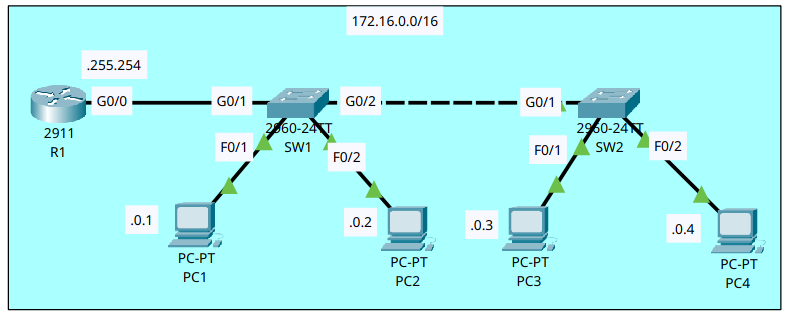
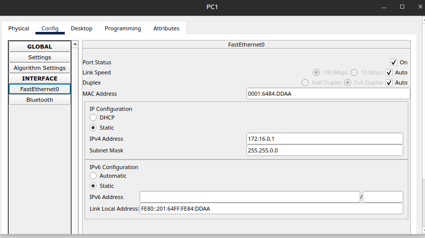
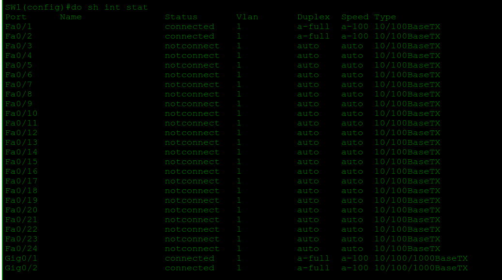
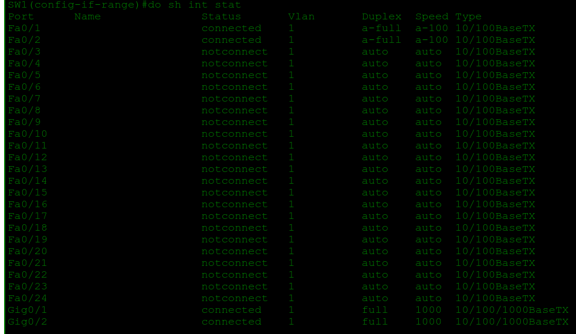
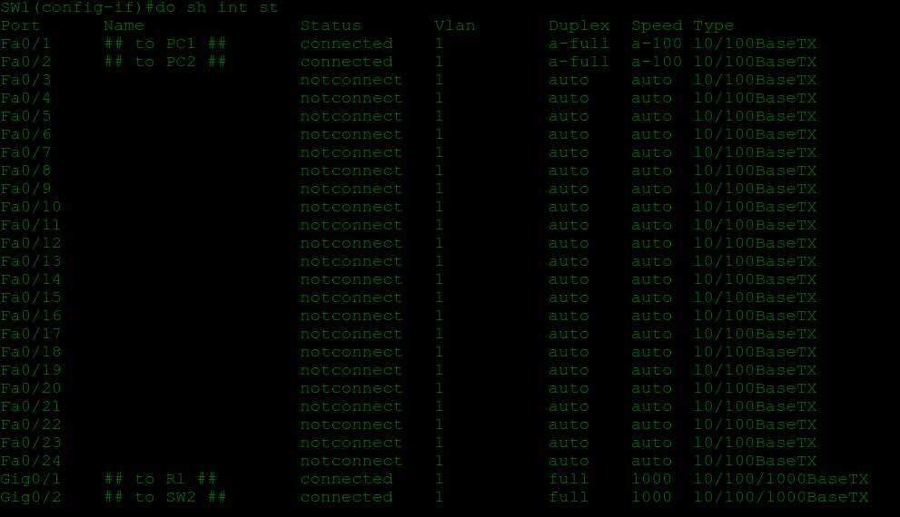
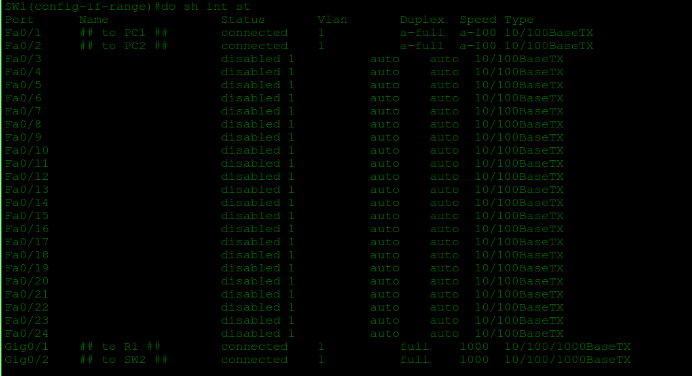
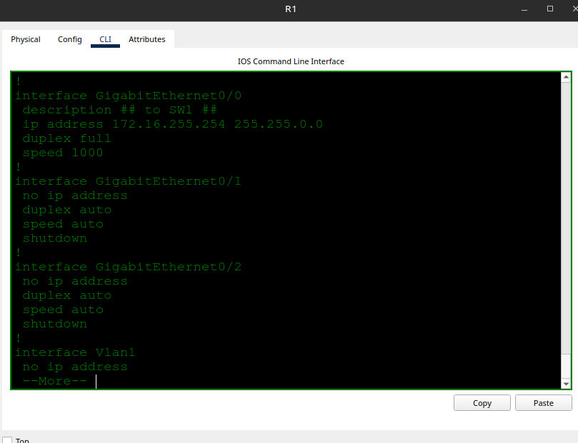
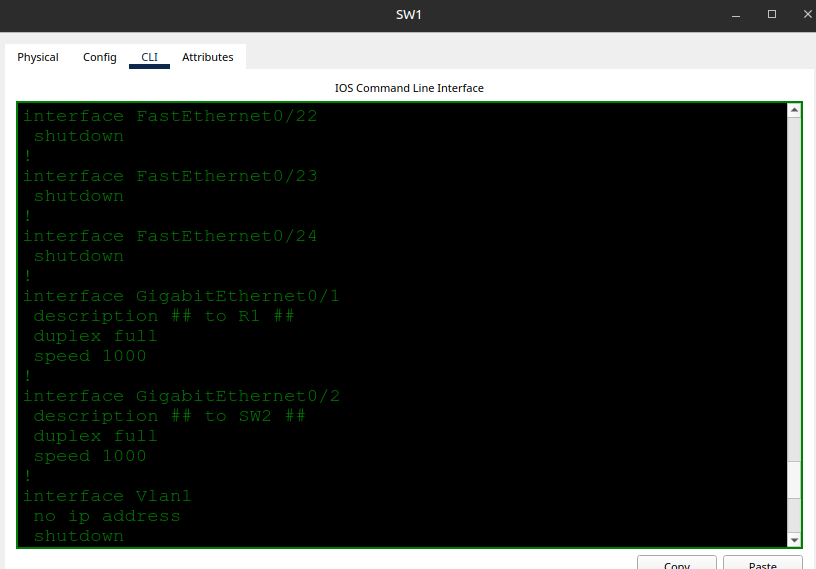

# Interface Configuration

- **Date:** 2026-10-15
- **Topic area:** Switch interface configuration, speed and duplex, disabling unused ports
- **Difficulty:** Easy

## Objective
Configure hostnames and IP addresses, set speed and duplex manually on the links between network devices, add interface descriptions, disable the interfaces that aren't connected, and save the configurations.

## Topology


One LAN, 172.16.0.0/16. R1 connects to SW1, SW1 connects to SW2, and two PCs connect to each switch.

## Key configuration

**Hostnames:**
```
Router> enable
Router# configure terminal
Router(config)# hostname R1

Switch> enable
Switch# configure terminal
Switch(config)# hostname SW1

Switch> enable
Switch# configure terminal
Switch(config)# hostname SW2
```

**R1's address:**
```
R1(config)# interface gigabitethernet0/0
R1(config-if)# ip address 172.16.255.254 255.255.0.0
R1(config-if)# no shutdown
```

**Speed and duplex on the links between network devices:**
```
SW1(config)# interface range gigabitethernet0/1 - 2
SW1(config-if-range)# speed 1000
SW1(config-if-range)# duplex full

SW2(config)# interface gigabitethernet0/1
SW2(config-if)# speed 1000
SW2(config-if)# duplex full

R1(config)# interface gigabitethernet0/0
R1(config-if)# speed 1000
R1(config-if)# duplex full
```

**Interface Descriptions:**
```
SW1(config)# interface gigabitethernet0/1
SW1(config-if)# description ## to R1 ##
SW1(config)# interface gigabitethernet0/2
SW1(config-if)# description ## to SW2 ##
SW1(config)# interface fastethernet0/1
SW1(config-if)# description ## to PC1 ##
SW1(config)# interface fastethernet0/2
SW1(config-if)# description ## to PC2 ##

SW2(config)# interface gigabitethernet0/1
SW2(config-if)# description ## to SW1 ##
SW2(config)# interface fastethernet0/1
SW2(config-if)# description ## to PC3 ##
SW2(config)# interface fastethernet0/2
SW2(config-if)# description ## to PC4 ##

R1(config)# interface gigabitethernet0/0
R1(config-if)# description ## to SW1 ##
```

**Disabling the unused interfaces:**
```
SW1(config)# interface range fastethernet0/3 - 24
SW1(config-if-range)# shutdown
%LINK-5-CHANGED: Interface FastEthernet0/3, changed state to administratively down
(one message per interface)

SW2(config)# interface range fastethernet0/3 - 24 , gigabitethernet0/2
SW2(config-if-range)# shutdown
```

**Saving the configurations on all three devices:**
```
R1(config)# do write memory
Building configuration...
[OK]
```

## Verification

**PC addresses:** I entered the IP address and subnet mask on each PC in Packet Tracer's IP configuration window, then checked PC1 with `ipconfig`. The screenshot is from PC1, and PC2 to PC4 were set the same way with their own addresses.



```
C:\> ipconfig

FastEthernet0 Connection:(default port)

Connection-specific DNS Suffix..:
Link-local IPv6 Address.........: FE80::201:64FF:FE84:DDAA
IPv6 Address....................: ::
IPv4 Address....................: 172.16.0.1
Subnet Mask.....................: 255.255.0.0
Default Gateway.................: ::
172.16.255.254
```

The default gateway was already filled in on each PC. I only entered the IP address and subnet mask.

**SW1's interfaces before the speed and duplex change:** This was taken after R1's interface was enabled, so the link to R1 is up.




**SW1's interfaces after the change:** The Speed and Duplex columns on G0/1 and G0/2 are the difference. I set SW2 and R1 the same way, so both ends of each link match.




**Unused ports before disabling:**




**Unused ports after disabling:** F0/3 to F0/24 on SW1 are disabled. SW2 got the same treatment, plus its unused G0/2.




I didn't touch R1's unused interfaces, G0/1 and G0/2, because router interfaces start administratively down (see the IPv4 Addresses lab).


**Saved configs, Gigabit interfaces:** Each connected Gigabit interface has `speed 1000`, `duplex full` and its description. Screenshots are from R1 and SW1. SW2's Gigabit interface matches.


R1:




SW1:




## Where I struggled
After assigning R1's G0/0 its address, I moved on without enabling the interface. When I checked SW1's interface status, G0/1 showed as not connected. It took me a moment to work out why: the cable was fine, but R1's G0/0 was still administratively shut down. I ran `no shutdown` on it, and the link came up.

## Things to note
- A link that's down at one end shows as not connected at the other, so checking the neighbor's interface status is a quick way to tell whether a fault is local or on the far end.
- This matches the IPv4 Addresses lab: R1's interface had an IP address and stayed down until `no shutdown`. I still haven't tested `no shutdown` on an interface with no address.
- Both ends of a link need matching speed and duplex. I set them manually on the links between network devices and left the host-facing ports alone.
- `interface range` configures several interfaces at once. Different interface types can be combined in one range with a comma (`fastethernet0/3 - 24 , gigabitethernet0/2`).
- Each `shutdown` on the switch printed a state change to `administratively down`, so those ports were up before. Switch ports come up on their own, while router interfaces start down.
- IOS printed one `%LINK-5-CHANGED` message per interface in a range, so a range of 22 ports prints 22 lines.
- `do` runs a privileged EXEC command from any config mode, so `do copy running-config startup-config` works from interface config.
- I forgot to give the disabled interfaces a description such as "not in use". I only described the connected ones.
