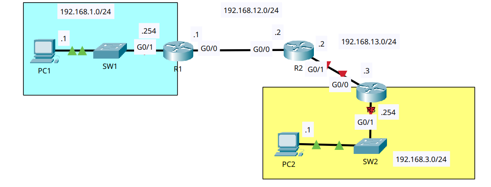
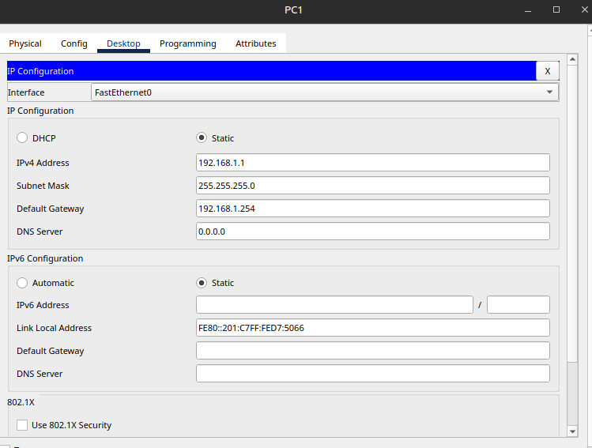
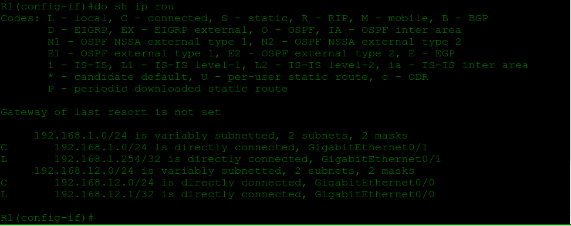
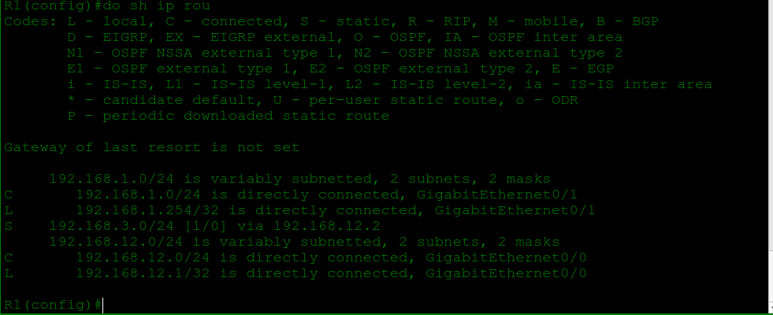
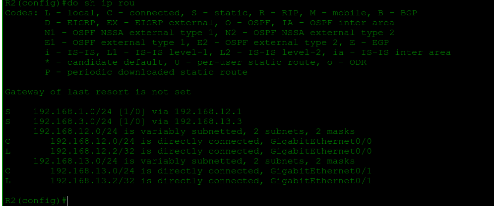
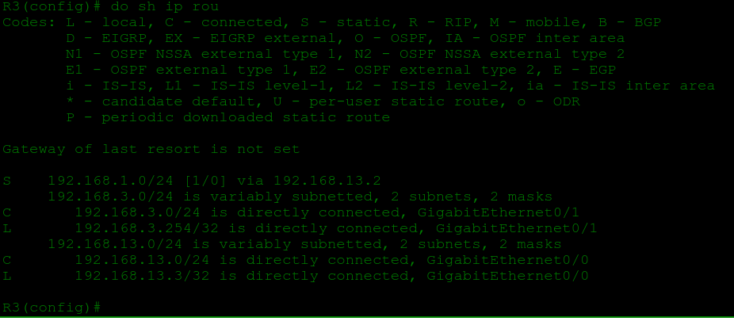

# Configuring Static Routes

- **Date:** 2026-10-16
- **Topic area:** Static routing, router interface configuration
- **Difficulty:** Medium

## Objective
Configure the PCs and routers from scratch according to the network diagram, then add static routes on the routers so PC1 can ping PC2 across the WAN.

## Topology


Two LANs joined by a WAN of three routers (R1 to R2 to R3). The switches have no configuration.


## Key configuration

**Hostnames and interface addresses:**
```
Router> enable
Router# configure terminal
Router(config)# hostname R1
R1(config)# interface gigabitethernet0/1
R1(config-if)# ip address 192.168.1.254 255.255.255.0
R1(config-if)# no shutdown
R1(config)# interface gigabitethernet0/0
R1(config-if)# ip address 192.168.12.1 255.255.255.0
R1(config-if)# no shutdown

Router(config)# hostname R2
R2(config)# interface gigabitethernet0/0
R2(config-if)# ip address 192.168.12.2 255.255.255.0
R2(config-if)# no shutdown
R2(config)# interface gigabitethernet0/1
R2(config-if)# ip address 192.168.13.2 255.255.255.0
R2(config-if)# no shutdown

Router(config)# hostname R3
R3(config)# interface gigabitethernet0/0
R3(config-if)# ip address 192.168.13.3 255.255.255.0
R3(config-if)# no shutdown
R3(config)# interface gigabitethernet0/1
R3(config-if)# ip address 192.168.3.254 255.255.255.0
R3(config-if)# no shutdown
```
(R2 and R3 started with the same `enable` and `configure terminal` as R1.)

**Static routes:**
```
R1(config)# ip route 192.168.3.0 255.255.255.0 192.168.12.2

R2(config)# ip route 192.168.1.0 255.255.255.0 192.168.12.1
R2(config)# ip route 192.168.3.0 255.255.255.0 192.168.13.3

R3(config)# ip route 192.168.1.0 255.255.255.0 192.168.13.2
```

## Verification

**PC addresses:** Nothing was pre-configured in this lab, so I entered the IP address, subnet mask, and default gateway on each PC myself, then checked with `ipconfig`. Screenshot is from PC1, and PC2 was set the same way with its own addresses.



```
C:\> ipconfig

FastEthernet0 Connection:(default port)

Connection-specific DNS Suffix..:
Link-local IPv6 Address.........: FE80::201:C7FF:FED7:5066
IPv6 Address....................: ::
IPv4 Address....................: 192.168.1.1
Subnet Mask.....................: 255.255.255.0
Default Gateway.................: ::
192.168.1.254
```

| PC | IPv4 address | Subnet mask | Default gateway |
|----|--------------|-------------|-----------------|
| PC1 | 192.168.1.1 | 255.255.255.0 | 192.168.1.254 |
| PC2 | 192.168.3.1 | 255.255.255.0 | 192.168.3.254 |


**Routing tables before the static routes:** After the interfaces were configured, each router lists only its own connected (`C`) and local (`L`) routes.

R1:



R2:
```
R2# show ip route
Gateway of last resort is not set

     192.168.12.0/24 is variably subnetted, 2 subnets, 2 masks
C       192.168.12.0/24 is directly connected, GigabitEthernet0/0
L       192.168.12.2/32 is directly connected, GigabitEthernet0/0
     192.168.13.0/24 is variably subnetted, 2 subnets, 2 masks
C       192.168.13.0/24 is directly connected, GigabitEthernet0/1
L       192.168.13.2/32 is directly connected, GigabitEthernet0/1
```

R3:
```
R3# show ip route
Gateway of last resort is not set

     192.168.3.0/24 is variably subnetted, 2 subnets, 2 masks
C       192.168.3.0/24 is directly connected, GigabitEthernet0/1
L       192.168.3.254/32 is directly connected, GigabitEthernet0/1
     192.168.13.0/24 is variably subnetted, 2 subnets, 2 masks
C       192.168.13.0/24 is directly connected, GigabitEthernet0/0
L       192.168.13.3/32 is directly connected, GigabitEthernet0/0
```

**Ping attempt before configuring the static routes on each router:** 

PC1 to PC2 failed with 100% loss. The `Destination host unreachable` replies came from 192.168.1.254, which is R1, so the router answered that it couldn't forward the packets, instead of the packets disappearing. One request timed out in the middle, and I don't know why.
```
C:\> ping 192.168.3.1

Pinging 192.168.3.1 with 32 bytes of data:

Reply from 192.168.1.254: Destination host unreachable.
Reply from 192.168.1.254: Destination host unreachable.
Request timed out.
Reply from 192.168.1.254: Destination host unreachable.

Ping statistics for 192.168.3.1:
Packets: Sent = 4, Received = 0, Lost = 4 (100% loss),
```

**Routing tables after static route config:** Each router now has `S` routes pointing at the next hop from the commands above.

R1:



R2:



R3:



**Ping after the static routes:** The first attempt got 1 of 4 replies, and the second got 4 of 4.
```
C:\> ping 192.168.3.1

Pinging 192.168.3.1 with 32 bytes of data:

Request timed out.
Request timed out.
Request timed out.
Reply from 192.168.3.1: bytes=32 time<1ms TTL=125

Ping statistics for 192.168.3.1:
Packets: Sent = 4, Received = 1, Lost = 3 (75% loss),
Approximate round trip times in milli-seconds:
Minimum = 0ms, Maximum = 0ms, Average = 0ms
```
```
C:\> ping 192.168.3.1

Pinging 192.168.3.1 with 32 bytes of data:

Reply from 192.168.3.1: bytes=32 time<1ms TTL=125
Reply from 192.168.3.1: bytes=32 time<1ms TTL=125
Reply from 192.168.3.1: bytes=32 time<1ms TTL=125
Reply from 192.168.3.1: bytes=32 time<1ms TTL=125

Ping statistics for 192.168.3.1:
Packets: Sent = 4, Received = 4, Lost = 0 (0% loss),
Approximate round trip times in milli-seconds:
Minimum = 0ms, Maximum = 0ms, Average = 0ms
```

## Where I struggled
After setting PC1's static IP address, the default gateway field was empty. I had just configured the connected router interface, so I assumed the gateway would fill in on its own. I tried disabling and re-enabling the router interface and power cycling the PC, and nothing changed. The gateway is a setting on the PC that I have to enter myself. In the earlier labs the gateways were already filled in, which is why I expected it here too.

After configuring R1's interfaces, I checked the routing table, and only one of the two connected networks was listed. I had configured and enabled both interfaces, so I checked the interface status. The one missing from the table, G0/0, had its line protocol down. R2's interface on that link hadn't been configured yet and was still shut down, so the link wasn't up at both ends.

## Things to note
- A connected route only appears in the routing table once the interface is up and its line protocol is up. A link needs both ends up, so an interface can be enabled and configured and still be missing from the table until the device at the other end is configured too.
- A static route is `ip route <destination network> <subnet mask> <next-hop address>`. The next hop is the neighbouring router's address on the link they share.
- R2 needed two routes, one for each LAN, because it sits between them. R1 and R3 each needed one, for the LAN on the far side.
- A ping needs a route in both directions: the request needs a path to PC2, and the reply needs a path back to PC1. That's why R3 has a route to 192.168.1.0 even though PC1 is the one pinging. This comes from how routing works, not from something I tested.
- Before the static routes, R1 replied `Destination host unreachable`, which is different from `Request timed out`. The first means a router answered that it had no route. The second means nothing answered.
- The replies came back with TTL 125. Same-LAN replies were TTL 128 in the Ethernet LAN switching lab and TTL 127 across one router in the IPv4 Addresses lab. Three routers here is 125, which fits each router subtracting one.
- The first ping lost three packets, and the rerun got 4 of 4, the same pattern as the IPv4 Addresses lab. My theory is that devices along the path have to resolve MAC addresses first, and this path has more of them. I haven't confirmed that, and simulation mode would show it.
- `variably subnetted, 2 subnets, 2 masks` appears because each interface adds a /24 connected route and a /32 local route for the router's own address. That's my reading of the output, so check it against the video.
- `Gateway of last resort is not set` is the default route slot, and it's empty here.
