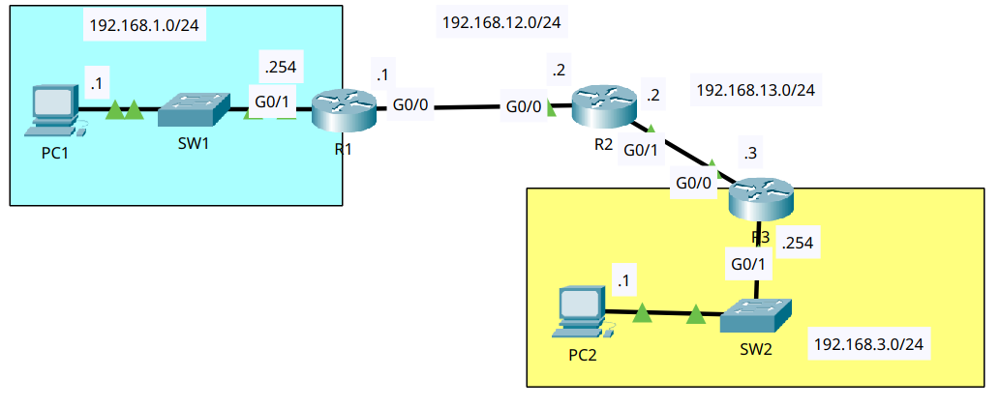
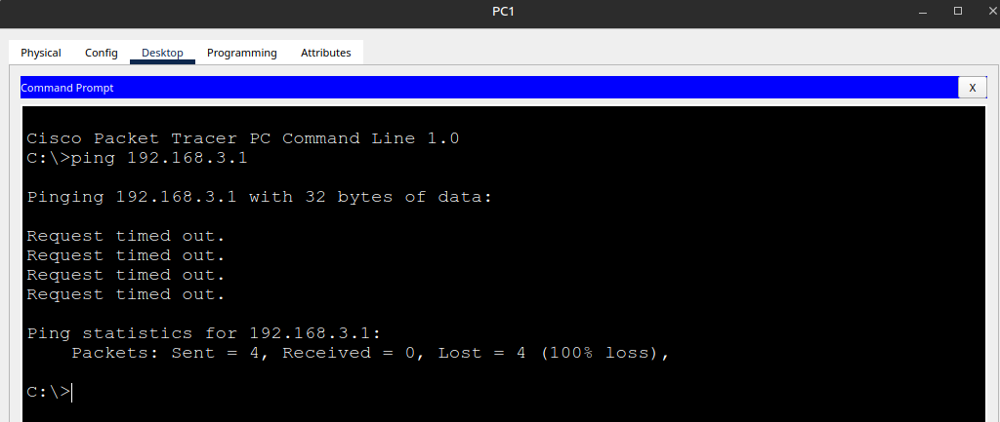

# Troubleshooting Static Routes

- **Date:** 2026-10-17
- **Topic area:** Static routing, troubleshooting
- **Difficulty:** Easy

## Objective
PC1 and PC2 can't ping each other. Each router has one misconfiguration. Find and fix them until the ping works.

## Topology


Same topology and intended addressing as the [Configuring Static Routes](../08-configuring-static-routes/notes.md) lab.


## Starting state
PC1 to PC2 failed.



All I got from PC1 were `Request timed out` replies and 100% loss, with no reply from any device saying why. Pinging PC1 from PC2 gave `Destination host unreachable` replies from R3.


## Troubleshooting log

**PCs (ruled out):** Both PCs had the right address, mask, and gateway, checked with `ipconfig`.

| PC | IPv4 address | Subnet mask | Default gateway |
|----|--------------|-------------|-----------------|
| PC1 | 192.168.1.1 | 255.255.255.0 | 192.168.1.254 |
| PC2 | 192.168.3.1 | 255.255.255.0 | 192.168.3.254 |

I checked each router with `show ip interface brief` first, since it shows right away whether an interface is shut down or has the wrong address, then with `show ip route`. Lines that were wrong are in red below, and the corrected lines are in green.

**R1 - wrong next hop on the static route:** The interfaces were correct, and both were up.
```
R1# show ip interface brief
GigabitEthernet0/0     192.168.12.1    YES manual up                    up
GigabitEthernet0/1     192.168.1.254   YES manual up                    up
```
The routing table had a static route to LAN 2, but the next hop was wrong. 192.168.12.3 isn't any device on that link. R2 is .2.
```diff
- S    192.168.3.0/24 [1/0] via 192.168.12.3
+ S    192.168.3.0/24 [1/0] via 192.168.12.2
```
Fix:
```
R1(config)# no ip route 192.168.3.0 255.255.255.0 192.168.12.3
R1(config)# ip route 192.168.3.0 255.255.255.0 192.168.12.2
```

**R2 - static route pointing out the wrong interface:** The interfaces were correct, and both were up.
```
R2# show ip interface brief
GigabitEthernet0/0     192.168.12.2    YES manual up                    up
GigabitEthernet0/1     192.168.13.2    YES manual up                    up
```
The route to LAN 2 used G0/0, which faces R1. LAN 2 is reached through G0/1, which faces R3.
```diff
- S    192.168.3.0/24 is directly connected, GigabitEthernet0/0
+ S    192.168.3.0/24 [1/0] via 192.168.13.3
```
Fix: I rewrote the route with R3's address as the next hop, the form I used in the Configuring Static Routes lab. The fault itself was the wrong interface.
```
R2(config)# no ip route 192.168.3.0 255.255.255.0 gigabitethernet0/0
R2(config)# ip route 192.168.3.0 255.255.255.0 192.168.13.3
```

**R3 - wrong address on G0/0:** The interface table showed it.
```diff
- GigabitEthernet0/0     192.168.23.3    YES manual up                    up
+ GigabitEthernet0/0     192.168.13.3    YES manual up                    up
```
The routing table had no route to LAN 1, even though the running config already had one:
```
ip route 192.168.1.0 255.255.255.0 192.168.13.2
```
Its next hop, 192.168.13.2, wasn't in any network connected to R3, and G0/0 had the wrong address, so the route never made it into the table. Fixing the address brought it back with no change to the route itself.
```diff
- C    192.168.23.0/24 is directly connected, GigabitEthernet0/0
+ C    192.168.13.0/24 is directly connected, GigabitEthernet0/0
+ S    192.168.1.0/24 [1/0] via 192.168.13.2
```
Fix:
```
R3(config)# interface gigabitethernet0/0
R3(config-if)# ip address 192.168.13.3 255.255.255.0
```

I saved the configuration on all three routers with `write`.

## Verification
PC1 to PC2 after the fixes. The first attempt got 1 of 4 replies, and the second got 4 of 4.
```
C:\> ping 192.168.3.1

Pinging 192.168.3.1 with 32 bytes of data:

Request timed out.
Request timed out.
Request timed out.
Reply from 192.168.3.1: bytes=32 time=20ms TTL=125

Ping statistics for 192.168.3.1:
Packets: Sent = 4, Received = 1, Lost = 3 (75% loss),
Approximate round trip times in milli-seconds:
Minimum = 20ms, Maximum = 20ms, Average = 20ms
```
```
C:\> ping 192.168.3.1

Pinging 192.168.3.1 with 32 bytes of data:

Reply from 192.168.3.1: bytes=32 time<1ms TTL=125
Reply from 192.168.3.1: bytes=32 time<1ms TTL=125
Reply from 192.168.3.1: bytes=32 time<1ms TTL=125
Reply from 192.168.3.1: bytes=32 time<1ms TTL=125

Ping statistics for 192.168.3.1:
Packets: Sent = 4, Received = 4, Lost = 0 (0% loss),
Approximate round trip times in milli-seconds:
Minimum = 0ms, Maximum = 0ms, Average = 0ms
```

## Things to note
- The three faults were three different kinds: a wrong next hop (R1), a route pointing out the wrong interface (R2), and a wrong interface address (R3). Each router had exactly one.
- R3's symptom, a missing route, wasn't caused by the route. The route was in the config the whole time, and the fault was in the interface address underneath it.
- A static route enters the routing table only when its next hop falls inside a network the router has a connected route for. That's why R3's route was missing.
- R1's route with the wrong next hop did show up in the table because 192.168.12.3 is inside the connected 192.168.12.0/24. A route appearing in the table doesn't mean it points to a real device, so check next hops against the topology.
- Adding the correct route doesn't remove the wrong one. I removed the old routes with `no ip route` first, then added the new ones, and checked each table for a leftover `S` line.
- Changing an interface's address replaces the old one, so on R3 I didn't need to remove 192.168.23.3 first.
- The two directions of the same failure gave different symptoms. From PC1, the ping only timed out. From PC2, the replies were `Destination host unreachable`, and they came from R3, the router that had no route to LAN 1 in its table. That matches the Configuring Static Routes lab, where the same reply came from R1 when it had no route. R1 had a route here, with a wrong next hop, so it forwarded the packets toward an address where nothing answered, and that ping only timed out. My reading is that `Destination host unreachable` points at a router with no route, and a timeout tells you less. The R3 half is observed, and the R1 half is my explanation and isn't confirmed.
- The replies came back with TTL 125, the same as the Configuring Static Routes lab.
- The first ping lost three packets, and the rerun got 4 of 4, the same pattern as the last two routed labs. My explanation is ARP: the devices along the path resolve MAC addresses on the first ping, and the cached entries make the rerun clean. I haven't confirmed that, and simulation mode would show it.
