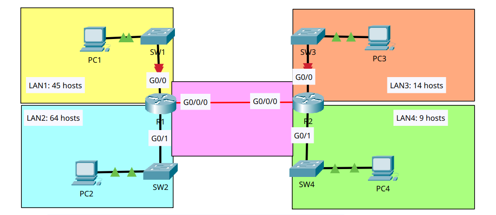
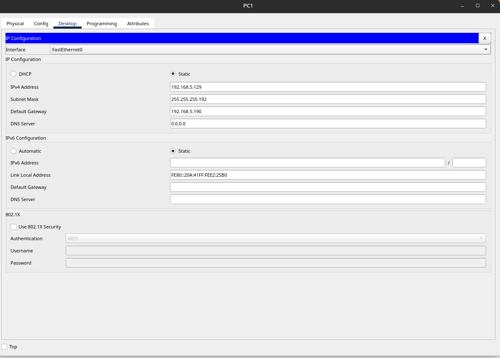

# Subnetting (VLSM)

- **Date:** 2026-10-21
- **Topic area:** Subnetting, VLSM, static routing
- **Difficulty:** Hard

## Objective
Subnet 192.168.5.0/24 so each LAN and the point-to-point link between R1 and R2 get enough addresses. Give each PC the first usable address in its subnet and each router's LAN interface the last usable address. Then configure static routes so the PCs can ping each other.

## Topology


Four LANs and a point-to-point link between two routers. R1 serves LAN1 and LAN2, and R2 serves LAN3 and LAN4. The red link markers in the diagram are the starting state, before any interface was configured.

## Subnetting
I allocated from the largest requirement to the smallest, so each block starts on a multiple of its own size and none overlap. Each requirement is the hosts plus the network and broadcast addresses, rounded up to the next power of two. In the binary, the `|` marks where the network portion ends and the host portion begins.

Starting network:
```
Network address  192.168.5.0      11000000 10101000 00000101|00000000
```

LAN2: 64 + 2 = 66 addresses; 2^7 = 128, so 7 host bits and /25.
```
Network address  192.168.5.0      11000000 10101000 00000101 0|0000000
Subnet mask      255.255.255.128  11111111 11111111 11111111 1|0000000
First usable     192.168.5.1      11000000 10101000 00000101 0|0000001
Last usable      192.168.5.126    11000000 10101000 00000101 0|1111110
Broadcast        192.168.5.127    11000000 10101000 00000101 0|1111111
```

LAN1: 45 + 2 = 47 addresses; 2^6 = 64, so 6 host bits and /26.
```
Network address  192.168.5.128    11000000 10101000 00000101 10|000000
Subnet mask      255.255.255.192  11111111 11111111 11111111 11|000000
First usable     192.168.5.129    11000000 10101000 00000101 10|000001
Last usable      192.168.5.190    11000000 10101000 00000101 10|111110
Broadcast        192.168.5.191    11000000 10101000 00000101 10|111111
```

LAN3: 14 + 2 = 16 addresses; 2^4 = 16, so 4 host bits and /28.
```
Network address  192.168.5.192    11000000 10101000 00000101 1100|0000
Subnet mask      255.255.255.240  11111111 11111111 11111111 1111|0000
First usable     192.168.5.193    11000000 10101000 00000101 1100|0001
Last usable      192.168.5.206    11000000 10101000 00000101 1100|1110
Broadcast        192.168.5.207    11000000 10101000 00000101 1100|1111
```
I counted the router interface among the 14 hosts, so a /28 (14 usable) fits exactly. PC3 takes the first usable address and R2 G0/0 takes the last. If the 14 hosts excluded the router, it would need 15 usable addresses and a /27.

LAN4: 9 + 2 = 11 addresses; 2^4 = 16, so 4 host bits and /28.
```
Network address  192.168.5.208    11000000 10101000 00000101 1101|0000
Subnet mask      255.255.255.240  11111111 11111111 11111111 1111|0000
First usable     192.168.5.209    11000000 10101000 00000101 1101|0001
Last usable      192.168.5.222    11000000 10101000 00000101 1101|1110
Broadcast        192.168.5.223    11000000 10101000 00000101 1101|1111
```

R1 to R2 link: 2 + 2 = 4 addresses; 2^2 = 4, so 2 host bits and /30.
```
Network address  192.168.5.224    11000000 10101000 00000101 111000|00
Subnet mask      255.255.255.252  11111111 11111111 11111111 111111|00
First usable     192.168.5.225    11000000 10101000 00000101 111000|01
Last usable      192.168.5.226    11000000 10101000 00000101 111000|10
Broadcast        192.168.5.227    11000000 10101000 00000101 111000|11
```
R1 G0/0/0 takes the first usable address, and R2 G0/0/0 takes the last. Some people use /31 for a link like this in real networks, because a point-to-point link doesn't need a network and broadcast address. The lab uses /30.

| Network | Network address | Prefix | Subnet mask | First usable | Last usable | Broadcast |
|---------|-----------------|--------|-------------|--------------|-------------|-----------|
| LAN1 | 192.168.5.128 | /26 | 255.255.255.192 | 192.168.5.129 | 192.168.5.190 | 192.168.5.191 |
| LAN2 | 192.168.5.0 | /25 | 255.255.255.128 | 192.168.5.1 | 192.168.5.126 | 192.168.5.127 |
| LAN3 | 192.168.5.192 | /28 | 255.255.255.240 | 192.168.5.193 | 192.168.5.206 | 192.168.5.207 |
| LAN4 | 192.168.5.208 | /28 | 255.255.255.240 | 192.168.5.209 | 192.168.5.222 | 192.168.5.223 |
| R1 to R2 link | 192.168.5.224 | /30 | 255.255.255.252 | 192.168.5.225 | 192.168.5.226 | 192.168.5.227 |

## Device addressing

| Device | Interface | IPv4 address | Default gateway |
|--------|-----------|--------------|-----------------|
| PC1 | FastEthernet0 | 192.168.5.129 | 192.168.5.190 |
| PC2 | FastEthernet0 | 192.168.5.1 | 192.168.5.126 |
| PC3 | FastEthernet0 | 192.168.5.193 | 192.168.5.206 |
| PC4 | FastEthernet0 | 192.168.5.209 | 192.168.5.222 |
| R1 | G0/0 | 192.168.5.190 | n/a |
| R1 | G0/1 | 192.168.5.126 | n/a |
| R1 | G0/0/0 | 192.168.5.225 | n/a |
| R2 | G0/0 | 192.168.5.206 | n/a |
| R2 | G0/1 | 192.168.5.222 | n/a |
| R2 | G0/0/0 | 192.168.5.226 | n/a |

## Key configuration

**Router interfaces:**
```
R1(config)# interface gigabitethernet0/0
R1(config-if)# ip address 192.168.5.190 255.255.255.192
R1(config-if)# no shutdown
R1(config)# interface gigabitethernet0/1
R1(config-if)# ip address 192.168.5.126 255.255.255.128
R1(config-if)# no shutdown
R1(config)# interface gigabitethernet0/0/0
R1(config-if)# ip address 192.168.5.225 255.255.255.252
R1(config-if)# no shutdown

R2(config)# interface gigabitethernet0/0
R2(config-if)# ip address 192.168.5.206 255.255.255.240
R2(config-if)# no shutdown
R2(config)# interface gigabitethernet0/1
R2(config-if)# ip address 192.168.5.222 255.255.255.240
R2(config-if)# no shutdown
R2(config)# interface gigabitethernet0/0/0
R2(config-if)# ip address 192.168.5.226 255.255.255.252
R2(config-if)# no shutdown
```

**Static routes:**
```
R1(config)# ip route 192.168.5.192 255.255.255.240 192.168.5.226
R1(config)# ip route 192.168.5.208 255.255.255.240 192.168.5.226

R2(config)# ip route 192.168.5.128 255.255.255.192 192.168.5.225
R2(config)# ip route 192.168.5.0 255.255.255.128 192.168.5.225
```

## Verification

**PC1 address:** 

I entered the IP address, subnet mask, and default gateway on each PC myself. The screenshot is from PC1, and PC2 to PC4 were set the same way with their own addresses.



```
C:\> ipconfig /all

IPv4 Address....................: 192.168.5.129
Subnet Mask.....................: 255.255.255.192
Default Gateway.................: ::
192.168.5.190
```

**Interfaces before configuring static routes:** 

All three interfaces on each router were up. Unused interfaces are left out.
```
R1# show ip interface brief
GigabitEthernet0/0     192.168.5.190   YES manual up                    up
GigabitEthernet0/1     192.168.5.126   YES manual up                    up
GigabitEthernet0/0/0   192.168.5.225   YES manual up                    up
```
```
R2# show ip interface brief
GigabitEthernet0/0     192.168.5.206   YES manual up                    up
GigabitEthernet0/1     192.168.5.222   YES manual up                    up
GigabitEthernet0/0/0   192.168.5.226   YES manual up                    up
```

**Routing tables before configuring static routes:** 

Each router listed only its own connected (`C`) and local (`L`) routes.
```
R1# show ip route
Gateway of last resort is not set

     192.168.5.0/24 is variably subnetted, 6 subnets, 4 masks
C       192.168.5.0/25 is directly connected, GigabitEthernet0/1
L       192.168.5.126/32 is directly connected, GigabitEthernet0/1
C       192.168.5.128/26 is directly connected, GigabitEthernet0/0
L       192.168.5.190/32 is directly connected, GigabitEthernet0/0
C       192.168.5.224/30 is directly connected, GigabitEthernet0/0/0
L       192.168.5.225/32 is directly connected, GigabitEthernet0/0/0
```
```
R2# show ip route
Gateway of last resort is not set

     192.168.5.0/24 is variably subnetted, 6 subnets, 3 masks
C       192.168.5.192/28 is directly connected, GigabitEthernet0/0
L       192.168.5.206/32 is directly connected, GigabitEthernet0/0
C       192.168.5.208/28 is directly connected, GigabitEthernet0/1
L       192.168.5.222/32 is directly connected, GigabitEthernet0/1
C       192.168.5.224/30 is directly connected, GigabitEthernet0/0/0
L       192.168.5.226/32 is directly connected, GigabitEthernet0/0/0
```

**Pings before configuring static routes:**

| From | To | Result |
|------|----|--------|
| PC1 | PC2 (192.168.5.1) | First attempt 3 of 4, rerun 4 of 4, TTL 127 |
| PC1 | PC3 (192.168.5.193) | 0 of 4. Three `Destination host unreachable` replies from 192.168.5.190 (R1) and one timeout |
| R1 | R2 (192.168.5.226) | First attempt 4 of 5, rerun 5 of 5 |

PC1 to PC3 as an example:
```
C:\> ping 192.168.5.193

Pinging 192.168.5.193 with 32 bytes of data:

Reply from 192.168.5.190: Destination host unreachable.
Reply from 192.168.5.190: Destination host unreachable.
Reply from 192.168.5.190: Destination host unreachable.
Request timed out.

Ping statistics for 192.168.5.193:
Packets: Sent = 4, Received = 0, Lost = 4 (100% loss),
```

**Routing tables after static routing:** 

Each router now has two `S` routes pointing to the other router across the /30.
```
R1# show ip route
Gateway of last resort is not set

     192.168.5.0/24 is variably subnetted, 8 subnets, 5 masks
C       192.168.5.0/25 is directly connected, GigabitEthernet0/1
L       192.168.5.126/32 is directly connected, GigabitEthernet0/1
C       192.168.5.128/26 is directly connected, GigabitEthernet0/0
L       192.168.5.190/32 is directly connected, GigabitEthernet0/0
S       192.168.5.192/28 [1/0] via 192.168.5.226
S       192.168.5.208/28 [1/0] via 192.168.5.226
C       192.168.5.224/30 is directly connected, GigabitEthernet0/0/0
L       192.168.5.225/32 is directly connected, GigabitEthernet0/0/0
```
```
R2# show ip route
Gateway of last resort is not set

     192.168.5.0/24 is variably subnetted, 8 subnets, 5 masks
S       192.168.5.0/25 [1/0] via 192.168.5.225
S       192.168.5.128/26 [1/0] via 192.168.5.225
C       192.168.5.192/28 is directly connected, GigabitEthernet0/0
L       192.168.5.206/32 is directly connected, GigabitEthernet0/0
C       192.168.5.208/28 is directly connected, GigabitEthernet0/1
L       192.168.5.222/32 is directly connected, GigabitEthernet0/1
C       192.168.5.224/30 is directly connected, GigabitEthernet0/0/0
L       192.168.5.226/32 is directly connected, GigabitEthernet0/0/0
```

**Pings after static routing:** 

The four pairs that cross the R1 to R2 link all worked, pinging from PC1 and PC2. PC1 to PC2 and PC3 to PC4 worked as well, so every PC can ping every other.

| From | To | Result |
|------|----|--------|
| PC1 | PC3 (192.168.5.193) | 4 of 4, TTL 126 |
| PC1 | PC4 (192.168.5.209) | 4 of 4, TTL 126, first reply 24ms |
| PC2 | PC3 (192.168.5.193) | 4 of 4, TTL 126 |
| PC2 | PC4 (192.168.5.209) | 4 of 4, TTL 126 |

PC1 to PC4 as an example:
```
C:\> ping 192.168.5.209

Pinging 192.168.5.209 with 32 bytes of data:

Reply from 192.168.5.209: bytes=32 time=24ms TTL=126
Reply from 192.168.5.209: bytes=32 time=3ms TTL=126
Reply from 192.168.5.209: bytes=32 time<1ms TTL=126
Reply from 192.168.5.209: bytes=32 time<1ms TTL=126

Ping statistics for 192.168.5.209:
Packets: Sent = 4, Received = 4, Lost = 0 (0% loss),
Approximate round trip times in milli-seconds:
Minimum = 0ms, Maximum = 24ms, Average = 6ms
```

## Where I struggled
This was my first time subnetting. I made a few mistakes with the host portion of the addresses and had to recalculate several times before the blocks came out right. The lab also took longer than it should have, because I'm still getting used to the CLI rules and sometimes forget commands for a moment. That should improve with practice.

## Things to note
- VLSM means a different prefix length for each network, sized to what it needs (/25, /26, /28, and /30 here). Allocating from largest to smallest keeps every block aligned and avoids overlaps.
- The `variably subnetted` line counts both the connected routes and the /32 local routes. Before the static routes, R1 showed 6 subnets with 4 masks, and R2 showed 6 subnets with 3 masks. After, both showed 8 subnets with 5 masks.
- Each router needed one static route per LAN behind the other router, so two each. The next hop is the other router's address on the /30.
- TTL was 127 across one router (PC1 to PC2) and 126 across two (PC1 and PC2 to PC3 and PC4), which fits each router subtracting one, as in the earlier routed labs.
- Before the static routes, R1 answered `Destination host unreachable`, the same as in the Configuring Static Routes lab. The fourth request timed out, and I don't know why.
- Before the static routes, the first ping to PC2 lost a packet (3 of 4), and so did the first ping from R1 to R2 (4 of 5), the same pattern as the last few labs. After the routes, no packets were lost across the routers, but PC1 to PC4's first reply took 24ms against under 1ms for the rest. My theory is still ARP, with a delay this time and not a loss, but I haven't confirmed it, and I don't know why the first packet survived here. Simulation mode would show it.
