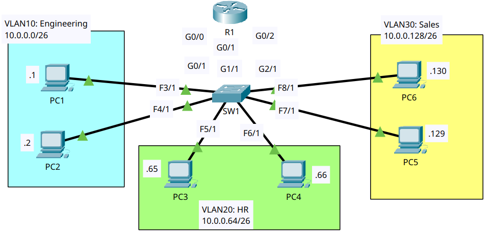
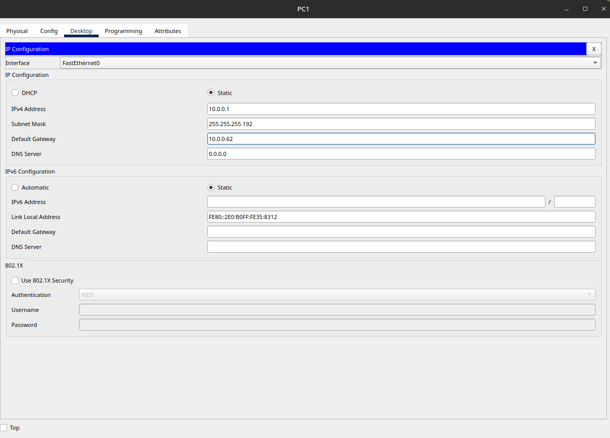
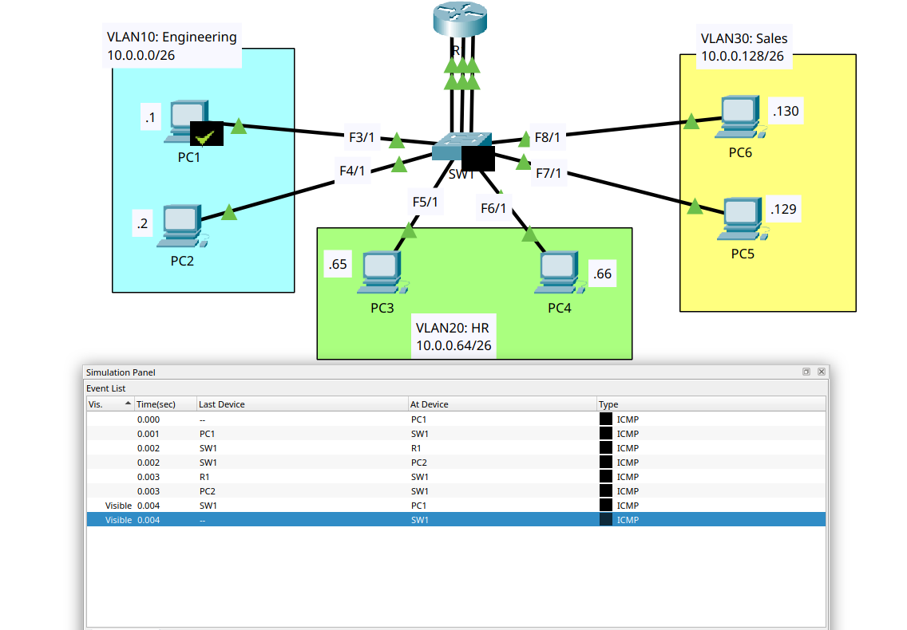

# VLANs (Part 1)

- **Date:** 2026-10-23
- **Topic area:** VLANs, access ports, broadcast domains
- **Difficulty:** Medium

## Objective
Put three departments on three VLANs on one switch, connect each VLAN to its own router interface, and check connectivity. Then send a broadcast ping from each VLAN in simulation mode to see which devices receive it.

## Topology


Three departments on one switch (SW1), each in its own /26 subnet and VLAN, with three cables from SW1 to R1, one per VLAN.

## Device addressing
The PC gateways are the last usable address in each subnet, as the lab asks, and each is the address of the matching R1 interface.

| Device | IPv4 address | Subnet mask | Default gateway |
|--------|--------------|-------------|-----------------|
| PC1 | 10.0.0.1 | 255.255.255.192 | 10.0.0.62 |
| PC2 | 10.0.0.2 | 255.255.255.192 | 10.0.0.62 |
| PC3 | 10.0.0.65 | 255.255.255.192 | 10.0.0.126 |
| PC4 | 10.0.0.66 | 255.255.255.192 | 10.0.0.126 |
| PC5 | 10.0.0.129 | 255.255.255.192 | 10.0.0.190 |
| PC6 | 10.0.0.130 | 255.255.255.192 | 10.0.0.190 |
| R1 G0/0 | 10.0.0.62 | 255.255.255.192 | n/a |
| R1 G0/1 | 10.0.0.126 | 255.255.255.192 | n/a |
| R1 G0/2 | 10.0.0.190 | 255.255.255.192 | n/a |

## Key configuration

**R1 interfaces:**
```
R1(config)# interface gigabitethernet0/0
R1(config-if)# ip address 10.0.0.62 255.255.255.192
R1(config-if)# no shutdown
R1(config)# interface gigabitethernet0/1
R1(config-if)# ip address 10.0.0.126 255.255.255.192
R1(config-if)# no shutdown
R1(config)# interface gigabitethernet0/2
R1(config-if)# ip address 10.0.0.190 255.255.255.192
R1(config-if)# no shutdown
```

**SW1 access ports:** 

The ports facing R1 (G0/1, G1/1 and G2/1) go in the VLAN of the router interface they connect to.
```
SW1(config)# interface range fastethernet3/1 , fastethernet4/1 , gigabitethernet0/1
SW1(config-if-range)# switchport mode access
SW1(config-if-range)# switchport access vlan 10
% Access VLAN does not exist. Creating vlan 10

SW1(config)# interface range fastethernet5/1 , fastethernet6/1 , gigabitethernet1/1
SW1(config-if-range)# switchport mode access
SW1(config-if-range)# switchport access vlan 20
% Access VLAN does not exist. Creating vlan 20

SW1(config)# interface range fastethernet7/1 , fastethernet8/1 , gigabitethernet2/1
SW1(config-if-range)# switchport mode access
SW1(config-if-range)# switchport access vlan 30
% Access VLAN does not exist. Creating vlan 30
```

**VLAN names:**
```
SW1(config)# vlan 10
SW1(config-vlan)# name Engineering
SW1(config-vlan)# vlan 20
SW1(config-vlan)# name HR
SW1(config-vlan)# vlan 30
SW1(config-vlan)# name Sales
```

## Verification

**PC addresses:** 

I entered the IP address, subnet mask, and default gateway on each PC and checked all six with `ipconfig /all`. The screenshot is from PC1, and the other five matched the table above.



```
C:\> ipconfig /all

IPv4 Address....................: 10.0.0.1
Subnet Mask.....................: 255.255.255.192
Default Gateway.................: ::
10.0.0.62
```

**R1 interfaces:** All three were up.
```
R1# show ip interface brief
GigabitEthernet0/0     10.0.0.62       YES manual up                    up
GigabitEthernet0/1     10.0.0.126      YES manual up                    up
GigabitEthernet0/2     10.0.0.190      YES manual up                    up
```

**VLANs before the configuration:** Every port started in the default VLAN.
```
SW1# show vlan

VLAN Name                             Status    Ports
---- -------------------------------- --------- -------------------------------
1    default                          active    Gig0/1, Gig1/1, Gig2/1, Fa3/1
                                                Fa4/1, Fa5/1, Fa6/1, Fa7/1
                                                Fa8/1, Fa9/1
```

**VLANs after the configuration:** Each VLAN has its two PC ports and the port facing R1. Fa9/1 isn't used in this lab and stayed in VLAN 1. The default VLANs 1002 to 1005 are left out.
```
SW1# show vlan

VLAN Name                             Status    Ports
---- -------------------------------- --------- -------------------------------
1    default                          active    Fa9/1
10   Engineering                      active    Gig0/1, Fa3/1, Fa4/1
20   HR                               active    Gig1/1, Fa5/1, Fa6/1
30   Sales                            active    Gig2/1, Fa7/1, Fa8/1
```

**Pings between PCs:** 

PCs in the same VLAN reached each other with no loss. Across VLANs, the first request was lost, and the rest went through. PC1 and PC2 reached PC3 to PC6, and every PC could ping every other PC. Only the examples below are pasted.

| From | To | Result |
|------|----|--------|
| PC1 | PC2 (same VLAN) | 4 of 4, TTL 128 |
| PC1 | PC4 (VLAN 20) | 3 of 4, TTL 127 |
| PC1 | PC6 (VLAN 30) | 3 of 4, TTL 127 |

PC1 to PC4 as an example:
```
C:\> ping 10.0.0.66

Pinging 10.0.0.66 with 32 bytes of data:

Request timed out.
Reply from 10.0.0.66: bytes=32 time<1ms TTL=127
Reply from 10.0.0.66: bytes=32 time<1ms TTL=127
Reply from 10.0.0.66: bytes=32 time<1ms TTL=127

Ping statistics for 10.0.0.66:
    Packets: Sent = 4, Received = 3, Lost = 1 (25% loss),
Approximate round trip times in milli-seconds:
    Minimum = 0ms, Maximum = 0ms, Average = 0ms
```

**Broadcast pings:** 

I pinged the subnet broadcast address from one PC in each VLAN. In each case, only the other PC in that VLAN and the matching R1 interface replied, four replies each.

| VLAN | From | Broadcast address | Replies |
|------|------|-------------------|---------|
| 10 | PC1 | 10.0.0.63 | 8: four from 10.0.0.62 (R1, TTL 255) and four from 10.0.0.2 (PC2, TTL 128) |
| 20 | PC3 | 10.0.0.127 | 8: four from 10.0.0.126 (R1, TTL 255) and four from 10.0.0.66 (PC4, TTL 128) |
| 30 | PC5 | 10.0.0.191 | 8: four from 10.0.0.190 (R1, TTL 255) and four from 10.0.0.130 (PC6, TTL 128) |

VLAN 10 as the example:
```
C:\> ping 10.0.0.63

Pinging 10.0.0.63 with 32 bytes of data:

Reply from 10.0.0.62: bytes=32 time=4ms TTL=255
Reply from 10.0.0.2: bytes=32 time=5ms TTL=128
Reply from 10.0.0.62: bytes=32 time=4ms TTL=255
Reply from 10.0.0.2: bytes=32 time=5ms TTL=128
Reply from 10.0.0.62: bytes=32 time=4ms TTL=255
Reply from 10.0.0.2: bytes=32 time=5ms TTL=128
Reply from 10.0.0.62: bytes=32 time=4ms TTL=255
Reply from 10.0.0.2: bytes=32 time=5ms TTL=128

Ping statistics for 10.0.0.63:
    Packets: Sent = 4, Received = 8, Lost = 0 (0% loss),
Approximate round trip times in milli-seconds:
    Minimum = 4ms, Maximum = 5ms, Average = 4ms
```

**Simulation mode:** 

In the event list for the VLAN 10 broadcast, the ICMP went from PC1 to SW1, then to R1 and PC2. The replies went from R1 and PC2 back through SW1 to PC1. It didn't cross VLANs. VLAN 20 and VLAN 30 behaved the same way.



## Where I struggled
I started out thinking traffic was leaking across my VLANs because I wasn't seeing the whole event list. After reviewing the lab closely, I realized I was wrong. The broadcast ping stayed inside its own VLAN, and only the router interface and the other PC in that VLAN replied.

What confused me next was what came after the PC received its echo replies. The switch sent STP frames into each VLAN one at a time. The devices that received them dropped them, while the target VLAN's devices carried on communicating. I didn't under
## Things to note
- Each VLAN is its own broadcast domain. A broadcast ping from a PC reached only the devices in that PC's VLAN, and the router interface for that VLAN counted as one of them.
- Each VLAN needed its own router interface and its own cable to SW1. The switch port facing R1 is an access port in the VLAN of the router interface it connects to, and that interface's address is the gateway for the PCs in the VLAN.
- The first `switchport access vlan` command created each VLAN, because IOS reported that it didn't exist yet. I named the VLANs afterward.
- Before the configuration, every port was in VLAN 1. Fa9/1 isn't used in this lab and stayed there.
- The broadcast address of each /26 is its last address: 10.0.0.63, 10.0.0.127, and 10.0.0.191.
- In a broadcast ping, `Received` can be higher than `Sent` because more than one device answers each request. The router's replies came back with TTL 255 and the PCs' with TTL 128, so the TTL shows which kind of device answered.
- Pings between PCs in different VLANs had TTL 127, which fits one router hop. The first request was lost, the same pattern as the earlier routed labs. My theory is still ARP, but I haven't confirmed it, and the same-VLAN ping between PC1 and PC2 lost nothing.
