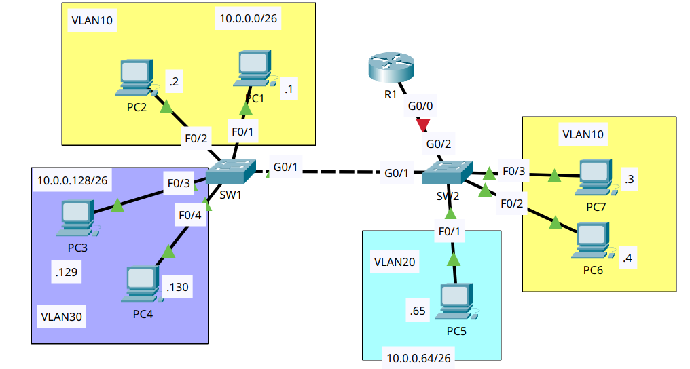

# VLANs (Part 2)

- **Date:** 2026-10-26
- **Topic area:** VLANs, trunking, router-on-a-stick
- **Difficulty:** Medium

## Objective
Set up router-on-a-stick across two switches. Put the PC ports in the right VLANs, trunk the link between the switches so it carries only the VLANs it needs and uses an unused native VLAN, connect SW2 to R1 with subinterfaces, and test that every PC can reach every other PC.

## Topology


Two switches joined by a link (SW1 G0/1 to SW2 G0/1), with R1 connected to SW2 (R1 G0/0 to SW2 G0/2). VLAN 10 has PCs on both switches, VLAN 30 is on SW1 only, and VLAN 20 is on SW2 only. The red marker on R1's link is the starting state, before the interface was enabled.


## Device addressing
The default gateways were already filled in on the PCs. Each one is the address of the matching R1 subinterface, which is the last usable address of the subnet, as the lab asks.

| PC | IPv4 address | Subnet mask | Default gateway |
|----|--------------|-------------|-----------------|
| PC1 | 10.0.0.1 | 255.255.255.192 | 10.0.0.62 |
| PC2 | 10.0.0.2 | 255.255.255.192 | 10.0.0.62 |
| PC3 | 10.0.0.129 | 255.255.255.192 | 10.0.0.190 |
| PC4 | 10.0.0.130 | 255.255.255.192 | 10.0.0.190 |
| PC5 | 10.0.0.65 | 255.255.255.192 | 10.0.0.126 |
| PC6 | 10.0.0.4 | 255.255.255.192 | 10.0.0.62 |
| PC7 | 10.0.0.3 | 255.255.255.192 | 10.0.0.62 |

| Subinterface | VLAN | IPv4 address | Subnet mask |
|--------------|------|--------------|-------------|
| R1 G0/0.10 | 10 | 10.0.0.62 | 255.255.255.192 |
| R1 G0/0.20 | 20 | 10.0.0.126 | 255.255.255.192 |
| R1 G0/0.30 | 30 | 10.0.0.190 | 255.255.255.192 |

## Key configuration

**Access ports:**
```
SW1(config)# interface range fastethernet0/1 - 2
SW1(config-if-range)# switchport mode access
SW1(config-if-range)# switchport access vlan 10
% Access VLAN does not exist. Creating vlan 10
SW1(config)# interface range fastethernet0/3 - 4
SW1(config-if-range)# switchport mode access
SW1(config-if-range)# switchport access vlan 30
% Access VLAN does not exist. Creating vlan 30

SW2(config)# interface range fastethernet0/2 - 3
SW2(config-if-range)# switchport mode access
SW2(config-if-range)# switchport access vlan 10
% Access VLAN does not exist. Creating vlan 10
SW2(config)# interface fastethernet0/1
SW2(config-if)# switchport mode access
SW2(config-if)# switchport access vlan 20
% Access VLAN does not exist. Creating vlan 20
```

**Trunk and native VLAN configs:** 

I created VLAN 30 on SW2 first, since SW2 only had VLANs 10 and 20.
```
SW1(config)# interface gigabitethernet0/1
SW1(config-if)# switchport mode trunk
%LINEPROTO-5-UPDOWN: Line protocol on Interface GigabitEthernet0/1, changed state to down
%LINEPROTO-5-UPDOWN: Line protocol on Interface GigabitEthernet0/1, changed state to up
SW1(config-if)# switchport trunk allowed vlan 10,30
SW1(config-if)# switchport trunk native vlan 500

SW2(config)# vlan 30
SW2(config-vlan)# exit
SW2(config)# interface gigabitethernet0/1
SW2(config-if)# switchport mode trunk
SW2(config-if)# switchport trunk allowed vlan 10,30
SW2(config-if)# switchport trunk native vlan 500
SW2(config)# interface gigabitethernet0/2
SW2(config-if)# switchport mode trunk
SW2(config-if)# switchport trunk allowed vlan 10,20,30
SW2(config-if)# switchport trunk native vlan 500
```

**Router-on-a-stick:**
```
R1(config)# interface gigabitethernet0/0
R1(config-if)# no shutdown
%LINK-5-CHANGED: Interface GigabitEthernet0/0, changed state to up
%LINEPROTO-5-UPDOWN: Line protocol on Interface GigabitEthernet0/0, changed state to up
R1(config)# interface gigabitethernet0/0.10
R1(config-subif)# encapsulation dot1q 10
R1(config-subif)# ip address 10.0.0.62 255.255.255.192
R1(config)# interface gigabitethernet0/0.20
R1(config-subif)# encapsulation dot1q 20
R1(config-subif)# ip address 10.0.0.126 255.255.255.192
R1(config)# interface gigabitethernet0/0.30
R1(config-subif)# encapsulation dot1q 30
R1(config-subif)# ip address 10.0.0.190 255.255.255.192
```

## Verification

**VLANs:** 

Each VLAN has the ports I assigned. The VLANs have default names because I didn't name them. The default VLANs 1002 to 1005 are left out.
```
SW1# show vlan brief

VLAN Name                             Status    Ports
---- -------------------------------- --------- -------------------------------
1    default                          active    Fa0/5, Fa0/6, Fa0/7, Fa0/8
                                                Fa0/9, Fa0/10, Fa0/11, Fa0/12
                                                Fa0/13, Fa0/14, Fa0/15, Fa0/16
                                                Fa0/17, Fa0/18, Fa0/19, Fa0/20
                                                Fa0/21, Fa0/22, Fa0/23, Fa0/24
                                                Gig0/1, Gig0/2
10   VLAN0010                         active    Fa0/1, Fa0/2
30   VLAN0030                         active    Fa0/3, Fa0/4
```
```
SW2# show vlan brief

VLAN Name                             Status    Ports
---- -------------------------------- --------- -------------------------------
1    default                          active    Fa0/4, Fa0/5, Fa0/6, Fa0/7
                                                Fa0/8, Fa0/9, Fa0/10, Fa0/11
                                                Fa0/12, Fa0/13, Fa0/14, Fa0/15
                                                Fa0/16, Fa0/17, Fa0/18, Fa0/19
                                                Fa0/20, Fa0/21, Fa0/22, Fa0/23
                                                Fa0/24, Gig0/1, Gig0/2
10   VLAN0010                         active    Fa0/2, Fa0/3
20   VLAN0020                         active    Fa0/1
```

**Trunks:** 

The native VLAN is 500 on every trunk port, and each link allows only the VLANs it needs.
```
SW1# show interfaces trunk
Port        Mode         Encapsulation  Status        Native vlan
Gig0/1      on           802.1q         trunking      500

Port        Vlans allowed on trunk
Gig0/1      10,30

Port        Vlans allowed and active in management domain
Gig0/1      10,30

Port        Vlans in spanning tree forwarding state and not pruned
Gig0/1      10,30
```
```
SW2# show interfaces trunk
Port        Mode         Encapsulation  Status        Native vlan
Gig0/1      on           802.1q         trunking      500
Gig0/2      on           802.1q         trunking      500

Port        Vlans allowed on trunk
Gig0/1      10,30
Gig0/2      10,20,30

Port        Vlans allowed and active in management domain
Gig0/1      10,30
Gig0/2      10,20,30

Port        Vlans in spanning tree forwarding state and not pruned
Gig0/1      10,30
Gig0/2      10,20,30
```

**R1 interfaces before and after:** 

G0/0 went from administratively down to up, and it has no address of its own. The three subinterfaces carry the addresses. G0/1, G0/2, and Vlan1 are unused and stayed down.
```
R1# show ip interface brief
GigabitEthernet0/0     unassigned      YES unset  administratively down down
```
```
R1# show ip interface brief
GigabitEthernet0/0     unassigned      YES unset  up                    up
GigabitEthernet0/0.10  10.0.0.62       YES manual up                    up
GigabitEthernet0/0.20  10.0.0.126      YES manual up                    up
GigabitEthernet0/0.30  10.0.0.190      YES manual up                    up
```

**Connectivity Test:** 

Every PC could ping every other PC. I pasted examples below and also tested PC1 to PC4 and PC4 to PC5.

| From | To | Result |
|------|----|--------|
| PC1 (VLAN 10) | PC6 (VLAN 10, other switch) | 4 of 4, TTL 128, first reply 34ms |
| PC1 (VLAN 10) | PC3 (VLAN 30) | 4 of 4, TTL 127 |
| PC1 (VLAN 10) | PC5 (VLAN 20) | 4 of 4, TTL 127 |
| PC3 (VLAN 30) | PC5 (VLAN 20) | 4 of 4, TTL 127 |

PC1 to PC6, the same VLAN on the other switch, as the first example:
```
C:\> ping 10.0.0.4

Pinging 10.0.0.4 with 32 bytes of data:

Reply from 10.0.0.4: bytes=32 time=34ms TTL=128
Reply from 10.0.0.4: bytes=32 time<1ms TTL=128
Reply from 10.0.0.4: bytes=32 time<1ms TTL=128
Reply from 10.0.0.4: bytes=32 time<1ms TTL=128

Ping statistics for 10.0.0.4:
    Packets: Sent = 4, Received = 4, Lost = 0 (0% loss),
Approximate round trip times in milli-seconds:
    Minimum = 0ms, Maximum = 34ms, Average = 8ms
```

PC1 to PC5, a different VLAN, as the second example:
```
C:\> ping 10.0.0.65

Pinging 10.0.0.65 with 32 bytes of data:

Reply from 10.0.0.65: bytes=32 time<1ms TTL=127
Reply from 10.0.0.65: bytes=32 time<1ms TTL=127
Reply from 10.0.0.65: bytes=32 time<1ms TTL=127
Reply from 10.0.0.65: bytes=32 time<1ms TTL=127

Ping statistics for 10.0.0.65:
    Packets: Sent = 4, Received = 4, Lost = 0 (0% loss),
Approximate round trip times in milli-seconds:
    Minimum = 0ms, Maximum = 0ms, Average = 0ms
```

## Where I struggled
I had trouble remembering commands. I also forgot to configure SW2's G0/2, the port facing R1, as a trunk. Without that, no PC could reach the router, so the pings between VLANs failed. Once that port was a trunk, they worked.

## Things to note
- With router-on-a-stick, one physical R1 interface (G0/0) carries all three VLANs. The physical interface has no address. Each VLAN gets a subinterface with `encapsulation dot1q <vlan>` and the gateway address for that VLAN.
- I numbered the subinterfaces to match the VLANs, which makes them easy to read. The number doesn't set the VLAN. The encapsulation command does.
- The link between SW2 and R1 has to be a trunk, since three VLANs share one cable. That's the port I forgot.
- VLAN 30 has no PCs on SW2, but its traffic crosses SW2 on its way to R1, so VLAN 30 has to exist on SW2 and be allowed on both trunks. VLAN 20 is the reverse. It only exists on SW2, and it never crosses the SW1 to SW2 trunk, so that trunk doesn't allow it.
- The native VLAN is 500 on every trunk port. I didn't create VLAN 500 because the lab only said to use an unused VLAN, and the trunks came up with it set as the native VLAN anyway. The native VLAN has to match on both ends of a trunk.
- PC1 and PC3 are on the same switch, but their ping had TTL 127, one router hop. Traffic between VLANs goes up the trunk to R1 and back down, even between PCs on the same switch.
- PC1 to PC6 is the same VLAN on the other switch. It crossed the SW1 to SW2 trunk and came back with TTL 128, so there was no router hop. Traffic inside a VLAN stays on the switches, and only traffic between VLANs goes through R1. The first reply took 34ms and the rest under 1ms.
- The `switchport trunk encapsulation dot1q` command wasn't accepted on these switches. My reading is that they only support 802.1Q, so the command isn't needed.
