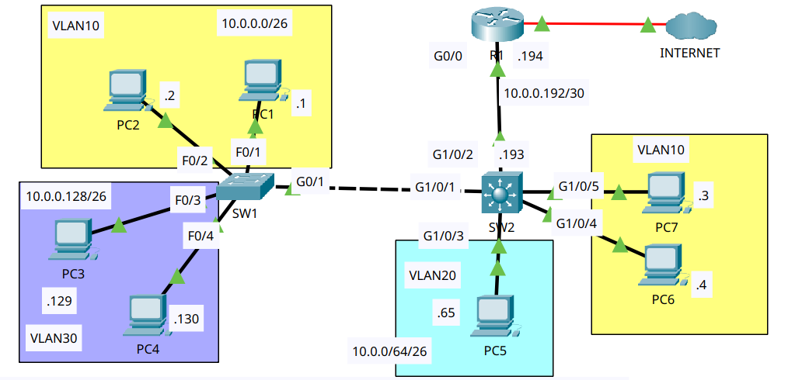
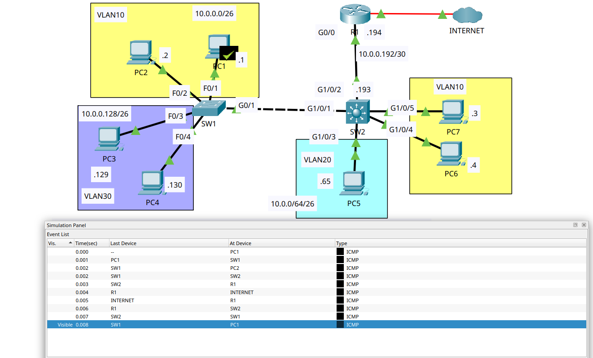

# Multilayer Switching

- **Date:** 2026-10-27
- **Topic area:** Multilayer switching, SVIs, routed ports, default routing
- **Difficulty:** Easy

## Objective
Replace the router-on-a-stick link between R1 and SW2 with a point-to-point Layer 3 link, add a default route on SW2, create an SVI on SW2 for each VLAN, and test connectivity between VLANs and to the internet (1.1.1.1).

## Topology


Same layout as the VLANs (Part 2) lab, except SW2 is now a multilayer switch (interfaces G1/0/x), R1 connects to SW2 over a point-to-point link instead of a trunk, and R1 now connects to the internet. All devices start preconfigured from the end of the previous lab: hosts in the right VLANs, SW1 and SW2 trunked, and R1 and SW2 using router-on-a-stick. The red marker on R1's link to the internet is the starting state. The diagram doesn't say which R1 interface faces the internet; it's Giga0/0/0. I found it in the CLI.

## Device addressing
The default gateways were already filled in on every PC. Each one is the last usable address of its subnet, which is the address of the matching SVI on SW2.

| VLAN | PCs | Default gateway (SVI) |
|------|-----|-----------------------|
| 10 | PC1, PC2, PC6, PC7 | 10.0.0.62 |
| 20 | PC5 | 10.0.0.126 |
| 30 | PC3, PC4 | 10.0.0.190 |

| Device | Interface | IPv4 address | Subnet mask |
|--------|-----------|--------------|-------------|
| SW2 | G1/0/2 (routed port) | 10.0.0.193 | 255.255.255.252 |
| R1 | G0/0 | 10.0.0.194 | 255.255.255.252 |
| R1 | G0/0/0 | 1.1.1.2 | 255.255.255.0 |
| SW2 | Vlan10 | 10.0.0.62 | 255.255.255.192 |
| SW2 | Vlan20 | 10.0.0.126 | 255.255.255.192 |
| SW2 | Vlan30 | 10.0.0.190 | 255.255.255.192 |

## Key configuration
R1's routing was already configured, so I didn't change it.

**R1 config, remove router-on-a-stick, add the point-to-point address:**
```
R1(config)# no interface gigabitethernet0/0.10
%LINK-3-UPDOWN: Interface GigabitEthernet0/0.10, changed state to down
%LINEPROTO-5-UPDOWN: Line protocol on Interface GigabitEthernet0/0.10, changed state to down
R1(config)# no interface gigabitethernet0/0.20
R1(config)# no interface gigabitethernet0/0.30
R1(config)# default interface gigabitethernet0/0
Building configuration...
Interface GigabitEthernet0/0 set to default configuration
R1(config)# interface gigabitethernet0/0
R1(config-if)# ip address 10.0.0.194 255.255.255.252
```
G0/0 was already up in the starting state, so I didn't run `no shutdown`.

**SW2 config, routed port and default route:** 

I enabled routing first, then made G1/0/2 a routed port and gave it its address, then added the default route.
```
SW2(config)# ip routing
SW2(config)# interface gigabitethernet1/0/2
SW2(config-if)# no switchport
%LINEPROTO-5-UPDOWN: Line protocol on Interface GigabitEthernet1/0/2, changed state to down
%LINEPROTO-5-UPDOWN: Line protocol on Interface GigabitEthernet1/0/2, changed state to up
SW2(config-if)# ip address 10.0.0.193 255.255.255.252
SW2(config-if)# exit
SW2(config)# ip route 0.0.0.0 0.0.0.0 10.0.0.194
```

**SVIs:**
```
SW2(config)# interface vlan 10
%LINK-5-CHANGED: Interface Vlan10, changed state to up
%LINEPROTO-5-UPDOWN: Line protocol on Interface Vlan10, changed state to up
SW2(config-if)# ip address 10.0.0.62 255.255.255.192
SW2(config-if)# interface vlan 20
SW2(config-if)# ip address 10.0.0.126 255.255.255.192
SW2(config-if)# interface vlan 30
SW2(config-if)# ip address 10.0.0.190 255.255.255.192
```
Vlan20 and Vlan30 printed the same two messages as Vlan10 when I created them.

## Verification

**R1 interfaces before and after:** 

Before, G0/0 had no address and carried the three subinterfaces. After, it has the point-to-point address and the subinterfaces are gone. G0/0/0 toward the internet didn't change. Unused interfaces are left out.
```
R1# show ip interface brief
GigabitEthernet0/0     unassigned      YES NVRAM  up                    up
GigabitEthernet0/0.10  10.0.0.62       YES manual up                    up
GigabitEthernet0/0.20  10.0.0.126      YES manual up                    up
GigabitEthernet0/0.30  10.0.0.190      YES manual up                    up
GigabitEthernet0/0/0   1.1.1.2         YES manual up                    up
```
```
R1# show ip interface brief
GigabitEthernet0/0     10.0.0.194      YES manual up                    up
GigabitEthernet0/0/0   1.1.1.2         YES manual up                    up
```

**SW2 port status before and after:** 

G1/0/2 was a trunk to R1 and is now a routed port. The other ports are unused and left out.
```
SW2# show interfaces status
Port      Name               Status       Vlan       Duplex  Speed Type
Gig1/0/1                     connected    trunk      a-full  a-100 10/100/1000BaseTX
Gig1/0/2                     connected    trunk      a-full  a-100 10/100/1000BaseTX
Gig1/0/3                     connected    20         a-full  a-100 10/100/1000BaseTX
Gig1/0/4                     connected    10         a-full  a-100 10/100/1000BaseTX
Gig1/0/5                     connected    10         a-full  a-100 10/100/1000BaseTX
```
```
SW2# show interfaces status
Port      Name               Status       Vlan       Duplex  Speed Type
Gig1/0/1                     connected    trunk      a-full  a-100 10/100/1000BaseTX
Gig1/0/2                     connected    routed     a-full  a-100 10/100/1000BaseTX
Gig1/0/3                     connected    20         a-full  a-100 10/100/1000BaseTX
Gig1/0/4                     connected    10         a-full  a-100 10/100/1000BaseTX
Gig1/0/5                     connected    10         a-full  a-100 10/100/1000BaseTX
```

**SW2 routing table before and after:** 

Routing wasn't enabled on SW2, so `show ip route` didn't show a routing table.
```
SW2# show ip route
Default gateway is not set

Host               Gateway           Last Use    Total Uses  Interface
ICMP redirect cache is empty
```
After `ip routing`, the routed port and the default route, the table shows the connected link and the default route.
```
SW2# show ip route
Gateway of last resort is 10.0.0.194 to network 0.0.0.0

     10.0.0.0/8 is variably subnetted, 2 subnets, 2 masks
C       10.0.0.192/30 is directly connected, GigabitEthernet1/0/2
L       10.0.0.193/32 is directly connected, GigabitEthernet1/0/2
S*   0.0.0.0/0 [1/0] via 10.0.0.194
```

**SW2 VLANs before the SVIs were created:** 

All three VLANs exist on SW2. VLAN 30 has no ports on SW2, since its PCs are on SW1. Unused ports in VLAN 1 and the default VLANs 1002 to 1005 are left out.
```
SW2# show vlan brief

VLAN Name                             Status    Ports
---- -------------------------------- --------- -------------------------------
10   VLAN0010                         active    Gig1/0/4, Gig1/0/5
20   VLAN0020                         active    Gig1/0/3
30   VLAN0030                         active
```

**SW2 interfaces after the SVIs were created:** 

The three SVIs are up. Before, the list had only Vlan1, which is administratively down and unchanged. Unused ports are left out.
```
SW2# show ip interface brief
GigabitEthernet1/0/1   unassigned      YES unset  up                    up
GigabitEthernet1/0/2   10.0.0.193      YES manual up                    up
GigabitEthernet1/0/3   unassigned      YES unset  up                    up
GigabitEthernet1/0/4   unassigned      YES unset  up                    up
GigabitEthernet1/0/5   unassigned      YES unset  up                    up
Vlan1                  unassigned      YES unset  administratively down down
Vlan10                 10.0.0.62       YES manual up                    up
Vlan20                 10.0.0.126      YES manual up                    up
Vlan30                 10.0.0.190      YES manual up                    up
```

**SW2 routing table after the SVIs were created:** 

Each SVI added a connected route for its VLAN and a local route for its address. The default route didn't change.
```
SW2# show ip route
Gateway of last resort is 10.0.0.194 to network 0.0.0.0

     10.0.0.0/8 is variably subnetted, 8 subnets, 3 masks
C       10.0.0.0/26 is directly connected, Vlan10
L       10.0.0.62/32 is directly connected, Vlan10
C       10.0.0.64/26 is directly connected, Vlan20
L       10.0.0.126/32 is directly connected, Vlan20
C       10.0.0.128/26 is directly connected, Vlan30
L       10.0.0.190/32 is directly connected, Vlan30
C       10.0.0.192/30 is directly connected, GigabitEthernet1/0/2
L       10.0.0.193/32 is directly connected, GigabitEthernet1/0/2
S*   0.0.0.0/0 [1/0] via 10.0.0.194
```

**Pings between VLANs:** 

After the SVIs were created and configured, the three pairs below worked, which covers every pair of VLANs. All replies came back with TTL 127.

| From | To | Attempt 1 | Attempt 2 |
|------|----|-----------|-----------|
| PC1 (VLAN 10) | PC5 (VLAN 20) | 3 of 4, first lost | 4 of 4, first reply 34ms |
| PC1 (VLAN 10) | PC3 (VLAN 30) | 3 of 4, first lost | 4 of 4 |
| PC4 (VLAN 30) | PC5 (VLAN 20) | 4 of 4, first reply 17ms | 4 of 4 |

PC1 to PC5, both attempts:
```
C:\> ping 10.0.0.65

Pinging 10.0.0.65 with 32 bytes of data:

Request timed out.
Reply from 10.0.0.65: bytes=32 time<1ms TTL=127
Reply from 10.0.0.65: bytes=32 time<1ms TTL=127
Reply from 10.0.0.65: bytes=32 time<1ms TTL=127

Ping statistics for 10.0.0.65:
    Packets: Sent = 4, Received = 3, Lost = 1 (25% loss),
Approximate round trip times in milli-seconds:
    Minimum = 0ms, Maximum = 0ms, Average = 0ms
```
```
C:\> ping 10.0.0.65

Pinging 10.0.0.65 with 32 bytes of data:

Reply from 10.0.0.65: bytes=32 time=34ms TTL=127
Reply from 10.0.0.65: bytes=32 time<1ms TTL=127
Reply from 10.0.0.65: bytes=32 time<1ms TTL=127
Reply from 10.0.0.65: bytes=32 time<1ms TTL=127

Ping statistics for 10.0.0.65:
    Packets: Sent = 4, Received = 4, Lost = 0 (0% loss),
Approximate round trip times in milli-seconds:
    Minimum = 0ms, Maximum = 34ms, Average = 8ms
```

**Pings to the internet:** 

All four PCs I tried could ping 1.1.1.1 after the changes. All replies came back with TTL 253.

| PC | Attempt 1 | Attempt 2 |
|----|-----------|-----------|
| PC1 (VLAN 10) | 1 of 4 | 4 of 4 |
| PC3 (VLAN 30) | 3 of 4 | 4 of 4 |
| PC5 (VLAN 20) | 3 of 4 | 4 of 4 |
| PC6 (VLAN 10) | 3 of 4 | 4 of 4 |

PC1 to 1.1.1.1, both attempts:
```
C:\> ping 1.1.1.1

Pinging 1.1.1.1 with 32 bytes of data:

Request timed out.
Request timed out.
Request timed out.
Reply from 1.1.1.1: bytes=32 time<1ms TTL=253

Ping statistics for 1.1.1.1:
    Packets: Sent = 4, Received = 1, Lost = 3 (75% loss),
Approximate round trip times in milli-seconds:
    Minimum = 0ms, Maximum = 0ms, Average = 0ms
```
```
C:\> ping 1.1.1.1

Pinging 1.1.1.1 with 32 bytes of data:

Reply from 1.1.1.1: bytes=32 time<1ms TTL=253
Reply from 1.1.1.1: bytes=32 time<1ms TTL=253
Reply from 1.1.1.1: bytes=32 time<1ms TTL=253
Reply from 1.1.1.1: bytes=32 time<1ms TTL=253

Ping statistics for 1.1.1.1:
    Packets: Sent = 4, Received = 4, Lost = 0 (0% loss),
Approximate round trip times in milli-seconds:
    Minimum = 0ms, Maximum = 0ms, Average = 0ms
```

Simulation mode during PC1's second ping to 1.1.1.1. PC1 is receiving the ICMP reply from the internet, and the event list shows only the first request and its reply.



## Things to note
- A multilayer switch can route. `ip routing` turns routing on, SVIs take over from R1's subinterfaces as the VLAN gateways, and `no switchport` turns G1/0/2 into a routed port that works like a router interface.
- `default interface` resets an interface to its default configuration. I used it to clear R1's G0/0 after removing the subinterfaces.
- R1's G0/0 was already up in the starting state, from the router-on-a-stick setup, and it was still up after `default interface` and the new address, so I didn't need `no shutdown`.
- After `no switchport`, `show interfaces status` showed G1/0/2 as `routed` instead of `trunk`, and the line protocol went down and up once.
- The /30 link has two usable addresses: 10.0.0.193 on SW2 G1/0/2 and 10.0.0.194 on R1 G0/0. The default route on SW2 points to R1's address.
- The default route shows in the table as `S*`, and `Gateway of last resort` is 10.0.0.194.
- The `10.0.0.0/8` line in SW2's routing table says 8 subnets with 3 masks (/26, /30, and /32), because it counts the connected routes and the /32 local routes.
- The PC gateways were already filled in with the last usable address of each subnet, so the SVIs took over from R1's subinterfaces without any change on the PCs.
- The SVIs came up as soon as I created them, and IOS printed `%LINK-5-CHANGED` for each one. When I ran `no shutdown` afterward, it printed nothing. My reading is that there was nothing to change, because they were already up. I don't know why SVIs behave differently from the router interfaces in the earlier labs, which started shut down.
- Vlan30 came up even though no access port on SW2 is in VLAN 30. My reading is that the trunk to SW1 counts, since it carries VLAN 30. I haven't confirmed that.
- Replies between VLANs came back with TTL 127, one routing hop, and this time the hop is SW2, not R1. Replies from 1.1.1.1 came back with TTL 253, which fits the internet router starting at 255 and R1 and SW2 each subtracting one.
- The first packet was lost or delayed in most of the pings, and the rerun was 4 of 4 each time. PC1's first ping to 1.1.1.1 lost three. It's the same pattern as the other routed labs. My theory is still ARP, but I haven't confirmed it.
