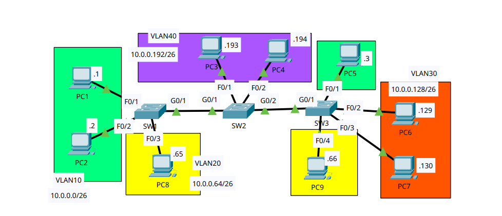

# DTP & VTP

- **Date:** 2026-10-30
- **Topic area:** DTP, VTP, VLAN databases
- **Difficulty:** Easy

## Objective
Configure the links between three switches as trunks with DTP disabled, set up VTP with SW1 as the server, SW2 as transparent, and SW3 as a client, and observe how VLANs are or aren't carried between the switches. Then configure the host ports as access ports and check whether DTP is still active on them.

## Topology


Three switches in a line, SW1 to SW2 to SW3, with four VLANs spread across them. VLAN 10 and VLAN 20 each have PCs on SW1 and SW3, VLAN 30 is on SW3 only, and VLAN 40 is on SW2 only.

## Key configuration

**Trunks with DTP disabled:** 

I set the mode to trunk first, because `switchport nonegotiate` wasn't accepted while the port was in `dynamic auto`.
```
SW1(config)# interface gigabitethernet0/1
SW1(config-if)# switchport mode trunk
%LINEPROTO-5-UPDOWN: Line protocol on Interface GigabitEthernet0/1, changed state to down
%LINEPROTO-5-UPDOWN: Line protocol on Interface GigabitEthernet0/1, changed state to up
SW1(config-if)# switchport nonegotiate

SW2(config)# interface gigabitethernet0/1
SW2(config-if)# switchport mode trunk
SW2(config-if)# switchport nonegotiate
SW2(config)# interface gigabitethernet0/2
SW2(config-if)# switchport mode trunk
SW2(config-if)# switchport nonegotiate

SW3(config)# interface gigabitethernet0/1
SW3(config-if)# switchport mode trunk
SW3(config-if)# switchport nonegotiate
```
SW2 and SW3 printed the same two line protocol messages as SW1 for each port.


**VTP server config on SW1:**
```
SW1(config)# vtp domain CCNA
Changing VTP domain name from NULL to CCNA
%SW_VLAN-6-VTP_DOMAIN_NAME_CHG: VTP domain name changed to CCNA.
SW1(config)# vlan 10
SW1(config-vlan)# vlan 20
SW1(config-vlan)# vlan 30
```

**VTP transparent config on SW2:**
```
SW2(config)# vtp mode transparent
Setting device to VTP TRANSPARENT mode.
SW2(config)# vlan 40
```

**VTP client config on SW3:**
```
SW3(config)# vtp mode client
Setting device to VTP CLIENT mode.
SW3(config)# vlan 50
VTP VLAN configuration not allowed when device is in CLIENT mode.
```

**Access port config for switchports connected to hosts:**
```
SW1(config)# interface range fastethernet0/1 - 2
SW1(config-if-range)# switchport mode access
SW1(config-if-range)# switchport access vlan 10
SW1(config-if-range)# interface fastethernet0/3
SW1(config-if)# switchport mode access
SW1(config-if)# switchport access vlan 20

SW2(config)# interface range fastethernet0/1 - 2
SW2(config-if-range)# switchport mode access
SW2(config-if-range)# switchport access vlan 40

SW3(config)# interface fastethernet0/1
SW3(config-if)# switchport mode access
SW3(config-if)# switchport access vlan 10
SW3(config-if)# interface range fastethernet0/2 - 3
SW3(config-if-range)# switchport mode access
SW3(config-if-range)# switchport access vlan 30
SW3(config-if-range)# interface fastethernet0/4
SW3(config-if)# switchport mode access
SW3(config-if)# switchport access vlan 20
```

## Verification

### Trunks and DTP
Before any configuration, all four inter-switch ports were in `dynamic auto` with negotiation on, and their operational mode was `static access`, so none of them were trunking. After the configuration, all four showed the same result: administrative and operational mode `trunk`, and negotiation off.

| Port | Before (administrative / operational / negotiation) | After (administrative / operational / negotiation) |
|------|-----------------------------------------------------|----------------------------------------------------|
| SW1 G0/1 | dynamic auto / static access / On | trunk / trunk / Off |
| SW2 G0/1 | dynamic auto / static access / On | trunk / trunk / Off |
| SW2 G0/2 | dynamic auto / static access / On | trunk / trunk / Off |
| SW3 G0/1 | dynamic auto / static access / On | trunk / trunk / Off |

SW1 G0/1 as an example, cropped to the relevant lines:
```
SW1# show interfaces gigabitethernet0/1 switchport
Name: Gig0/1
Switchport: Enabled
Administrative Mode: dynamic auto
Operational Mode: static access
Administrative Trunking Encapsulation: dot1q
Operational Trunking Encapsulation: native
Negotiation of Trunking: On
```
```
SW1# show interfaces gigabitethernet0/1 switchport
Name: Gig0/1
Switchport: Enabled
Administrative Mode: trunk
Operational Mode: trunk
Administrative Trunking Encapsulation: dot1q
Operational Trunking Encapsulation: dot1q
Negotiation of Trunking: Off
Trunking Native Mode VLAN: 1 (default)
Trunking VLANs Enabled: All
```

### SW1 in VTP server mode:

SW1 started with the VTP defaults and only the default VLANs (1 and 1002 to 1005). After I set the domain and created VLANs 10, 20, and 30, SW2 and SW3 had added all three VLANs. I hadn't configured VTP on either of them.
```
SW1# show vtp status
Configuration Revision          : 0
Number of existing VLANs        : 5
VTP Operating Mode              : Server
VTP Domain Name                 : 
MD5 digest                      : 0x7D 0x5A 0xA6 0x0E 0x9A 0x72 0xA0 0x3A
```
```
SW1# show vtp status
Configuration Revision          : 3
Number of existing VLANs        : 8
VTP Operating Mode              : Server
VTP Domain Name                 : CCNA
MD5 digest                      : 0xA4 0x74 0x57 0x93 0x13 0x95 0xA4 0x9A
```

SW2 afterward. SW3 showed exactly the same revision, VLAN count, mode, domain, and digest.
```
SW2# show vtp status
Configuration Revision          : 3
Number of existing VLANs        : 8
VTP Operating Mode              : Server
VTP Domain Name                 : CCNA
MD5 digest                      : 0xA4 0x74 0x57 0x93 0x13 0x95 0xA4 0x9A
```
```
SW2# show vlan brief

VLAN Name                             Status    Ports
---- -------------------------------- --------- -------------------------------
10   VLAN0010                         active    
20   VLAN0020                         active    
30   VLAN0030                         active    
```
VLAN 1 and the default VLANs 1002 to 1005 are left out. SW3's table matched.


### SW2 in VTP transparent mode:

After I set SW2 to transparent mode and created VLAN 40, VLAN 40 existed on SW2 only. SW1 and SW3 didn't add it, and their VLAN databases stayed the same as in step 2. SW2's revision number went from 3 to 0, and it kept VLANs 10, 20 and 30.
```
SW2# show vtp status
Configuration Revision          : 0
Number of existing VLANs        : 9
VTP Operating Mode              : Transparent
VTP Domain Name                 : CCNA
MD5 digest                      : 0x47 0x9B 0x8C 0xE7 0xF0 0xB7 0x11 0xED
```
```
SW2# show vlan brief

VLAN Name                             Status    Ports
---- -------------------------------- --------- -------------------------------
10   VLAN0010                         active    
20   VLAN0020                         active    
30   VLAN0030                         active    
40   VLAN0040                         active    
```


### SW3 in VTP client mode:

On SW3 in client mode, I wasn't able to create VLAN 50. IOS rejected the command with `VTP VLAN configuration not allowed when device is in CLIENT mode.` SW3's VLAN count stayed at 8, and its revision and digest didn't change.
```
SW3# show vtp status
Configuration Revision          : 3
Number of existing VLANs        : 8
VTP Operating Mode              : Client
VTP Domain Name                 : CCNA
MD5 digest                      : 0xA4 0x74 0x57 0x93 0x13 0x95 0xA4 0x9A
```

Current VTP state summary:

| Switch | VTP mode | Domain | Revision |
|--------|----------|--------|----------|
| SW1 | Server | CCNA | 3 |
| SW2 | Transparent | CCNA | 0 |
| SW3 | Client | CCNA | 3 |


### Access ports and DTP status:

After I set the host ports to access mode, DTP was no longer enabled on any of them. Every host port showed `static access` for the administrative and operational mode, and negotiation was off. I checked all nine.

| Switch | Port | VLAN | Administrative / operational mode | Negotiation |
|--------|------|------|-----------------------------------|-------------|
| SW1 | F0/1 | 10 | static access / static access | Off |
| SW1 | F0/2 | 10 | static access / static access | Off |
| SW1 | F0/3 | 20 | static access / static access | Off |
| SW2 | F0/1 | 40 | static access / static access | Off |
| SW2 | F0/2 | 40 | static access / static access | Off |
| SW3 | F0/1 | 10 | static access / static access | Off |
| SW3 | F0/2 | 30 | static access / static access | Off |
| SW3 | F0/3 | 30 | static access / static access | Off |
| SW3 | F0/4 | 20 | static access / static access | Off |

SW1 F0/1 as an example:
```
SW1# show interfaces fastethernet0/1 switchport
Name: Fa0/1
Switchport: Enabled
Administrative Mode: static access
Operational Mode: static access
Negotiation of Trunking: Off
Access Mode VLAN: 10 (VLAN0010)
```

The VLAN databases afterward, cropped to VLANs 10 to 40. VLAN 40 doesn't exist on SW1 or SW3, and VLAN 50 doesn't exist anywhere.
```
SW1# show vlan brief
10   VLAN0010                         active    Fa0/1, Fa0/2
20   VLAN0020                         active    Fa0/3
30   VLAN0030                         active    
```
```
SW2# show vlan brief
10   VLAN0010                         active    
20   VLAN0020                         active    
30   VLAN0030                         active    
40   VLAN0040                         active    Fa0/1, Fa0/2
```
```
SW3# show vlan brief
10   VLAN0010                         active    Fa0/1
20   VLAN0020                         active    Fa0/4
30   VLAN0030                         active    Fa0/2, Fa0/3
```

## Things to note
- Ports in `dynamic auto` don't form a trunk with each other, since neither end asks for one. That's why all four inter-switch ports were operating as access ports before I configured them.
- `switchport nonegotiate` wasn't accepted while a port was in `dynamic auto`, so I set `switchport mode trunk` first. The line protocol went down and up once on each port when I changed the mode.
- All three switches were in VTP server mode, and I only set the domain on SW1. SW2 and SW3 still showed domain CCNA, revision 3, and the same MD5 digest as SW1 afterward. My reading is that they adopted the domain name and the VLANs from SW1's VTP advertisements, since I didn't configure either of them.
- SW1's revision number went from 0 to 3 after I set the domain and created three VLANs.
- Switching SW2 to transparent mode reset its revision number to 0. It kept the VLANs it already had, and the VLAN I added afterward stayed local to it.
- A VTP client can't create, change, or delete VLANs. IOS rejected `vlan 50` on SW3 with a message, and the VLAN count didn't change.
- Setting a port to `switchport mode access` turned negotiation off on it. I didn't need `switchport nonegotiate` on the host ports.
- VLAN 30 exists on all three switches through VTP, but it only has ports on SW3. VLAN 40 only exists on SW2.
