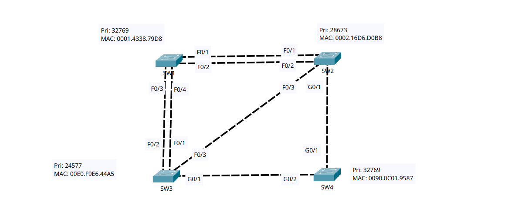
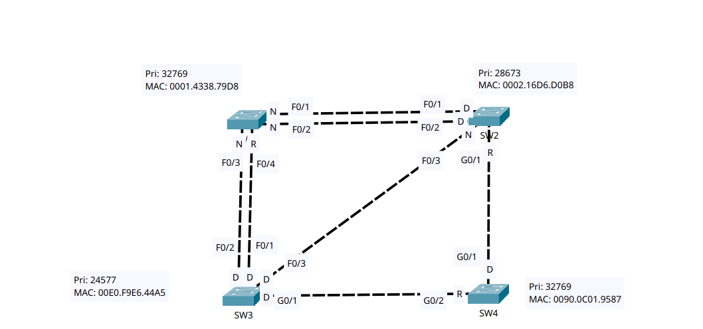

# Analyzing STP

- **Date:** 2026-10-31
- **Topic area:** Spanning Tree Protocol, root bridge election, port roles
- **Difficulty:** Hard

## Objective
Work out which switch is the root bridge and what role each switch port has (root, designated, or non-designated), then confirm the answers in the CLI.

## Topology


Four switches with redundant links between them. SW1 has two links each to SW2 and SW3, SW2 and SW3 are linked directly, and SW4 connects to both SW2 and SW3. The STP output is all for VLAN 1.


## Prediction
I revised these once before looking at any CLI output, because my first attempt had some root path costs wrong and my reasoning for the roles was unsound.

**Root bridge:** SW3, which has the lowest bridge priority of the four (24577).

| Switch | Port | Connects to | Predicted role | Reasoning |
|--------|------|-------------|----------------|-----------|
| SW1 | F0/1 | SW2 F0/1 | Non-designated | Port cost 19, root path cost via this port 27. It isn't SW1's root port, and SW2's F0/1 on the same segment is designated. |
| SW1 | F0/2 | SW2 F0/2 | Non-designated | Same as F0/1, with SW2's F0/2 designated. |
| SW1 | F0/3 | SW3 F0/2 | Non-designated | Port cost 19, root path cost via this port 19. It isn't SW1's root port, and SW3's F0/2 on the same segment is designated. |
| SW1 | F0/4 | SW3 F0/1 | Root | Port cost 19, root path cost 19. It ties with F0/3, and F0/4 wins because SW3's F0/1 has a lower port ID than its F0/2. |
| SW2 | F0/1 | SW1 F0/1 | Designated | SW2's root path cost to the root bridge is lower than SW1's. |
| SW2 | F0/2 | SW1 F0/2 | Designated | Same as F0/1. |
| SW2 | F0/3 | SW3 F0/3 | Non-designated | Port cost 19, root path cost via this port 19. It isn't SW2's root port, and SW3's F0/3 on the same segment is designated. |
| SW2 | G0/1 | SW4 G0/1 | Root | Port cost 4, root path cost 8. |
| SW3 | F0/1 | SW1 F0/4 | Designated | SW3 is the root bridge, so its root path cost is 0, and every port is designated. Port cost 19. |
| SW3 | F0/2 | SW1 F0/3 | Designated | Same as F0/1. |
| SW3 | F0/3 | SW2 F0/3 | Designated | Same as F0/1. |
| SW3 | G0/1 | SW4 G0/2 | Designated | Same as F0/1, with port cost 4. |
| SW4 | G0/1 | SW2 G0/1 | Designated | Port cost 4. The BPDU SW4 sends out of G0/1 carries a root path cost of 4. SW2 adds its own port cost (4) when it receives it, so SW2's cost on that link is 8. SW4 has the lower cost, so it's the designated bridge. |
| SW4 | G0/2 | SW3 G0/1 | Root | Port cost 4, root path cost 4. It connects to SW3, the root bridge. |

The root path cost via a blocked port isn't printed in the CLI. The 27 on SW1's F0/1 and F0/2 comes from SW2's root path cost of 8, which the CLI does show, plus 19.



My predicted port roles, labelled on the topology before I checked the CLI.


## Key configuration
I only used show commands. Nothing was configured.
```
SW3# show spanning-tree
SW3# show spanning-tree detail
SW3# show spanning-tree summary
```
I ran the first two on each switch, and the third on SW3 only.

## Verification

### Root bridge
SW3 is the root bridge. Its root ID and bridge ID are the same, and the output says so.
```
SW3# show spanning-tree
VLAN0001
  Root ID    Priority    24577
             Address     00E0.F9E6.44A5
             This bridge is the root

  Bridge ID  Priority    24577  (priority 24576 sys-id-ext 1)
             Address     00E0.F9E6.44A5

Interface        Role Sts Cost      Prio.Nbr Type
---------------- ---- --- --------- -------- --------------------------------
Fa0/1            Desg FWD 19        128.1    P2p
Fa0/2            Desg FWD 19        128.2    P2p
Fa0/3            Desg FWD 19        128.3    P2p
Gi0/1            Desg FWD 4         128.25   P2p
```
SW3's Root ID block has no Cost line, unlike the other three switches. My reading is that this is because the root bridge's cost to itself is 0. The summary output on SW3 also says it's the root bridge for VLAN 1, with 4 ports forwarding and none blocking.


### The other three switches:
```
SW1# show spanning-tree
VLAN0001
  Root ID    Priority    24577
             Address     00E0.F9E6.44A5
             Cost        19
             Port        4(FastEthernet0/4)

  Bridge ID  Priority    32769  (priority 32768 sys-id-ext 1)
             Address     0001.4338.79D8

Interface        Role Sts Cost      Prio.Nbr Type
---------------- ---- --- --------- -------- --------------------------------
Fa0/1            Altn BLK 19        128.1    P2p
Fa0/4            Root FWD 19        128.4    P2p
Fa0/3            Altn BLK 19        128.3    P2p
Fa0/2            Altn BLK 19        128.2    P2p
```
```
SW2# show spanning-tree
VLAN0001
  Root ID    Priority    24577
             Address     00E0.F9E6.44A5
             Cost        8
             Port        25(GigabitEthernet0/1)

  Bridge ID  Priority    28673  (priority 28672 sys-id-ext 1)
             Address     0002.16D6.D0B8

Interface        Role Sts Cost      Prio.Nbr Type
---------------- ---- --- --------- -------- --------------------------------
Gi0/1            Root FWD 4         128.25   P2p
Fa0/1            Desg FWD 19        128.1    P2p
Fa0/2            Desg FWD 19        128.2    P2p
Fa0/3            Altn BLK 19        128.3    P2p
```
```
SW4# show spanning-tree
VLAN0001
  Root ID    Priority    24577
             Address     00E0.F9E6.44A5
             Cost        4
             Port        26(GigabitEthernet0/2)

  Bridge ID  Priority    32769  (priority 32768 sys-id-ext 1)
             Address     0090.0C01.9587

Interface        Role Sts Cost      Prio.Nbr Type
---------------- ---- --- --------- -------- --------------------------------
Gi0/1            Desg FWD 4         128.25   P2p
Gi0/2            Root FWD 4         128.26   P2p
```


### Designated bridge on the blocked segments:

For each blocked port, `show spanning-tree detail` names the designated bridge, the switch on the other end of that link that forwards traffic for it. Two examples from SW1:

- **F0/1** is blocked, and its designated bridge is SW2 (priority 28673). That matches my prediction that SW2's F0/1 is designated.
- **F0/3** is blocked, and its designated bridge is SW3 (priority 24577), the root bridge.
```
SW1# show spanning-tree detail
Port 1 (FastEthernet0/1) of VLAN0001 is alternate blocking
  Port path cost 19, Port priority 128, Port Identifier 128.1
  Designated root has priority 24577, address 00E0.F9E6.44A5
  Designated bridge has priority 28673, address 0002.16D6.D0B8

Port 3 (FastEthernet0/3) of VLAN0001 is alternate blocking
  Port path cost 19, Port priority 128, Port Identifier 128.3
  Designated root has priority 24577, address 00E0.F9E6.44A5
  Designated bridge has priority 24577, address 00E0.F9E6.44A5
```


### Prediction against the CLI:
The root bridge and all 14 port roles matched.

| Switch | Port | Predicted | CLI | Match |
|--------|------|-----------|-----|-------|
| SW1 | F0/1 | Non-designated | Altn BLK | Yes |
| SW1 | F0/2 | Non-designated | Altn BLK | Yes |
| SW1 | F0/3 | Non-designated | Altn BLK | Yes |
| SW1 | F0/4 | Root | Root FWD | Yes |
| SW2 | F0/1 | Designated | Desg FWD | Yes |
| SW2 | F0/2 | Designated | Desg FWD | Yes |
| SW2 | F0/3 | Non-designated | Altn BLK | Yes |
| SW2 | G0/1 | Root | Root FWD | Yes |
| SW3 | F0/1 | Designated | Desg FWD | Yes |
| SW3 | F0/2 | Designated | Desg FWD | Yes |
| SW3 | F0/3 | Designated | Desg FWD | Yes |
| SW3 | G0/1 | Designated | Desg FWD | Yes |
| SW4 | G0/1 | Designated | Desg FWD | Yes |
| SW4 | G0/2 | Root | Root FWD | Yes |


## Where I struggled
I had trouble understanding root path costs, and I calculated some of them wrong on my first attempt. I got some of the port roles right on that first try, but my reasoning was unsound because I'd forgotten the reasons that decide each role. I then redid my reasoning and made the predictions above before confirming them in the CLI.

## Things to note
- Designated port costs aren't part of the root path cost calculation. Only the costs of the root ports along the path add up. SW2's root path cost is 8 because it goes through SW4: SW2's G0/1 (4) plus SW4's root port (4).
- A BPDU leaves the root bridge with a root path cost of 0, and each switch adds the cost of the port it receives it on. That's how SW1 gets 19 on its root port, and SW4 gets 4.
- Port roles depend on the whole network, so there's an order. Find the root bridge first, then the root port on each non-root switch, then the designated ports, and the remaining ports are non-designated.
- The CLI shows non-designated ports as `Altn BLK` (alternate, blocking). Four ports are blocking: SW1's F0/1, F0/2 and F0/3, and SW2's F0/3. Every other port is forwarding.
- SW1's F0/3 and F0/4 had the same root path cost (19) and went to the same neighbor. F0/4 became the root port, and it connects to SW3's F0/1, which has the lower port ID (128.1 against 128.2).
- The bridge priority in the topology is the configured priority plus the VLAN number. SW3's 24577 is 24576 plus the `sys-id-ext` of 1, as the output shows.
