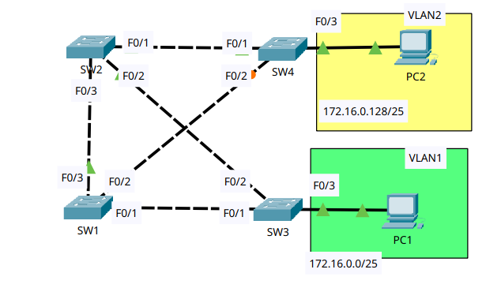

# Configuring Spanning Tree

- **Date:** 2026-11-03
- **Topic area:** Spanning Tree Protocol, root bridge placement, port cost, port priority, PortFast, BPDU Guard
- **Difficulty:** Easy

## Objective
Check the STP topology that the switches build on their own, then control it by setting root bridges per VLAN, changing a port cost and a port priority, and enabling PortFast and BPDU Guard on the host-facing ports.

## Topology


Four switches linked in a ring, with SW1 also linked to SW4 and SW2 also linked to SW3. PC1 is on SW3 in VLAN 1, and PC2 is on SW4 in VLAN 2. The diagram shows an orange marker on SW4 F0/2 at the start.


## Key configuration
I read the STP state with `show spanning-tree` on each switch.

**Root bridge config:**
```
SW1(config)# spanning-tree vlan 1 root primary
SW1(config)# spanning-tree vlan 2 root secondary

SW2(config)# spanning-tree vlan 2 root primary
SW2(config)# spanning-tree vlan 1 root secondary
```

**Port cost config on SW4:**
```
SW4(config)# interface fastethernet0/2
SW4(config-if)# spanning-tree vlan 1 cost 100
```

**Port priority config on SW1:**
```
SW1(config)# interface fastethernet0/1
SW1(config-if)# spanning-tree vlan 1 port-priority 240
```

**PortFast and BPDU Guard config on both SW3's and SW4's access port:**
```
SW3(config)# interface fastethernet0/3
SW3(config-if)# spanning-tree portfast
%Warning: portfast should only be enabled on ports connected to a single
host. Connecting hubs, concentrators, switches, bridges, etc... to this
interface  when portfast is enabled, can cause temporary bridging loops.
Use with CAUTION

%Portfast has been configured on FastEthernet0/3 but will only
have effect when the interface is in a non-trunking mode.
SW3(config-if)# spanning-tree bpduguard enable

SW4(config)# interface fastethernet0/3
SW4(config-if)# spanning-tree portfast
SW4(config-if)# spanning-tree bpduguard enable
```
SW4 printed the same warning.


## Verification


### Initial STP topology:

SW2 was the root bridge for both VLANs. SW1's root port is F0/3 in both VLANs, so SW1 reaches the root through SW2. All of SW2's ports were designated and forwarding.

| Switch | Port | Connects to | VLAN 1 | VLAN 2 |
|--------|------|-------------|--------|--------|
| SW1 | F0/1 | SW3 F0/1 | Altn BLK | Altn BLK |
| SW1 | F0/2 | SW4 F0/2 | Desg FWD | Desg FWD |
| SW1 | F0/3 | SW2 F0/3 | Root FWD | Root FWD |
| SW2 | F0/1 | SW4 F0/1 | Desg FWD | Desg FWD |
| SW2 | F0/2 | SW3 F0/2 | Desg FWD | Desg FWD |
| SW2 | F0/3 | SW1 F0/3 | Desg FWD | Desg FWD |
| SW3 | F0/1 | SW1 F0/1 | Desg FWD | Desg FWD |
| SW3 | F0/2 | SW2 F0/2 | Root FWD | Root FWD |
| SW3 | F0/3 | PC1 | Desg FWD | n/a |
| SW4 | F0/1 | SW2 F0/1 | Root FWD | Root FWD |
| SW4 | F0/2 | SW1 F0/2 | Altn BLK | Altn BLK |
| SW4 | F0/3 | PC2 | n/a | Desg FWD |

SW1's output showed the root bridge's MAC address, 0001.4301.4B81, which is SW2's. SW2's own output confirms it. Both outputs are below, cropped to the root ID, bridge ID, and port table.
```
SW1# show spanning-tree
VLAN0001
  Root ID    Priority    32769
             Address     0001.4301.4B81
             Cost        19
             Port        3(FastEthernet0/3)

  Bridge ID  Priority    32769  (priority 32768 sys-id-ext 1)
             Address     0060.2F90.D14A

Interface        Role Sts Cost      Prio.Nbr Type
---------------- ---- --- --------- -------- --------------------------------
Fa0/3            Root FWD 19        128.3    P2p
Fa0/2            Desg FWD 19        128.2    P2p
Fa0/1            Altn BLK 19        128.1    P2p

VLAN0002
  Root ID    Priority    32770
             Address     0001.4301.4B81
             Cost        19
             Port        3(FastEthernet0/3)

  Bridge ID  Priority    32770  (priority 32768 sys-id-ext 2)
             Address     0060.2F90.D14A

Interface        Role Sts Cost      Prio.Nbr Type
---------------- ---- --- --------- -------- --------------------------------
Fa0/3            Root FWD 19        128.3    P2p
Fa0/2            Desg FWD 19        128.2    P2p
Fa0/1            Altn BLK 19        128.1    P2p
```
```
SW2# show spanning-tree
VLAN0001
  Root ID    Priority    32769
             Address     0001.4301.4B81
             This bridge is the root

  Bridge ID  Priority    32769  (priority 32768 sys-id-ext 1)
             Address     0001.4301.4B81

Interface        Role Sts Cost      Prio.Nbr Type
---------------- ---- --- --------- -------- --------------------------------
Fa0/1            Desg FWD 19        128.1    P2p
Fa0/2            Desg FWD 19        128.2    P2p
Fa0/3            Desg FWD 19        128.3    P2p

VLAN0002
  Root ID    Priority    32770
             Address     0001.4301.4B81
             This bridge is the root

  Bridge ID  Priority    32770  (priority 32768 sys-id-ext 2)
             Address     0001.4301.4B81

Interface        Role Sts Cost      Prio.Nbr Type
---------------- ---- --- --------- -------- --------------------------------
Fa0/1            Desg FWD 19        128.1    P2p
Fa0/2            Desg FWD 19        128.2    P2p
Fa0/3            Desg FWD 19        128.3    P2p
```

### The new root bridges:

After the configuration, SW1 is the root bridge for VLAN 1, and SW2 is the root bridge for VLAN 2. Each is the secondary root for the other VLAN. SW3 and SW4 weren't configured, so they kept the default priorities.

| Switch | VLAN 1 priority, start | VLAN 1 priority, now | VLAN 2 priority, start | VLAN 2 priority, now |
|--------|------------------------|----------------------|------------------------|----------------------|
| SW1 | 32769 | 24577 (root) | 32770 | 28674 |
| SW2 | 32769 | 28673 | 32770 | 24578 (root) |
| SW3 | 32769 | 32769 | 32770 | 32770 |
| SW4 | 32769 | 32769 | 32770 | 32770 |

| Switch | Port | Connects to | VLAN 1 | VLAN 2 |
|--------|------|-------------|--------|--------|
| SW1 | F0/1 | SW3 F0/1 | Desg FWD | Desg FWD |
| SW1 | F0/2 | SW4 F0/2 | Desg FWD | Desg FWD |
| SW1 | F0/3 | SW2 F0/3 | Desg FWD | Root FWD |
| SW2 | F0/1 | SW4 F0/1 | Desg FWD | Desg FWD |
| SW2 | F0/2 | SW3 F0/2 | Desg FWD | Desg FWD |
| SW2 | F0/3 | SW1 F0/3 | Root FWD | Desg FWD |
| SW3 | F0/1 | SW1 F0/1 | Root FWD | Altn BLK |
| SW3 | F0/2 | SW2 F0/2 | Altn BLK | Root FWD |
| SW3 | F0/3 | PC1 | Desg FWD | n/a |
| SW4 | F0/1 | SW2 F0/1 | Altn BLK | Root FWD |
| SW4 | F0/2 | SW1 F0/2 | Root FWD | Altn BLK |
| SW4 | F0/3 | PC2 | n/a | Desg FWD |

SW1 and SW2 after the configuration:
```
SW1# show spanning-tree
VLAN0001
  Root ID    Priority    24577
             Address     0060.2F90.D14A
             This bridge is the root

  Bridge ID  Priority    24577  (priority 24576 sys-id-ext 1)
             Address     0060.2F90.D14A

Interface        Role Sts Cost      Prio.Nbr Type
---------------- ---- --- --------- -------- --------------------------------
Fa0/3            Desg FWD 19        128.3    P2p
Fa0/2            Desg FWD 19        128.2    P2p
Fa0/1            Desg FWD 19        128.1    P2p

VLAN0002
  Root ID    Priority    24578
             Address     0001.4301.4B81
             Cost        19
             Port        3(FastEthernet0/3)

  Bridge ID  Priority    28674  (priority 28672 sys-id-ext 2)
             Address     0060.2F90.D14A

Interface        Role Sts Cost      Prio.Nbr Type
---------------- ---- --- --------- -------- --------------------------------
Fa0/3            Root FWD 19        128.3    P2p
Fa0/2            Desg FWD 19        128.2    P2p
Fa0/1            Desg FWD 19        128.1    P2p
```
```
SW2# show spanning-tree
VLAN0001
  Root ID    Priority    24577
             Address     0060.2F90.D14A
             Cost        19
             Port        3(FastEthernet0/3)

  Bridge ID  Priority    28673  (priority 28672 sys-id-ext 1)
             Address     0001.4301.4B81

Interface        Role Sts Cost      Prio.Nbr Type
---------------- ---- --- --------- -------- --------------------------------
Fa0/1            Desg FWD 19        128.1    P2p
Fa0/2            Desg FWD 19        128.2    P2p
Fa0/3            Root FWD 19        128.3    P2p

VLAN0002
  Root ID    Priority    24578
             Address     0001.4301.4B81
             This bridge is the root

  Bridge ID  Priority    24578  (priority 24576 sys-id-ext 2)
             Address     0001.4301.4B81

Interface        Role Sts Cost      Prio.Nbr Type
---------------- ---- --- --------- -------- --------------------------------
Fa0/1            Desg FWD 19        128.1    P2p
Fa0/2            Desg FWD 19        128.2    P2p
Fa0/3            Desg FWD 19        128.3    P2p
```

### Port cost on SW4 F0/2:

In VLAN 1, SW4 chose F0/1 as its new root port because it now has the better root path cost. Raising the cost of F0/2 to 100 made the path through F0/2 more expensive than the path through F0/1. The cost applied to VLAN 1 only, and SW4's VLAN 2 output didn't change.

Before:
```
SW4# show spanning-tree
VLAN0001
  Root ID    Priority    24577
             Address     0060.2F90.D14A
             Cost        19
             Port        2(FastEthernet0/2)

Interface        Role Sts Cost      Prio.Nbr Type
---------------- ---- --- --------- -------- --------------------------------
Fa0/1            Altn BLK 19        128.1    P2p
Fa0/2            Root FWD 19        128.2    P2p
```
After:
```
SW4# show spanning-tree
VLAN0001
  Root ID    Priority    24577
             Address     0060.2F90.D14A
             Cost        38
             Port        1(FastEthernet0/1)

Interface        Role Sts Cost      Prio.Nbr Type
---------------- ---- --- --------- -------- --------------------------------
Fa0/1            Root FWD 19        128.1    P2p
Fa0/2            Altn BLK 100       128.2    P2p
```


### Port priority on SW1 F0/1:

SW3 didn't select a different root port in VLAN 1. After the change, F0/1 still receives BPDUs with a better root path cost than the ones arriving on F0/2, so the port priority didn't change its choice. SW1's F0/1 now shows priority 240 in VLAN 1, and it stays at 128 in VLAN 2.
```
SW1# show spanning-tree
VLAN0001
Interface        Role Sts Cost      Prio.Nbr Type
---------------- ---- --- --------- -------- --------------------------------
Fa0/3            Desg FWD 19        128.3    P2p
Fa0/2            Desg FWD 19        128.2    P2p
Fa0/1            Desg FWD 19        240.1    P2p
```
SW3's VLAN 1 output after the change. It's the same as before:
```
SW3# show spanning-tree
VLAN0001
  Root ID    Priority    24577
             Address     0060.2F90.D14A
             Cost        19
             Port        1(FastEthernet0/1)

Interface        Role Sts Cost      Prio.Nbr Type
---------------- ---- --- --------- -------- --------------------------------
Fa0/1            Root FWD 19        128.1    P2p
Fa0/2            Altn BLK 19        128.2    P2p
Fa0/3            Desg FWD 19        128.3    P2p
```


### PortFast and BPDU Guard:

After the change, F0/3 on both SW3 (VLAN 1) and SW4 (VLAN 2) is designated and forwarding, and the detailed spanning-tree interface output says the port is in PortFast mode. BPDU Guard doesn't show up in that output, only in the running configuration.
```
SW3# show spanning-tree interface fastethernet0/3 detail
Port 3 (FastEthernet0/3) of VLAN0001 is designated forwarding
  Port path cost 19, Port priority 128, Port Identifier 128.3
  The port is in the portfast mode
```
```
SW4# show spanning-tree interface fastethernet0/3 detail
Port 3 (FastEthernet0/3) of VLAN0002 is designated forwarding
  Port path cost 19, Port priority 128, Port Identifier 128.3
  The port is in the portfast mode
```
```
SW3# show running-config
interface FastEthernet0/3
 switchport mode access
 spanning-tree portfast
 spanning-tree bpduguard enable
```
```
SW4# show running-config
interface FastEthernet0/3
 switchport access vlan 2
 switchport mode access
 spanning-tree portfast
 spanning-tree bpduguard enable
```

## Things to note
- All four switches started with the default priority, 32768 plus the VLAN number, so the tie for root bridge went to the lowest MAC address, which is SW2's (0001.4301.4B81). It was the root for both VLANs.
- `root primary` set SW1's VLAN 1 priority to 24576 (24577 with the VLAN number), and `root secondary` set SW1's VLAN 2 priority to 28672 (28674). SW2 got the same values for the opposite VLANs.
- STP runs per VLAN. With different roots for VLAN 1 and VLAN 2, the same port can have different roles. SW3's F0/1 is a root port in VLAN 1 and blocked in VLAN 2.
- A switch's root path cost is the cost of the root port plus the cost on the neighbor's side. SW4's root path cost in VLAN 1 went from 19 to 38 after step 3, which fits SW2's cost of 19 plus F0/1's 19.
- Port cost and port priority are set per VLAN. SW4's VLAN 2 cost on F0/2 stayed 19, and SW1's F0/1 priority stayed 128 in VLAN 2.
- Port priority is only a tiebreaker. It matters when the root path costs and the neighbor's bridge ID are equal. SW3's choice was already settled by cost, so changing SW1's port priority didn't affect it.
- PortFast printed a warning that it should only be enabled on ports connected to a single host, and that it only has an effect when the interface isn't a trunk.
- SW4's running configuration lists the F0/2 cost as `spanning-tree cost 100`, without the VLAN number I typed. VLAN 2's cost on that port stayed 19 in the output, so I'm treating it as applying to VLAN 1 only. I don't know why the running configuration drops the VLAN.
