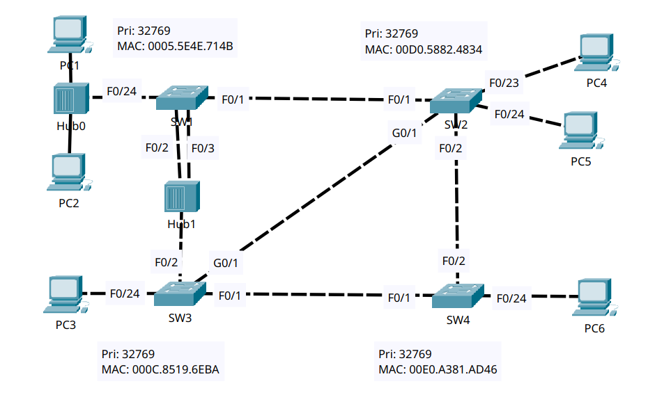
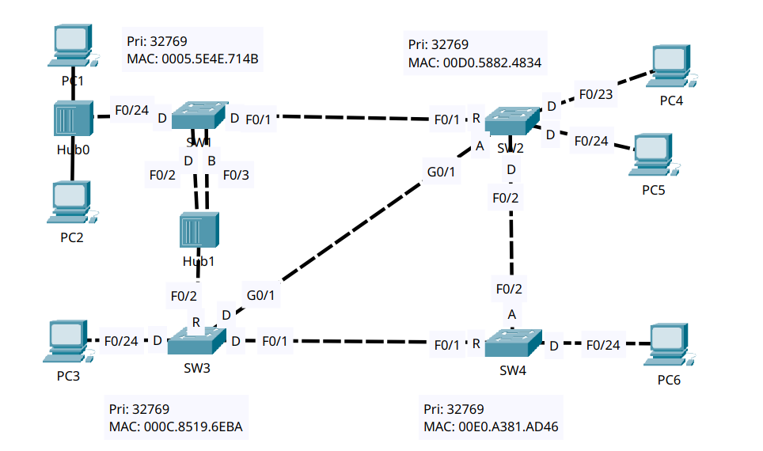

# Rapid STP

- **Date:** 2026-11-04
- **Topic area:** Rapid Spanning Tree Protocol, port roles, link types
- **Difficulty:** Easy

## Objective
Find the root bridge and look at its port roles, work out the roles of every other switch port without the CLI and then confirm them, and manually configure the RSTP link type on each interface.

## Topology


Four switches and two hubs. SW1 and SW2 are linked, SW2 links to SW3 and SW4, and SW3 links to SW4. Hub1 connects SW1 (two ports) to SW3, and Hub0 connects PC1 and PC2 to SW1.


## Key configuration
I didn't change the STP mode. All four switches were already running `rapid-pvst`, which `show spanning-tree` reports as `rstp`.

**Link types:**
```
SW1(config)# interface fastethernet0/1
SW1(config-if)# spanning-tree link-type point-to-point
SW1(config-if)# interface range fastethernet0/2 - 3 , fastethernet0/24
SW1(config-if-range)# spanning-tree link-type shared

SW2(config)# interface range fastethernet0/1 - 2 , gigabitethernet0/1
SW2(config-if-range)# spanning-tree link-type point-to-point
SW2(config-if-range)# interface range fastethernet0/23 - 24
SW2(config-if-range)# spanning-tree portfast

SW3(config)# interface range fastethernet0/1 , gigabitethernet0/1
SW3(config-if-range)# spanning-tree link-type point-to-point
SW3(config-if-range)# interface fastethernet0/2
SW3(config-if)# spanning-tree link-type shared
SW3(config-if)# interface fastethernet0/24
SW3(config-if)# spanning-tree portfast

SW4(config)# interface range fastethernet0/1 - 2
SW4(config-if-range)# spanning-tree link-type point-to-point
SW4(config-if-range)# interface fastethernet0/24
SW4(config-if)# spanning-tree portfast
```
Each `portfast` command printed a warning that it should only be enabled on ports connected to a single host, and that it only has an effect when the interface isn't a trunk.


## Verification

### The root bridge:

SW1 is the root bridge. All four switches have the same priority (32769), so the lowest MAC address decides, and SW1's (0005.5E4E.714B) is the lowest.

A root bridge normally has every port designated and forwarding. On SW1, F0/3 is a backup port in the blocking state. F0/2 and F0/3 both connect to Hub1, so they sit on the same shared segment, and F0/3 receives BPDUs sent by SW1's own F0/2. The designated bridge in F0/3's detail output is SW1's own address. F0/2 has the lower port ID (128.2 against 128.3), so it stays designated, and F0/3 becomes the backup.
```
SW1# show spanning-tree
VLAN0001
  Spanning tree enabled protocol rstp
  Root ID    Priority    32769
             Address     0005.5E4E.714B
             This bridge is the root

  Bridge ID  Priority    32769  (priority 32768 sys-id-ext 1)
             Address     0005.5E4E.714B

Interface        Role Sts Cost      Prio.Nbr Type
---------------- ---- --- --------- -------- --------------------------------
Fa0/2            Desg FWD 19        128.2    Shr
Fa0/24           Desg FWD 19        128.24   Shr
Fa0/3            Back BLK 19        128.3    Shr
Fa0/1            Desg FWD 19        128.1    P2p
```
```
SW1# show spanning-tree interface fastethernet0/3 detail
Port 3 (FastEthernet0/3) of VLAN0001 is backup blocking
  Port path cost 19, Port priority 128, Port Identifier 128.3
  Designated root has priority 32769, address 0005.5E4E.714B
  Designated bridge has priority 32769, address 0005.5E4E.714B
  Link type is shared by default
```

### Port roles:

I predicted the roles of the other three switches' ports before opening the CLI, and all of them matched.



| Switch | Port | Connects to | Predicted | CLI | Match |
|--------|------|-------------|-----------|-----|-------|
| SW1 | F0/1 | SW2 F0/1 | From the CLI output | Desg FWD | n/a |
| SW1 | F0/2 | Hub1 | From the CLI output | Desg FWD | n/a |
| SW1 | F0/3 | Hub1 | From the CLI output | Back BLK | n/a |
| SW1 | F0/24 | Hub0 | From the CLI output | Desg FWD | n/a |
| SW2 | F0/1 | SW1 F0/1 | Root | Root FWD | Yes |
| SW2 | F0/2 | SW4 F0/2 | Designated | Desg FWD | Yes |
| SW2 | G0/1 | SW3 G0/1 | Alternate | Altn BLK | Yes |
| SW2 | F0/23 | PC4 | Designated | Desg FWD | Yes |
| SW2 | F0/24 | PC5 | Designated | Desg FWD | Yes |
| SW3 | F0/1 | SW4 F0/1 | Designated | Desg FWD | Yes |
| SW3 | F0/2 | Hub1 | Root | Root FWD | Yes |
| SW3 | G0/1 | SW2 G0/1 | Designated | Desg FWD | Yes |
| SW3 | F0/24 | PC3 | Designated | Desg FWD | Yes |
| SW4 | F0/1 | SW3 F0/1 | Root | Root FWD | Yes |
| SW4 | F0/2 | SW2 F0/2 | Alternate | Altn BLK | Yes |
| SW4 | F0/24 | PC6 | Designated | Desg FWD | Yes |

```
SW2# show spanning-tree
VLAN0001
  Spanning tree enabled protocol rstp
  Root ID    Priority    32769
             Address     0005.5E4E.714B
             Cost        19
             Port        1(FastEthernet0/1)

  Bridge ID  Priority    32769  (priority 32768 sys-id-ext 1)
             Address     00D0.5882.4834

Interface        Role Sts Cost      Prio.Nbr Type
---------------- ---- --- --------- -------- --------------------------------
Fa0/1            Root FWD 19        128.1    P2p
Fa0/2            Desg FWD 19        128.2    P2p
Fa0/23           Desg FWD 19        128.23   P2p
Fa0/24           Desg FWD 19        128.24   P2p
Gi0/1            Altn BLK 4         128.25   P2p
```
```
SW3# show spanning-tree
VLAN0001
  Spanning tree enabled protocol rstp
  Root ID    Priority    32769
             Address     0005.5E4E.714B
             Cost        19
             Port        2(FastEthernet0/2)

  Bridge ID  Priority    32769  (priority 32768 sys-id-ext 1)
             Address     000C.8519.6EBA

Interface        Role Sts Cost      Prio.Nbr Type
---------------- ---- --- --------- -------- --------------------------------
Fa0/1            Desg FWD 19        128.1    P2p
Fa0/2            Root FWD 19        128.2    Shr
Fa0/24           Desg FWD 19        128.24   P2p
Gi0/1            Desg FWD 4         128.25   P2p
```
```
SW4# show spanning-tree
VLAN0001
  Spanning tree enabled protocol rstp
  Root ID    Priority    32769
             Address     0005.5E4E.714B
             Cost        38
             Port        1(FastEthernet0/1)

  Bridge ID  Priority    32769  (priority 32768 sys-id-ext 1)
             Address     00E0.A381.AD46

Interface        Role Sts Cost      Prio.Nbr Type
---------------- ---- --- --------- -------- --------------------------------
Fa0/1            Root FWD 19        128.1    P2p
Fa0/2            Altn BLK 19        128.2    P2p
Fa0/24           Desg FWD 19        128.24   P2p
```

### Link types:

The above CLI output already showed the right link type on every port. The switches work out the type for each link themselves, so the types I configured matched what was there. I configured them anyway to practice the commands. The ports connected to PCs showed `P2p`, and I set those with PortFast, because there's no `spanning-tree link-type edge` command on these switches.

| Switch | Port | Connects to | Link type before | Configured |
|--------|------|-------------|------------------|------------|
| SW1 | F0/1 | SW2 F0/1 | P2p | point-to-point |
| SW1 | F0/2 | Hub1 | Shr | shared |
| SW1 | F0/3 | Hub1 | Shr | shared |
| SW1 | F0/24 | Hub0 | Shr | shared |
| SW2 | F0/1 | SW1 F0/1 | P2p | point-to-point |
| SW2 | F0/2 | SW4 F0/2 | P2p | point-to-point |
| SW2 | G0/1 | SW3 G0/1 | P2p | point-to-point |
| SW2 | F0/23 | PC4 | P2p | PortFast |
| SW2 | F0/24 | PC5 | P2p | PortFast |
| SW3 | F0/1 | SW4 F0/1 | P2p | point-to-point |
| SW3 | F0/2 | Hub1 | Shr | shared |
| SW3 | G0/1 | SW2 G0/1 | P2p | point-to-point |
| SW3 | F0/24 | PC3 | P2p | PortFast |
| SW4 | F0/1 | SW3 F0/1 | P2p | point-to-point |
| SW4 | F0/2 | SW2 F0/2 | P2p | point-to-point |
| SW4 | F0/24 | PC6 | P2p | PortFast |

SW1's F0/24 connects to Hub0, which joins PC1, PC2, and the switch on one shared segment. A hub can only send in one direction at a time (half-duplex), so I think the right link type is shared.

The running configuration on each switch, cropped to the interfaces I configured:
```
SW1# show running-config
interface FastEthernet0/1
 spanning-tree link-type point-to-point
interface FastEthernet0/2
 spanning-tree link-type shared
interface FastEthernet0/3
 spanning-tree link-type shared
interface FastEthernet0/24
 spanning-tree link-type shared
```
```
SW2# show running-config
interface FastEthernet0/1
 spanning-tree link-type point-to-point
interface FastEthernet0/2
 spanning-tree link-type point-to-point
interface FastEthernet0/23
 spanning-tree portfast
interface FastEthernet0/24
 spanning-tree portfast
interface GigabitEthernet0/1
 spanning-tree link-type point-to-point
```
```
SW3# show running-config
interface FastEthernet0/1
 spanning-tree link-type point-to-point
interface FastEthernet0/2
 spanning-tree link-type shared
interface FastEthernet0/24
 spanning-tree portfast
interface GigabitEthernet0/1
 spanning-tree link-type point-to-point
```
```
SW4# show running-config
interface FastEthernet0/1
 spanning-tree link-type point-to-point
interface FastEthernet0/2
 spanning-tree link-type point-to-point
interface FastEthernet0/24
 spanning-tree portfast
```

## Things to note
- A point-to-point link connects two devices directly. A shared link has more than one device on the segment, as with a hub. SW1's F0/2, F0/3, and F0/24 and SW3's F0/2 were the shared links, and every other port showed point-to-point.
- RSTP splits the non-designated role into two. A port with another path to the root through a different switch is alternate (SW2's G0/1 and SW4's F0/2). A port on the same switch that connects to the same segment as one of its own designated ports is backup (SW1's F0/3). The CLI shows them as `Altn BLK` and `Back BLK`.
- A root bridge normally has only designated ports. SW1 didn't, because two of its ports sit on the same hub segment, and one of them became a backup port.
- SW3's root port, F0/2, goes to Hub1, so the root port can be on a shared link.
- The `spanning-tree link-type` command takes only `point-to-point` or `shared`. To mark a port as an edge port, I used `spanning-tree portfast`.
