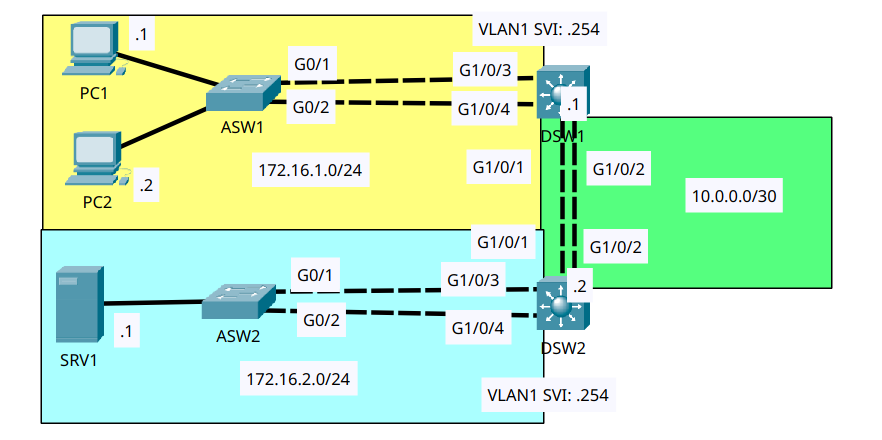
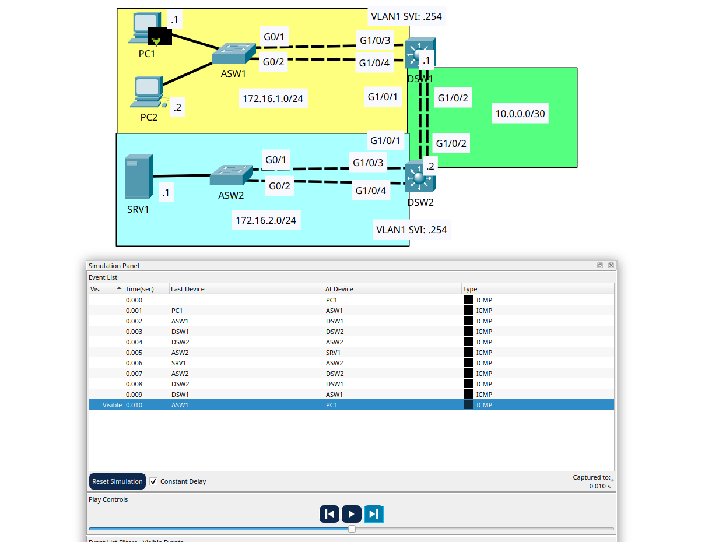

# EtherChannel

- **Date:** 2026-11-05
- **Topic area:** EtherChannel, LACP, PAgP, static EtherChannel, Layer 3 EtherChannel, load balancing
- **Difficulty:** Medium

## Objective
Bundle the links between switches into EtherChannels. ASW1 and DSW1 use LACP, and ASW2 and DSW2 use PAgP, both as trunks, and DSW1 and DSW2 use a static Layer 3 EtherChannel. Then add routes so the PCs can reach SRV1, check the default load-balancing method on each switch, and change it to source and destination IP.

## Topology


Two access switches (ASW1 and ASW2), each with two links to its own multilayer switch (DSW1 and DSW2), and two links between the multilayer switches. The PCs are in 172.16.1.0/24, behind DSW1, and SRV1 is in 172.16.2.0/24, behind DSW2. The DSWs are joined by a routed link, 10.0.0.0/30. I didn't label the ports on the diagram, so the tables below list them.

The end host and SVI addresses were already configured, and the DSWs started with VLAN 1 spanning tree priorities set (24576 on DSW1 and 20480 on DSW2).

## Key configuration

**LACP Port Channel link between ASW1 and DSW1, as a trunk:**
```
ASW1(config)# interface range gigabitethernet0/1 - 2
ASW1(config-if-range)# channel-group 1 mode active
%EC-5-L3DONTBNDL2: Gig0/1 suspended: LACP currently not enabled on the remote port.
%EC-5-L3DONTBNDL2: Gig0/2 suspended: LACP currently not enabled on the remote port.
Creating a port-channel interface Port-channel 1
ASW1(config-if-range)# interface port-channel 1
ASW1(config-if)# switchport mode trunk

DSW1(config)# interface range gigabitethernet1/0/3 - 4
DSW1(config-if-range)# channel-group 1 mode active
%EC-5-L3DONTBNDL2: Gig1/0/3 suspended: LACP currently not enabled on the remote port.
%EC-5-L3DONTBNDL2: Gig1/0/4 suspended: LACP currently not enabled on the remote port.
Creating a port-channel interface Port-channel 1
DSW1(config-if-range)# interface port-channel 1
DSW1(config-if)# switchport mode trunk
```
The line protocol on each member port went down and up once or twice as I configured each switch.

**PAgP Port Channel link between ASW2 and DSW2, as a trunk:**
```
ASW2(config)# interface range gigabitethernet0/1 - 2
ASW2(config-if-range)# channel-group 1 mode desirable
%EC-5-L3DONTBNDL2: Gig0/1 suspended: PAGP currently not enabled on the remote port.
%EC-5-L3DONTBNDL2: Gig0/2 suspended: PAGP currently not enabled on the remote port.
Creating a port-channel interface Port-channel 1
ASW2(config-if-range)# interface port-channel 1
ASW2(config-if)# switchport mode trunk

DSW2(config)# interface range gigabitethernet1/0/3 - 4
DSW2(config-if-range)# channel-group 1 mode desirable
%EC-5-L3DONTBNDL2: Gig1/0/3 suspended: PAGP currently not enabled on the remote port.
%EC-5-L3DONTBNDL2: Gig1/0/4 suspended: PAGP currently not enabled on the remote port.
Creating a port-channel interface Port-channel 1
DSW2(config-if-range)# interface port-channel 1
DSW2(config-if)# switchport mode trunk
```

**Static Layer 3 EtherChannel link between DSW1 and DSW2:** I enabled `ip routing` on both switches first.
```
DSW1(config)# ip routing
DSW1(config)# interface range gigabitethernet1/0/1 - 2
DSW1(config-if-range)# no switchport
DSW1(config-if-range)# channel-group 2 mode on
Creating a port-channel interface Port-channel 2

DSW2(config)# ip routing
DSW2(config)# interface range gigabitethernet1/0/1 - 2
DSW2(config-if-range)# no switchport
DSW2(config-if-range)# channel-group 2 mode on
Creating a port-channel interface Port-channel 2
```

**Addresses and routes:** I gave each Po2 an address before adding the routes, since each route's next hop is the other switch's Po2 address.
```
DSW1(config)# interface port-channel 2
DSW1(config-if)# ip address 10.0.0.1 255.255.255.252
DSW1(config-if)# exit
DSW1(config)# ip route 172.16.2.0 255.255.255.0 10.0.0.2

DSW2(config)# interface port-channel 2
DSW2(config-if)# ip address 10.0.0.2 255.255.255.252
DSW2(config-if)# exit
DSW2(config)# ip route 172.16.1.0 255.255.255.0 10.0.0.1
```

**Load balancing on all four switches:**
```
ASW1(config)# port-channel load-balance src-dst-ip
ASW2(config)# port-channel load-balance src-dst-ip
DSW1(config)# port-channel load-balance src-dst-ip
DSW2(config)# port-channel load-balance src-dst-ip
```

## Verification

### Layer 2 EtherChannels:

Before, no EtherChannel was configured on any of the four switches, and the interfaces I used were all up. After the configuration, each pair showed the right protocol with both ports bundled (`P`). The flags `SU` mean Layer 2 and in use.
```
ASW1# show etherchannel summary
Group  Port-channel  Protocol    Ports
------+-------------+-----------+----------------------------------------------
1      Po1(SU)           LACP   Gig0/1(P) Gig0/2(P)
```
```
ASW2# show etherchannel summary
Group  Port-channel  Protocol    Ports
------+-------------+-----------+----------------------------------------------
1      Po1(SU)           PAgP   Gig0/1(P) Gig0/2(P)
```
DSW1 and DSW2 showed the same protocols with Gig1/0/3 and Gig1/0/4 bundled.

On ASW1, setting trunk mode on the port channel also showed up on the member ports in the running configuration:
```
ASW1# show running-config
interface Port-channel1
 switchport mode trunk
interface GigabitEthernet0/1
 switchport mode trunk
 channel-group 1 mode active
interface GigabitEthernet0/2
 switchport mode trunk
 channel-group 1 mode active
```
ASW2 and the DSWs matched, with `desirable` on ASW2 and DSW2 and ports G1/0/3 and G1/0/4 on the DSWs.

After I configured only ASW2, `show etherchannel summary` showed Po1 as `DU` (down, in use) and the member ports as `I` (stand-alone). I didn't capture that output.


### Static Layer 3 EtherChannel:

Before, G1/0/1 and G1/0/2 on both DSWs were switchports with no configuration. After, group 2 is Po2 with flags `RU` (Layer 3, in use), and the protocol column is blank.
```
DSW1# show etherchannel summary
Group  Port-channel  Protocol    Ports
------+-------------+-----------+----------------------------------------------
1      Po1(SU)           LACP   Gig1/0/3(P) Gig1/0/4(P)
2      Po2(RU)           -      Gig1/0/1(P) Gig1/0/2(P)
```
```
DSW2# show etherchannel summary
Group  Port-channel  Protocol    Ports
------+-------------+-----------+----------------------------------------------
1      Po1(SU)           PAgP   Gig1/0/3(P) Gig1/0/4(P)
2      Po2(RU)           -      Gig1/0/1(P) Gig1/0/2(P)
```
DSW1's running configuration for the new channel, before I gave it an address. DSW2's matched.
```
DSW1# show running-config
interface Port-channel2
 no switchport
 no ip address
interface GigabitEthernet1/0/1
 no switchport
 no ip address
 channel-group 2 mode on
interface GigabitEthernet1/0/2
 no switchport
 no ip address
 channel-group 2 mode on
```

### Static routes to SRV1:

Before: each DSW only had its own connected network.
```
DSW1# show ip route
Gateway of last resort is not set

     172.16.0.0/16 is variably subnetted, 2 subnets, 2 masks
C       172.16.1.0/24 is directly connected, Vlan1
L       172.16.1.254/32 is directly connected, Vlan1
```
```
DSW2# show ip route
Gateway of last resort is not set

     172.16.0.0/16 is variably subnetted, 2 subnets, 2 masks
C       172.16.2.0/24 is directly connected, Vlan1
L       172.16.2.254/32 is directly connected, Vlan1
```

After: each DSW has the link between them as a connected network and a static route to the other side.
```
DSW1# show ip route
Gateway of last resort is not set

     10.0.0.0/8 is variably subnetted, 2 subnets, 2 masks
C       10.0.0.0/30 is directly connected, Port-channel2
L       10.0.0.1/32 is directly connected, Port-channel2
     172.16.0.0/16 is variably subnetted, 3 subnets, 2 masks
C       172.16.1.0/24 is directly connected, Vlan1
L       172.16.1.254/32 is directly connected, Vlan1
S       172.16.2.0/24 [1/0] via 10.0.0.2
```
```
DSW2# show ip route
Gateway of last resort is not set

     10.0.0.0/8 is variably subnetted, 2 subnets, 2 masks
C       10.0.0.0/30 is directly connected, Port-channel2
L       10.0.0.2/32 is directly connected, Port-channel2
     172.16.0.0/16 is variably subnetted, 3 subnets, 2 masks
S       172.16.1.0/24 [1/0] via 10.0.0.1
C       172.16.2.0/24 is directly connected, Vlan1
L       172.16.2.254/32 is directly connected, Vlan1
```
Po2 now has an address on each DSW, and the member ports still have `no ip address`.
```
DSW1# show running-config
interface Port-channel2
 no switchport
 ip address 10.0.0.1 255.255.255.252
```

PC1 and PC2 can both reach SRV1. All replies came back with TTL 126.

| From | To | Result |
|------|----|--------|
| PC1 | SRV1 (172.16.2.1) | First attempt 2 of 4, rerun 4 of 4 |
| PC2 | SRV1 (172.16.2.1) | First attempt 4 of 4 |

PC1 to SRV1, both attempts:
```
C:\> ping 172.16.2.1

Pinging 172.16.2.1 with 32 bytes of data:

Request timed out.
Request timed out.
Reply from 172.16.2.1: bytes=32 time<1ms TTL=126
Reply from 172.16.2.1: bytes=32 time<1ms TTL=126

Ping statistics for 172.16.2.1:
    Packets: Sent = 4, Received = 2, Lost = 2 (50% loss),
Approximate round trip times in milli-seconds:
    Minimum = 0ms, Maximum = 0ms, Average = 0ms
```
```
C:\> ping 172.16.2.1

Pinging 172.16.2.1 with 32 bytes of data:

Reply from 172.16.2.1: bytes=32 time<1ms TTL=126
Reply from 172.16.2.1: bytes=32 time<1ms TTL=126
Reply from 172.16.2.1: bytes=32 time<1ms TTL=126
Reply from 172.16.2.1: bytes=32 time<1ms TTL=126

Ping statistics for 172.16.2.1:
    Packets: Sent = 4, Received = 4, Lost = 0 (0% loss),
Approximate round trip times in milli-seconds:
    Minimum = 0ms, Maximum = 0ms, Average = 0ms
```

Simulation mode during PC1's ping to SRV1, showing the topology and the event list:




### Load balancing:

All four switches started with the source MAC address as the load-balancing method. After step 6, all four used source and destination IP.

| Switch | Default | After step 6 |
|--------|---------|--------------|
| ASW1 | src-mac | src-dst-ip |
| ASW2 | src-mac | src-dst-ip |
| DSW1 | src-mac | src-dst-ip |
| DSW2 | src-mac | src-dst-ip |

The ASWs and the DSWs print this differently. ASW1 and DSW1 as the examples, ASW2 and DSW2 matched:
```
ASW1# show etherchannel load-balance
EtherChannel Load-Balancing Operational State (src-mac):
Non-IP: Source MAC address
  IPv4: Source MAC address
  IPv6: Source MAC address
```
```
ASW1# show etherchannel load-balance
EtherChannel Load-Balancing Operational State (src-dst-ip):
Non-IP: Source XOR Destination MAC address
  IPv4: Source XOR Destination IP address
  IPv6: Source XOR Destination IP address
```
```
DSW1# show etherchannel load-balance
EtherChannel Load-Balancing Configuration:
        src-mac

EtherChannel Load-Balancing Addresses Used Per-Protocol:
Non-IP: Source MAC address
  IPv4: Source MAC address
  IPv6: Source MAC address
```
```
DSW1# show etherchannel load-balance
EtherChannel Load-Balancing Configuration:
        src-dst-ip

EtherChannel Load-Balancing Addresses Used Per-Protocol:
Non-IP: Source XOR Destination MAC address
  IPv4: Source XOR Destination IP address
  IPv6: Source XOR Destination IP address
```

### How the EtherChannels show up in spanning tree:

After everything was configured, I looked at spanning tree on each switch, cropped to the root, bridge ID, and port tables.
```
ASW1# show spanning-tree
VLAN0001
  Root ID    Priority    24577
             Address     0002.161B.EBBC
             Cost        3
             Port        27(Port-channel1)

  Bridge ID  Priority    32769  (priority 32768 sys-id-ext 1)
             Address     0005.5E1E.5B9D

Interface        Role Sts Cost      Prio.Nbr Type
---------------- ---- --- --------- -------- --------------------------------
Po1              Root FWD 3         128.27   P2p
Fa0/1            Desg FWD 19        128.1    P2p
Fa0/2            Desg FWD 19        128.2    P2p
```
```
DSW1# show spanning-tree
VLAN0001
  Root ID    Priority    24577
             Address     0002.161B.EBBC
             This bridge is the root

  Bridge ID  Priority    24577  (priority 24576 sys-id-ext 1)
             Address     0002.161B.EBBC

Interface        Role Sts Cost      Prio.Nbr Type
---------------- ---- --- --------- -------- --------------------------------
Po1              Desg FWD 3         128.29   P2p
Po2              Desg FWD 3         128.30   P2p
```
```
DSW2# show spanning-tree
VLAN0001
  Root ID    Priority    20481
             Address     0007.EC07.1D30
             This bridge is the root

  Bridge ID  Priority    20481  (priority 20480 sys-id-ext 1)
             Address     0007.EC07.1D30

Interface        Role Sts Cost      Prio.Nbr Type
---------------- ---- --- --------- -------- --------------------------------
Po2              Desg FWD 3         128.30   P2p
Po1              Desg FWD 3         128.29   P2p
```
```
ASW2# show spanning-tree
VLAN0001
  Root ID    Priority    20481
             Address     0007.EC07.1D30
             Cost        3
             Port        27(Port-channel1)

  Bridge ID  Priority    32769  (priority 32768 sys-id-ext 1)
             Address     0050.0FEB.DDCC

Interface        Role Sts Cost      Prio.Nbr Type
---------------- ---- --- --------- -------- --------------------------------
Fa0/1            Desg FWD 19        128.1    P2p
Po1              Root FWD 3         128.27   P2p
```

## Things to note
- The mode on `channel-group` picks the protocol: `active` gave LACP, `desirable` gave PAgP, and `on` gave a static EtherChannel with nothing in the protocol column. I didn't need a separate command to choose it.
- The `suspended` messages printed on both switches in each pair when I configured them. They don't mean the protocol wasn't configured. The summaries afterward show the right protocol with both ports bundled, so the messages were temporary.
- Setting trunk mode on the port channel applied it to the member ports too.
- The flags show the type: `SU` is a Layer 2 EtherChannel in use and `RU` is a Layer 3 one in use. Layer 3 members are routed ports, and the address goes on the port-channel interface, not on the members.
- Each static route points to the other DSW's Po2 address.
- Replies came back with TTL 126, two routing hops (DSW2 and DSW1), which fits what I saw in the earlier routed labs.
- PC1's first ping lost two packets, and the rerun was clean. PC2's first attempt came afterward and lost nothing. My theory is still ARP, with the entries PC1's pings created helping PC2, but I haven't confirmed it.
- `port-channel load-balance` is set in global configuration, so it applies to the whole switch. With `src-dst-ip`, IPv4 and IPv6 traffic use the source and destination IP addresses, and non-IP traffic uses the source and destination MAC addresses.
- To spanning tree, each EtherChannel is one port. Po1 and Po2 appear with a cost of 3, and the member ports don't appear separately. In the Analyzing STP lab, a single Gigabit port had a cost of 4. My reading is that the cost of a bundle reflects its combined speed, but I haven't confirmed that.
- DSW1 and DSW2 each claim to be the root bridge for VLAN 1, and each is the root for its own ASW. My reading is that the DSWs are joined by a routed link, so VLAN 1 isn't one Layer 2 network. I haven't confirmed that.
- DSW1 and DSW2 list Po2 in the spanning tree output even though it's a routed port. I didn't expect that, and I don't know why it shows.
