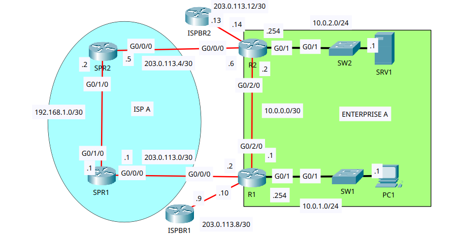
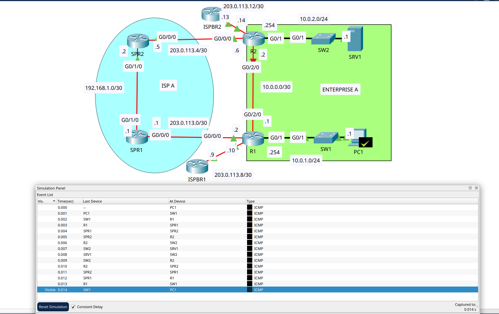

# Floating Static Routes

- **Date:** 2026-11-09
- **Topic area:** Administrative distance, floating static routes, route failover
- **Difficulty:** Easy

## Objective
Check which routes the enterprise routers use, configure floating static routes so PC1 can still reach SRV1 if the link between R1 and R2 fails, and test what happens to the routing tables and the pings when that link goes down.

## Topology


Enterprise A has two routers, R1 and R2, joined by a link. R1 serves PC1's LAN and R2 serves SRV1's LAN. Each router also connects to the ISP A network (SPR1 and SPR2) and to its own ISP border router (ISPBR1 for R1, ISPBR2 for R2). All devices start preconfigured, including OSPF, and PC1 and SRV1 already have default gateways.

## Key configuration

**Floating static routes:**
```
R1(config)# ip route 10.0.2.0 255.255.255.0 203.0.113.1 111
R2(config)# ip route 10.0.1.0 255.255.255.0 203.0.113.5 111
```
Each route points to the ISP A router on that side (SPR1 for R1, SPR2 for R2) and has an administrative distance of 111, one above OSPF's 110.

**Link failure:** I shut down R1's G0/2/0 to fail the link between R1 and R2.
```
R1(config)# interface gigabitethernet0/2/0
R1(config-if)# shutdown
%LINK-5-CHANGED: Interface GigabitEthernet0/2/0, changed state to administratively down
%LINEPROTO-5-UPDOWN: Line protocol on Interface GigabitEthernet0/2/0, changed state to down
%OSPF-5-ADJCHG: Process 1, Nbr 203.0.113.14 on GigabitEthernet0/2/0 from FULL to DOWN, Neighbor Down: Interface down or detached
```
The neighbor in the OSPF message is 203.0.113.14, which is R2's address on its border router link, so I read it as R2.

## Verification

### Initial Routing tables:

Enterprise A is using OSPF. Both routers have an `O` route to the other router's LAN, with an administrative distance of 110 and a metric of 2. Each router also has a static default route (`S*`) to its own border router.
```
R1# show ip route
Gateway of last resort is 203.0.113.9 to network 0.0.0.0

     10.0.0.0/8 is variably subnetted, 5 subnets, 3 masks
C       10.0.0.0/30 is directly connected, GigabitEthernet0/2/0
L       10.0.0.1/32 is directly connected, GigabitEthernet0/2/0
C       10.0.1.0/24 is directly connected, GigabitEthernet0/1
L       10.0.1.254/32 is directly connected, GigabitEthernet0/1
O       10.0.2.0/24 [110/2] via 10.0.0.2, 00:07:55, GigabitEthernet0/2/0
     203.0.113.0/24 is variably subnetted, 4 subnets, 2 masks
C       203.0.113.0/30 is directly connected, GigabitEthernet0/0/0
L       203.0.113.2/32 is directly connected, GigabitEthernet0/0/0
C       203.0.113.8/30 is directly connected, GigabitEthernet0/1/0
L       203.0.113.10/32 is directly connected, GigabitEthernet0/1/0
S*   0.0.0.0/0 [1/0] via 203.0.113.9
```
```
R2# show ip route
Gateway of last resort is 203.0.113.13 to network 0.0.0.0

     10.0.0.0/8 is variably subnetted, 5 subnets, 3 masks
C       10.0.0.0/30 is directly connected, GigabitEthernet0/2/0
L       10.0.0.2/32 is directly connected, GigabitEthernet0/2/0
O       10.0.1.0/24 [110/2] via 10.0.0.1, 00:09:00, GigabitEthernet0/2/0
C       10.0.2.0/24 is directly connected, GigabitEthernet0/1
L       10.0.2.254/32 is directly connected, GigabitEthernet0/1
     203.0.113.0/24 is variably subnetted, 4 subnets, 2 masks
C       203.0.113.4/30 is directly connected, GigabitEthernet0/0/0
L       203.0.113.6/32 is directly connected, GigabitEthernet0/0/0
C       203.0.113.12/30 is directly connected, GigabitEthernet0/1/0
L       203.0.113.14/32 is directly connected, GigabitEthernet0/1/0
S*   0.0.0.0/0 [1/0] via 203.0.113.13
```

**The route for PC1 to SRV1:** At R1, it's the OSPF route `10.0.2.0/24 [110/2] via 10.0.0.2`, out G0/2/0. At R2, 10.0.2.0/24 is a connected route out G0/1.

**The route for PC1 to 1.1.1.1:** At R1, it's the static default route `0.0.0.0/0 [1/0] via 203.0.113.9`, through ISPBR1. R2 has its own default route through ISPBR2, `0.0.0.0/0 [1/0] via 203.0.113.13`.

| From | To | Result |
|------|----|--------|
| PC1 | SRV1 (10.0.2.1) | First attempt 3 of 4, rerun 4 of 4, TTL 126 |
| PC1 | 1.1.1.1 | First attempt 3 of 4, rerun 4 of 4, TTL 254 |

PC1 to SRV1, first attempt:
```
C:\> ping 10.0.2.1

Pinging 10.0.2.1 with 32 bytes of data:

Request timed out.
Reply from 10.0.2.1: bytes=32 time<1ms TTL=126
Reply from 10.0.2.1: bytes=32 time<1ms TTL=126
Reply from 10.0.2.1: bytes=32 time<1ms TTL=126

Ping statistics for 10.0.2.1:
    Packets: Sent = 4, Received = 3, Lost = 1 (25% loss),
Approximate round trip times in milli-seconds:
    Minimum = 0ms, Maximum = 0ms, Average = 0ms
```

### Floating static routes:

The floating static routes didn't enter either routing table. Both routers already had an OSPF route to the same destination with an administrative distance of 110, and a router installs the route with the lowest distance. The static routes have a distance of 111, so OSPF wins. The tables remain the same, apart from the age on the OSPF routes. The relevant lines:
```
R1# show ip route
O       10.0.2.0/24 [110/2] via 10.0.0.2, 00:41:40, GigabitEthernet0/2/0
S*   0.0.0.0/0 [1/0] via 203.0.113.9
```
```
R2# show ip route
O       10.0.1.0/24 [110/2] via 10.0.0.1, 00:43:03, GigabitEthernet0/2/0
S*   0.0.0.0/0 [1/0] via 203.0.113.13
```

### Link failure:

After I shut down R1's G0/2/0, OSPF dropped its neighbor and the OSPF routes disappeared. The floating static routes entered both routing tables, each with a distance of 111 and a metric of 0, pointing at the ISP A routers. The connected route for 10.0.0.0/30 also disappeared on both routers, even though I only shut down R1's interface.
```
R1# show ip route
Gateway of last resort is 203.0.113.9 to network 0.0.0.0

     10.0.0.0/8 is variably subnetted, 3 subnets, 2 masks
C       10.0.1.0/24 is directly connected, GigabitEthernet0/1
L       10.0.1.254/32 is directly connected, GigabitEthernet0/1
S       10.0.2.0/24 [111/0] via 203.0.113.1
S*   0.0.0.0/0 [1/0] via 203.0.113.9
```
```
R2# show ip route
Gateway of last resort is 203.0.113.13 to network 0.0.0.0

     10.0.0.0/8 is variably subnetted, 3 subnets, 2 masks
S       10.0.1.0/24 [111/0] via 203.0.113.5
C       10.0.2.0/24 is directly connected, GigabitEthernet0/1
L       10.0.2.254/32 is directly connected, GigabitEthernet0/1
S*   0.0.0.0/0 [1/0] via 203.0.113.13
```
PC1 could still reach SRV1. The first attempt got 1 of 4 replies, and the rerun got 4 of 4. The replies came back with TTL 124, down from 126 before the failure.
```
C:\> ping 10.0.2.1

Pinging 10.0.2.1 with 32 bytes of data:

Request timed out.
Request timed out.
Request timed out.
Reply from 10.0.2.1: bytes=32 time<1ms TTL=124

Ping statistics for 10.0.2.1:
    Packets: Sent = 4, Received = 1, Lost = 3 (75% loss),
Approximate round trip times in milli-seconds:
    Minimum = 0ms, Maximum = 0ms, Average = 0ms
```
```
C:\> ping 10.0.2.1

Pinging 10.0.2.1 with 32 bytes of data:

Reply from 10.0.2.1: bytes=32 time<1ms TTL=124
Reply from 10.0.2.1: bytes=32 time<1ms TTL=124
Reply from 10.0.2.1: bytes=32 time<1ms TTL=124
Reply from 10.0.2.1: bytes=32 time<1ms TTL=124

Ping statistics for 10.0.2.1:
    Packets: Sent = 4, Received = 4, Lost = 0 (0% loss),
Approximate round trip times in milli-seconds:
    Minimum = 0ms, Maximum = 0ms, Average = 0ms
```

Simulation mode during PC1's second ping, with one request and its reply. The event list shows the path going PC1, SW1, R1, SPR1, SPR2, R2, SW2, SRV1, and the reply taking the same path back.



I left the interface shut down and didn't test re-enabling it.

## Things to note
- A floating static route is a static route with an administrative distance higher than the dynamic route it backs up. A static route's default distance is 1, OSPF's is 110, and I set 111.
- When two routes to the same destination come from different sources, the router installs the one with the lowest administrative distance. The floating routes stayed out of the table while the OSPF routes existed, and they entered once the OSPF routes were gone.
- Each floating route points at the ISP A router on its side, so traffic between the LANs crosses ISP A when the R1 to R2 link is down: PC1, SW1, R1, SPR1, SPR2, R2, SW2, SRV1.
- The TTL went from 126 to 124, which fits the two extra routers in the path (SPR1 and SPR2).
- The connected route for 10.0.0.0/30 disappeared on R2 as well, since the link is down at both ends once one end is shut down.
- The first ping lost one packet before the failure and three after it. The path is longer now, so more devices have to resolve addresses. My theory is still ARP, but I haven't confirmed it.
- Both routers keep a static default route to their own border router, and I didn't change either.
