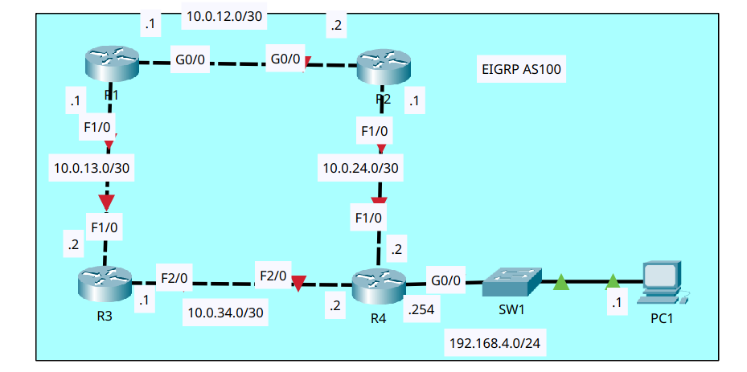

# EIGRP Configuration

- **Date:** 2026-11-10
- **Topic area:** EIGRP, passive interfaces, loopback interfaces, unequal-cost load balancing
- **Difficulty:** Easy

## Objective
Configure hostnames, addresses, and loopback interfaces on four routers, run EIGRP (AS 100) on all of them with auto-summary disabled and passive interfaces where they belong, and configure R1 to load-balance unequal-cost traffic to 192.168.4.0/24.

## Topology


Four routers in a ring, with a LAN behind R4. R1 connects to R2 and R3, R2 and R3 each connect to R4, and PC1 sits behind R4 through SW1. R1 therefore has two paths to the LAN, one through R2 and one through R3. All devices started with no configuration, and PC1 and SW1 weren't configured or used in this lab. The red markers on the router links in the diagram are the starting state.


## Key configuration

**Hostnames and addresses:**
```
Router(config)# hostname R1
R1(config)# interface gigabitethernet0/0
R1(config-if)# ip address 10.0.12.1 255.255.255.252
R1(config-if)# no shutdown
R1(config)# interface fastethernet1/0
R1(config-if)# ip address 10.0.13.1 255.255.255.252
R1(config-if)# no shutdown

Router(config)# hostname R2
R2(config)# interface gigabitethernet0/0
R2(config-if)# ip address 10.0.12.2 255.255.255.252
R2(config-if)# no shutdown
R2(config)# interface fastethernet1/0
R2(config-if)# ip address 10.0.24.1 255.255.255.252
R2(config-if)# no shutdown

Router(config)# hostname R3
R3(config)# interface fastethernet1/0
R3(config-if)# ip address 10.0.13.2 255.255.255.252
R3(config-if)# no shutdown
R3(config)# interface fastethernet2/0
R3(config-if)# ip address 10.0.34.1 255.255.255.252
R3(config-if)# no shutdown

Router(config)# hostname R4
R4(config)# interface fastethernet1/0
R4(config-if)# ip address 10.0.24.2 255.255.255.252
R4(config-if)# no shutdown
R4(config)# interface fastethernet2/0
R4(config-if)# ip address 10.0.34.2 255.255.255.252
R4(config-if)# no shutdown
R4(config)# interface gigabitethernet0/0
R4(config-if)# ip address 192.168.4.254 255.255.255.0
R4(config-if)# no shutdown
```

**Loopback addresses:** The same on every router, with 2.2.2.2, 3.3.3.3 and 4.4.4.4 on R2, R3 and R4.
```
R1(config)# interface loopback0
R1(config-if)# ip address 1.1.1.1 255.255.255.255
```
Each loopback printed link and line protocol messages when I created it.


**EIGRP:**

I used wildcard masks on the link networks and `0.0.0.0` on the loopbacks, and made the loopbacks passive on all four routers. R4's G0/0 is passive too.
```
R1(config)# router eigrp 100
R1(config-router)# no auto-summary
R1(config-router)# network 10.0.12.0 0.0.0.3
R1(config-router)# network 10.0.13.0 0.0.0.3
R1(config-router)# network 1.1.1.1 0.0.0.0
R1(config-router)# passive-interface loopback0

R2(config)# router eigrp 100
R2(config-router)# no auto-summary
R2(config-router)# network 10.0.12.0 0.0.0.3
R2(config-router)# network 10.0.24.0 0.0.0.3
R2(config-router)# network 2.2.2.2 0.0.0.0
R2(config-router)# passive-interface loopback0

R3(config)# router eigrp 100
R3(config-router)# no auto-summary
R3(config-router)# network 10.0.13.0 0.0.0.3
R3(config-router)# network 10.0.34.0 0.0.0.3
R3(config-router)# network 3.3.3.3 0.0.0.0
R3(config-router)# passive-interface loopback0

R4(config)# router eigrp 100
R4(config-router)# no auto-summary
R4(config-router)# network 10.0.24.0 0.0.0.3
R4(config-router)# network 10.0.34.0 0.0.0.3
R4(config-router)# network 192.168.4.0 0.0.0.255
R4(config-router)# network 4.4.4.4 0.0.0.0
R4(config-router)# passive-interface gigabitethernet0/0
R4(config-router)# passive-interface loopback0
```
Each router after R1 printed a `%DUAL-5-NBRCHANGE` message as its neighbors came up: R2 with R1, R3 with R1, and R4 with R2 and R3. R1 printed none while I configured it, since it was the first router with EIGRP running.


**Unequal-cost load balancing on R1:**
```
R1(config)# router eigrp 100
R1(config-router)# variance 2
%DUAL-5-NBRCHANGE: IP-EIGRP 100: Neighbor 10.0.13.2 (FastEthernet1/0) is up: new adjacency
%DUAL-5-NBRCHANGE: IP-EIGRP 100: Neighbor 10.0.12.2 (GigabitEthernet0/0) is up: new adjacency
```

## Verification

### Addresses and interfaces:

Each router's links came up only after the router at the other end was enabled. R1, which I configured first, showed the line protocol down on both links, and R4, which I configured last, had everything up.
```
R1# show ip interface brief
GigabitEthernet0/0     10.0.12.1       YES manual up                    down
FastEthernet1/0        10.0.13.1       YES manual up                    down
```
```
R4# show ip interface brief
GigabitEthernet0/0     192.168.4.254   YES manual up                    up
FastEthernet1/0        10.0.24.2       YES manual up                    up
FastEthernet2/0        10.0.34.2       YES manual up                    up
```
R2's F1/0 and R3's F2/0 showed the line protocol down in the same way until R4 was configured.


### Loopback interfaces:

After the loopbacks were added, every router showed its loopback up, along with its links.
```
R1# show ip interface brief
GigabitEthernet0/0     10.0.12.1       YES manual up                    up
FastEthernet1/0        10.0.13.1       YES manual up                    up
Loopback0              1.1.1.1         YES manual up                    up
```
```
R2# show ip interface brief
GigabitEthernet0/0     10.0.12.2       YES manual up                    up
FastEthernet1/0        10.0.24.1       YES manual up                    up
Loopback0              2.2.2.2         YES manual up                    up
```
```
R3# show ip interface brief
FastEthernet1/0        10.0.13.2       YES manual up                    up
FastEthernet2/0        10.0.34.1       YES manual up                    up
Loopback0              3.3.3.3         YES manual up                    up
```
```
R4# show ip interface brief
GigabitEthernet0/0     192.168.4.254   YES manual up                    up
FastEthernet1/0        10.0.24.2       YES manual up                    up
FastEthernet2/0        10.0.34.2       YES manual up                    up
Loopback0              4.4.4.4         YES manual up                    up
```

### EIGRP:

Before EIGRP, each router only had its own connected networks. R1 and R4 as examples, and R2 and R3 had only their loopback and their two links.
```
R1# show ip route
Gateway of last resort is not set

     1.0.0.0/32 is subnetted, 1 subnets
C       1.1.1.1 is directly connected, Loopback0
     10.0.0.0/30 is subnetted, 2 subnets
C       10.0.12.0 is directly connected, GigabitEthernet0/0
C       10.0.13.0 is directly connected, FastEthernet1/0
```
```
R4# show ip route
Gateway of last resort is not set

     4.0.0.0/32 is subnetted, 1 subnets
C       4.4.4.4 is directly connected, Loopback0
     10.0.0.0/30 is subnetted, 2 subnets
C       10.0.24.0 is directly connected, FastEthernet1/0
C       10.0.34.0 is directly connected, FastEthernet2/0
C    192.168.4.0/24 is directly connected, GigabitEthernet0/0
```

The EIGRP settings on R1 and R4, cropped to the networks, the passive interfaces, and the neighbors. Auto-summary is off on both.
```
R1# show ip protocols
Routing Protocol is "eigrp  100 "
  EIGRP metric weight K1=1, K2=0, K3=1, K4=0, K5=0
  EIGRP maximum metric variance 1
  Automatic network summarization is not in effect
  Routing for Networks:
     10.0.12.0/30
     10.0.13.0/30
     1.1.1.1/32
  Passive Interface(s):
    Loopback0
```
```
R4# show ip protocols
Routing Protocol is "eigrp  100 "
  EIGRP maximum metric variance 1
  Automatic network summarization is not in effect
  Routing for Networks:
     10.0.24.0/30
     10.0.34.0/30
     192.168.4.0
     4.4.4.4/32
  Passive Interface(s):
    GigabitEthernet0/0
    Loopback0
  Routing Information Sources:
    Gateway         Distance      Last Update
    10.0.24.1       90            13772331
    10.0.34.1       90            13787422
```
R2 and R3 matched this pattern, with their own networks, a passive loopback and their own neighbors.

After EIGRP configs, every router has a `D` route to every other router's loopback, to each link it isn't on, and to the LAN.
```
R1# show ip route
Gateway of last resort is not set

     1.0.0.0/32 is subnetted, 1 subnets
C       1.1.1.1 is directly connected, Loopback0
     2.0.0.0/32 is subnetted, 1 subnets
D       2.2.2.2 [90/130816] via 10.0.12.2, 00:14:39, GigabitEthernet0/0
     3.0.0.0/32 is subnetted, 1 subnets
D       3.3.3.3 [90/156160] via 10.0.13.2, 00:11:51, FastEthernet1/0
     4.0.0.0/32 is subnetted, 1 subnets
D       4.4.4.4 [90/156416] via 10.0.12.2, 00:06:16, GigabitEthernet0/0
     10.0.0.0/30 is subnetted, 4 subnets
C       10.0.12.0 is directly connected, GigabitEthernet0/0
C       10.0.13.0 is directly connected, FastEthernet1/0
D       10.0.24.0 [90/28416] via 10.0.12.2, 00:14:55, GigabitEthernet0/0
D       10.0.34.0 [90/30720] via 10.0.13.2, 00:12:08, FastEthernet1/0
D    192.168.4.0/24 [90/28672] via 10.0.12.2, 00:06:37, GigabitEthernet0/0
```
```
R2# show ip route
Gateway of last resort is not set

     1.0.0.0/32 is subnetted, 1 subnets
D       1.1.1.1 [90/130816] via 10.0.12.1, 00:15:48, GigabitEthernet0/0
     2.0.0.0/32 is subnetted, 1 subnets
C       2.2.2.2 is directly connected, Loopback0
     3.0.0.0/32 is subnetted, 1 subnets
D       3.3.3.3 [90/156416] via 10.0.12.1, 00:12:21, GigabitEthernet0/0
     4.0.0.0/32 is subnetted, 1 subnets
D       4.4.4.4 [90/156160] via 10.0.24.2, 00:06:46, FastEthernet1/0
     10.0.0.0/30 is subnetted, 4 subnets
C       10.0.12.0 is directly connected, GigabitEthernet0/0
D       10.0.13.0 [90/28416] via 10.0.12.1, 00:15:48, GigabitEthernet0/0
C       10.0.24.0 is directly connected, FastEthernet1/0
D       10.0.34.0 [90/30720] via 10.0.24.2, 00:08:35, FastEthernet1/0
D    192.168.4.0/24 [90/28416] via 10.0.24.2, 00:07:07, FastEthernet1/0
```
```
R3# show ip route
Gateway of last resort is not set

     1.0.0.0/32 is subnetted, 1 subnets
D       1.1.1.1 [90/156160] via 10.0.13.1, 00:13:35, FastEthernet1/0
     2.0.0.0/32 is subnetted, 1 subnets
D       2.2.2.2 [90/156416] via 10.0.13.1, 00:13:35, FastEthernet1/0
     3.0.0.0/32 is subnetted, 1 subnets
C       3.3.3.3 is directly connected, Loopback0
     4.0.0.0/32 is subnetted, 1 subnets
D       4.4.4.4 [90/156160] via 10.0.34.2, 00:07:27, FastEthernet2/0
     10.0.0.0/30 is subnetted, 4 subnets
D       10.0.12.0 [90/28416] via 10.0.13.1, 00:13:35, FastEthernet1/0
C       10.0.13.0 is directly connected, FastEthernet1/0
D       10.0.24.0 [90/30720] via 10.0.34.2, 00:09:15, FastEthernet2/0
C       10.0.34.0 is directly connected, FastEthernet2/0
D    192.168.4.0/24 [90/28416] via 10.0.34.2, 00:07:48, FastEthernet2/0
```
```
R4# show ip route
Gateway of last resort is not set

     1.0.0.0/32 is subnetted, 1 subnets
D       1.1.1.1 [90/156416] via 10.0.24.1, 00:10:13, FastEthernet1/0
     2.0.0.0/32 is subnetted, 1 subnets
D       2.2.2.2 [90/156160] via 10.0.24.1, 00:10:13, FastEthernet1/0
     3.0.0.0/32 is subnetted, 1 subnets
D       3.3.3.3 [90/156160] via 10.0.34.1, 00:09:58, FastEthernet2/0
     4.0.0.0/32 is subnetted, 1 subnets
C       4.4.4.4 is directly connected, Loopback0
     10.0.0.0/30 is subnetted, 4 subnets
D       10.0.12.0 [90/28416] via 10.0.24.1, 00:10:13, FastEthernet1/0
D       10.0.13.0 [90/30720] via 10.0.34.1, 00:09:58, FastEthernet2/0
C       10.0.24.0 is directly connected, FastEthernet1/0
C       10.0.34.0 is directly connected, FastEthernet2/0
C    192.168.4.0/24 is directly connected, GigabitEthernet0/0
```

### Unequal-cost load balancing:

Before the change, R1 knew two paths to 192.168.4.0/24, one through R2 and one through R3, but its routing table used only the one through R2, which has the lower metric. After setting `variance 2`, the topology table reports two successors for the network, and the routing table has both paths.

R1's EIGRP topology table before and after, cropped to 192.168.4.0/24:
```
R1# show ip eigrp topology
P 192.168.4.0/24, 1 successors, FD is 28672
         via 10.0.12.2 (28672/28416), GigabitEthernet0/0
         via 10.0.13.2 (30976/28416), FastEthernet1/0
```
```
R1# show ip eigrp topology
P 192.168.4.0/24, 2 successors, FD is 28672
         via 10.0.12.2 (28672/28416), GigabitEthernet0/0
         via 10.0.13.2 (30976/28416), FastEthernet1/0
```
R1's routing table entry for the same network, before and after:
```
D    192.168.4.0/24 [90/28672] via 10.0.12.2, 00:06:37, GigabitEthernet0/0
```
```
D    192.168.4.0/24 [90/28672] via 10.0.12.2, 00:02:05, GigabitEthernet0/0
                    [90/30976] via 10.0.13.2, 00:02:08, FastEthernet1/0
```
The variance applies to the whole router, so 4.4.4.4 also got a second path in R1's routing table, again through R3:
```
D    4.4.4.4 [90/156416] via 10.0.12.2, 00:02:05, GigabitEthernet0/0
                [90/158720] via 10.0.13.2, 00:02:08, FastEthernet1/0
```

## Things to note
- The `network` command takes a wildcard mask. I used `0.0.0.3` for the /30 links and `0.0.0.0` on the loopbacks, so each statement matches one interface exactly.
- I made the loopbacks passive on all four routers, and R4's G0/0 passive. None of those interfaces have an EIGRP neighbor behind them, and the router links stay non-passive because the neighbors need to form there. EIGRP still advertises the networks on passive interfaces.
- `show ip protocols` shows the passive interfaces and confirms that automatic summarization isn't in effect.
- The routing tables in this lab don't have local (`L`) routes, unlike the earlier routed labs. The routers are a different model here (Router-PT-Empty). It runs an older IOS that doesn't display local routes.
- 192.168.4.0 appears in `show ip protocols` without a prefix length, unlike the other networks. It's because the /24 matches the class C boundary. In EIGRP, Cisco IOS omits the prefix length whenever a network command matches the default classful mask of that IP address.
- R1's two paths to 192.168.4.0/24 have different metrics (28672 through R2 and 30976 through R3), and both report the same distance (28416). The link to R2 is Gigabit, and the link to R3 is FastEthernet. My reading is that the faster link gives the lower metric, since EIGRP's metric uses bandwidth and delay.
- R1's `show ip protocols` showed a maximum metric variance of 1 before I changed it. At 1, only the lowest-metric path is used. I set it to 2 on R1.
- After I entered `variance 2`, R1 printed new-adjacency messages for both neighbors, and the routes showed an age of about two minutes, down from several minutes. My reading is that the adjacencies restarted when I entered the command. I didn't expect that and haven't confirmed it.
