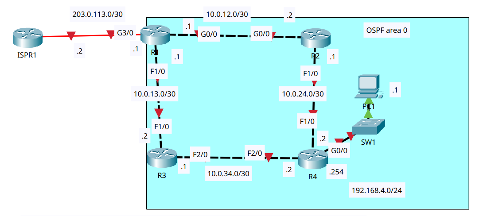

# OSPF (Part 1)

- **Date:** 2026-11-11
- **Topic area:** OSPF, passive interfaces, loopback interfaces, ASBR, default route advertisement
- **Difficulty:** Easy

## Objective
Configure hostnames, addresses, and loopback interfaces on four routers, run OSPF in area 0 on all of them (but not on R1's link to the internet), set passive interfaces where they belong, and configure R1 as an ASBR that advertises a default route into OSPF. Then check which default routes the other routers learned.

## Topology


Four routers in a ring, with a LAN behind R4 and an ISP router, ISPR1, connected to R1. R1 connects to R2 and R3, R2 and R3 each connect to R4, and PC1 sits behind R4 through SW1. The link between ISPR1 and R1 shows a red marker at the start. I didn't configure ISPR1, PC1, or SW1.


## Key configuration

**Hostnames and addresses:**
```
Router(config)# hostname R1
R1(config)# interface gigabitethernet0/0
R1(config-if)# ip address 10.0.12.1 255.255.255.252
R1(config-if)# no shutdown
R1(config)# interface fastethernet1/0
R1(config-if)# ip address 10.0.13.1 255.255.255.252
R1(config-if)# no shutdown
R1(config)# interface gigabitethernet3/0
R1(config-if)# ip address 203.0.113.1 255.255.255.252
R1(config-if)# no shutdown

Router(config)# hostname R2
R2(config)# interface gigabitethernet0/0
R2(config-if)# ip address 10.0.12.2 255.255.255.252
R2(config-if)# no shutdown
R2(config)# interface fastethernet1/0
R2(config-if)# ip address 10.0.24.1 255.255.255.252
R2(config-if)# no shutdown

Router(config)# hostname R3
R3(config)# interface fastethernet1/0
R3(config-if)# ip address 10.0.13.2 255.255.255.252
R3(config-if)# no shutdown
R3(config)# interface fastethernet2/0
R3(config-if)# ip address 10.0.34.1 255.255.255.252
R3(config-if)# no shutdown

Router(config)# hostname R4
R4(config)# interface fastethernet1/0
R4(config-if)# ip address 10.0.24.2 255.255.255.252
R4(config-if)# no shutdown
R4(config)# interface fastethernet2/0
R4(config-if)# ip address 10.0.34.2 255.255.255.252
R4(config-if)# no shutdown
R4(config)# interface gigabitethernet0/0
R4(config-if)# ip address 192.168.4.254 255.255.255.0
R4(config-if)# no shutdown
```

**Loopback addresses:** The same on every router, with 2.2.2.2, 3.3.3.3 and 4.4.4.4 on R2, R3 and R4 respectively.
```
R1(config)# interface loopback0
R1(config-if)# ip address 1.1.1.1 255.255.255.255
```


**OSPF configs:** 

I used wildcard masks on the link networks and `0.0.0.0` on the loopbacks, all in area 0, and made the loopbacks passive on all four routers. R4's G0/0 is passive too. I didn't enable OSPF on R1's G3/0, as the instructions say.
```
R1(config)# router ospf 1
R1(config-router)# network 10.0.12.0 0.0.0.3 area 0
R1(config-router)# network 10.0.13.0 0.0.0.3 area 0
R1(config-router)# network 1.1.1.1 0.0.0.0 area 0
R1(config-router)# passive-interface loopback0

R2(config)# router ospf 1
R2(config-router)# network 10.0.12.0 0.0.0.3 area 0
R2(config-router)# network 10.0.24.0 0.0.0.3 area 0
R2(config-router)# network 2.2.2.2 0.0.0.0 area 0
R2(config-router)# passive-interface loopback0

R3(config)# router ospf 1
R3(config-router)# network 10.0.13.0 0.0.0.3 area 0
R3(config-router)# network 10.0.34.0 0.0.0.3 area 0
R3(config-router)# network 3.3.3.3 0.0.0.0 area 0
R3(config-router)# passive-interface loopback0

R4(config)# router ospf 1
R4(config-router)# network 10.0.24.0 0.0.0.3 area 0
R4(config-router)# network 10.0.34.0 0.0.0.3 area 0
R4(config-router)# network 192.168.4.0 0.0.0.255 area 0
R4(config-router)# network 4.4.4.4 0.0.0.0 area 0
R4(config-router)# passive-interface gigabitethernet0/0
R4(config-router)# passive-interface loopback0
```
Each router printed an `%OSPF-5-ADJCHG` message as its neighbors reached the FULL state: R2 with R1, R3 with R1, and R4 with R2 and R3. I didn't set router IDs, since every router already had a loopback.


**R1 as an Autonomous-System Border Router:** I gave R1 a static default route to ISPR1 first.
```
R1(config)# ip route 0.0.0.0 0.0.0.0 203.0.113.2
R1(config)# router ospf 1
R1(config-router)# default-information originate
```

## Verification

### Addresses and interfaces:

G3/0 on R1 came up as soon as I enabled it. The links between the routers only came up once the router at the other end was enabled, so R1, which I configured first, showed the line protocol down on both router links, and R4, which I configured last, had everything up. R2's F1/0 and R3's F2/0 were down for the same reason until R4 was configured.
```
R1# show ip interface brief
GigabitEthernet0/0     10.0.12.1       YES manual up                    down
FastEthernet1/0        10.0.13.1       YES manual up                    down
GigabitEthernet3/0     203.0.113.1     YES manual up                    up
```
```
R4# show ip interface brief
GigabitEthernet0/0     192.168.4.254   YES manual up                    up
FastEthernet1/0        10.0.24.2       YES manual up                    up
FastEthernet2/0        10.0.34.2       YES manual up                    up
```

### Loopback interfaces:

After the loopbacks were added, every router showed its loopback up, along with its links.
```
R1# show ip interface brief
GigabitEthernet0/0     10.0.12.1       YES manual up                    up
FastEthernet1/0        10.0.13.1       YES manual up                    up
GigabitEthernet3/0     203.0.113.1     YES manual up                    up
Loopback0              1.1.1.1         YES manual up                    up
```
```
R2# show ip interface brief
GigabitEthernet0/0     10.0.12.2       YES manual up                    up
FastEthernet1/0        10.0.24.1       YES manual up                    up
Loopback0              2.2.2.2         YES manual up                    up
```
```
R3# show ip interface brief
FastEthernet1/0        10.0.13.2       YES manual up                    up
FastEthernet2/0        10.0.34.1       YES manual up                    up
Loopback0              3.3.3.3         YES manual up                    up
```
```
R4# show ip interface brief
GigabitEthernet0/0     192.168.4.254   YES manual up                    up
FastEthernet1/0        10.0.24.2       YES manual up                    up
FastEthernet2/0        10.0.34.2       YES manual up                    up
Loopback0              4.4.4.4         YES manual up                    up
```

### OSPF:

Before OSPF configuration, each router only had its own connected networks. R1 and R4 as examples, and R2 and R3 had only their loopback and their two links.
```
R1# show ip route
Gateway of last resort is not set

     1.0.0.0/32 is subnetted, 1 subnets
C       1.1.1.1 is directly connected, Loopback0
     10.0.0.0/30 is subnetted, 2 subnets
C       10.0.12.0 is directly connected, GigabitEthernet0/0
C       10.0.13.0 is directly connected, FastEthernet1/0
     203.0.113.0/30 is subnetted, 1 subnets
C       203.0.113.0 is directly connected, GigabitEthernet3/0
```
```
R4# show ip route
Gateway of last resort is not set

     4.0.0.0/32 is subnetted, 1 subnets
C       4.4.4.4 is directly connected, Loopback0
     10.0.0.0/30 is subnetted, 2 subnets
C       10.0.24.0 is directly connected, FastEthernet1/0
C       10.0.34.0 is directly connected, FastEthernet2/0
C    192.168.4.0/24 is directly connected, GigabitEthernet0/0
```

The OSPF settings on R1 and R4. Every router took its loopback address as its router ID, and every router is in one area. R1's `show ip protocols` is cropped to the router ID, the networks, and the passive interface. R4's output also shows the other three routers as routing information sources.
```
R1# show ip protocols
Routing Protocol is "ospf 1"
  Router ID 1.1.1.1
  Number of areas in this router is 1. 1 normal 0 stub 0 nssa
  Routing for Networks:
    10.0.12.0 0.0.0.3 area 0
    10.0.13.0 0.0.0.3 area 0
    1.1.1.1 0.0.0.0 area 0
  Passive Interface(s):
    Loopback0
```
```
R4# show ip protocols
Routing Protocol is "ospf 1"
  Router ID 4.4.4.4
  Number of areas in this router is 1. 1 normal 0 stub 0 nssa
  Routing for Networks:
    10.0.24.0 0.0.0.3 area 0
    10.0.34.0 0.0.0.3 area 0
    4.4.4.4 0.0.0.0 area 0
    192.168.4.0 0.0.0.255 area 0
  Passive Interface(s):
    GigabitEthernet0/0
    Loopback0
  Routing Information Sources:
    Gateway         Distance      Last Update
    1.1.1.1              110      00:10:06
    2.2.2.2              110      00:02:37
    3.3.3.3              110      00:02:20
    4.4.4.4              110      00:01:14
  Distance: (default is 110)
```

After OSPF configuration, every router has an `O` route to every other router's loopback, to each link it isn't on, and to the LAN behind R4. There's no route to 203.0.113.0/30 on R2, R3, or R4, because that link isn't in OSPF.
```
R1# show ip route
Gateway of last resort is not set

     1.0.0.0/32 is subnetted, 1 subnets
C       1.1.1.1 is directly connected, Loopback0
     2.0.0.0/32 is subnetted, 1 subnets
O       2.2.2.2 [110/2] via 10.0.12.2, 00:11:30, GigabitEthernet0/0
     3.0.0.0/32 is subnetted, 1 subnets
O       3.3.3.3 [110/2] via 10.0.13.2, 00:10:20, FastEthernet1/0
     4.0.0.0/32 is subnetted, 1 subnets
O       4.4.4.4 [110/3] via 10.0.12.2, 00:04:55, GigabitEthernet0/0
                [110/3] via 10.0.13.2, 00:04:55, FastEthernet1/0
     10.0.0.0/30 is subnetted, 4 subnets
C       10.0.12.0 is directly connected, GigabitEthernet0/0
C       10.0.13.0 is directly connected, FastEthernet1/0
O       10.0.24.0 [110/2] via 10.0.12.2, 00:05:40, GigabitEthernet0/0
O       10.0.34.0 [110/2] via 10.0.13.2, 00:05:20, FastEthernet1/0
O    192.168.4.0/24 [110/3] via 10.0.12.2, 00:04:17, GigabitEthernet0/0
                    [110/3] via 10.0.13.2, 00:04:17, FastEthernet1/0
     203.0.113.0/30 is subnetted, 1 subnets
C       203.0.113.0 is directly connected, GigabitEthernet3/0
```
```
R2# show ip route
Gateway of last resort is not set

     1.0.0.0/32 is subnetted, 1 subnets
O       1.1.1.1 [110/2] via 10.0.12.1, 00:13:40, GigabitEthernet0/0
     2.0.0.0/32 is subnetted, 1 subnets
C       2.2.2.2 is directly connected, Loopback0
     3.0.0.0/32 is subnetted, 1 subnets
O       3.3.3.3 [110/3] via 10.0.12.1, 00:05:49, GigabitEthernet0/0
                [110/3] via 10.0.24.2, 00:05:49, FastEthernet1/0
     4.0.0.0/32 is subnetted, 1 subnets
O       4.4.4.4 [110/2] via 10.0.24.2, 00:05:24, FastEthernet1/0
     10.0.0.0/30 is subnetted, 4 subnets
C       10.0.12.0 is directly connected, GigabitEthernet0/0
O       10.0.13.0 [110/2] via 10.0.12.1, 00:16:14, GigabitEthernet0/0
C       10.0.24.0 is directly connected, FastEthernet1/0
O       10.0.34.0 [110/2] via 10.0.24.2, 00:05:49, FastEthernet1/0
O    192.168.4.0/24 [110/2] via 10.0.24.2, 00:04:46, FastEthernet1/0
```
```
R3# show ip route
Gateway of last resort is not set

     1.0.0.0/32 is subnetted, 1 subnets
O       1.1.1.1 [110/2] via 10.0.13.1, 00:14:03, FastEthernet1/0
     2.0.0.0/32 is subnetted, 1 subnets
O       2.2.2.2 [110/3] via 10.0.13.1, 00:06:12, FastEthernet1/0
                [110/3] via 10.0.34.2, 00:06:12, FastEthernet2/0
     3.0.0.0/32 is subnetted, 1 subnets
C       3.3.3.3 is directly connected, Loopback0
     4.0.0.0/32 is subnetted, 1 subnets
O       4.4.4.4 [110/2] via 10.0.34.2, 00:05:47, FastEthernet2/0
     10.0.0.0/30 is subnetted, 4 subnets
O       10.0.12.0 [110/2] via 10.0.13.1, 00:16:37, FastEthernet1/0
C       10.0.13.0 is directly connected, FastEthernet1/0
O       10.0.24.0 [110/2] via 10.0.34.2, 00:06:12, FastEthernet2/0
C       10.0.34.0 is directly connected, FastEthernet2/0
O    192.168.4.0/24 [110/2] via 10.0.34.2, 00:05:09, FastEthernet2/0
```
```
R4# show ip route
Gateway of last resort is not set

     1.0.0.0/32 is subnetted, 1 subnets
O       1.1.1.1 [110/3] via 10.0.24.1, 00:06:38, FastEthernet1/0
                [110/3] via 10.0.34.1, 00:06:38, FastEthernet2/0
     2.0.0.0/32 is subnetted, 1 subnets
O       2.2.2.2 [110/2] via 10.0.24.1, 00:06:58, FastEthernet1/0
     3.0.0.0/32 is subnetted, 1 subnets
O       3.3.3.3 [110/2] via 10.0.34.1, 00:06:38, FastEthernet2/0
     4.0.0.0/32 is subnetted, 1 subnets
C       4.4.4.4 is directly connected, Loopback0
     10.0.0.0/30 is subnetted, 4 subnets
O       10.0.12.0 [110/2] via 10.0.24.1, 00:06:58, FastEthernet1/0
O       10.0.13.0 [110/2] via 10.0.34.1, 00:06:38, FastEthernet2/0
C       10.0.24.0 is directly connected, FastEthernet1/0
C       10.0.34.0 is directly connected, FastEthernet2/0
C    192.168.4.0/24 is directly connected, GigabitEthernet0/0
```


### The ASBR:

R1 had no default route at this point, so I gave it a static one to ISPR1 and then told OSPF to advertise it. After the change, `show ip protocols` on R1 says it's an autonomous system boundary router, which it didn't before, and its routing table has a gateway of last resort.
```
R1# show ip protocols
Routing Protocol is "ospf 1"
  Router ID 1.1.1.1
  It is an autonomous system boundary router
  Redistributing External Routes from,
  Number of areas in this router is 1. 1 normal 0 stub 0 nssa
```
```
R1# show ip route
Gateway of last resort is 203.0.113.2 to network 0.0.0.0

     203.0.113.0/30 is subnetted, 1 subnets
C       203.0.113.0 is directly connected, GigabitEthernet3/0
S*   0.0.0.0/0 [1/0] via 203.0.113.2
```
The rest of R1's table is the same as before, apart from the ages of the routes.


### Default routes on R2, R3 and R4:

All three routers previously had no gateway of last resort. I predicted that the default route would be added to the other routers' routing tables.

After configuring the ASBR, all three routers learned a default route from R1. It's an OSPF external type 2 route (`O*E2`) with a metric of 1 on every router. R2 and R3 each have one path, straight to R1, and R4 has two, one through R2 and one through R3.

| Router | Before | After |
|--------|--------|-------|
| R1 | Gateway of last resort not set | `S* 0.0.0.0/0 [1/0] via 203.0.113.2` |
| R2 | Gateway of last resort not set | `O*E2 0.0.0.0/0 [110/1] via 10.0.12.1, GigabitEthernet0/0` |
| R3 | Gateway of last resort not set | `O*E2 0.0.0.0/0 [110/1] via 10.0.13.1, FastEthernet1/0` |
| R4 | Gateway of last resort not set | `O*E2 0.0.0.0/0 [110/1]` via 10.0.24.1 and via 10.0.34.1 |

```
R2# show ip route
Gateway of last resort is 10.0.12.1 to network 0.0.0.0

O*E2 0.0.0.0/0 [110/1] via 10.0.12.1, 00:04:10, GigabitEthernet0/0
```
```
R3# show ip route
Gateway of last resort is 10.0.13.1 to network 0.0.0.0

O*E2 0.0.0.0/0 [110/1] via 10.0.13.1, 00:06:24, FastEthernet1/0
```
```
R4# show ip route
Gateway of last resort is 10.0.24.1 to network 0.0.0.0

O*E2 0.0.0.0/0 [110/1] via 10.0.24.1, 00:07:05, FastEthernet1/0
               [110/1] via 10.0.34.1, 00:07:05, FastEthernet2/0
```
The rest of each table is the same as before, apart from the ages of the routes. The OSPF settings in `show ip protocols` on R2, R3, and R4 didn't change.

## Things to note
- The `network` command takes a wildcard mask. I used `0.0.0.3` for the /30 links, `0.0.0.255` for the LAN and `0.0.0.0` on the loopbacks, so each statement matches one interface exactly. All of them are in area 0.
- Each router chose its loopback address as its router ID (1.1.1.1 to 4.4.4.4), since I didn't set one manually.
- I made the loopbacks passive on all four routers, and R4's G0/0 is passive. None of those interfaces have an OSPF neighbor behind them, and the router links stay non-passive because the neighbors need to form there. OSPF still advertises the networks on passive interfaces.
- As in the EIGRP lab, the routing tables have no local (`L`) routes, since these are the same router model.
- Several destinations have two paths with the same cost, shown as two lines under one route: R1 to 4.4.4.4 and to 192.168.4.0/24, R2 to 3.3.3.3, R3 to 2.2.2.2, and R4 to 1.1.1.1. OSPF installs equal-cost paths together.
- The static default route on R1 shows as `S*`, with an administrative distance of 1. The copies on R2, R3, and R4 show as `O*E2`, with a distance of 110.
- The link between R1 and ISPR1 isn't in OSPF, so R2, R3 and R4 have no route to 203.0.113.0/30. The default route is how they reach anything outside the OSPF domain.
