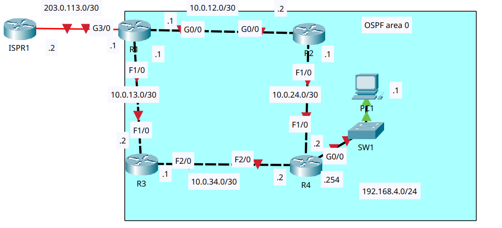
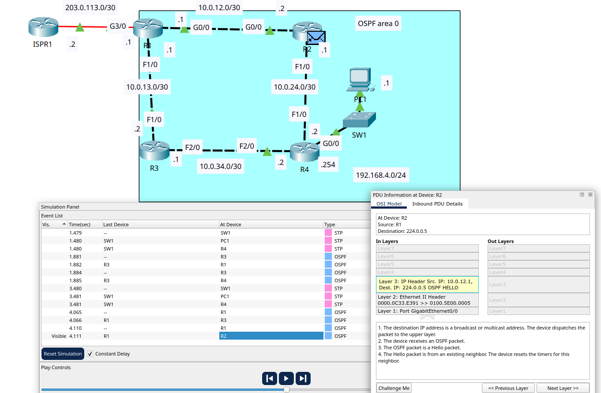
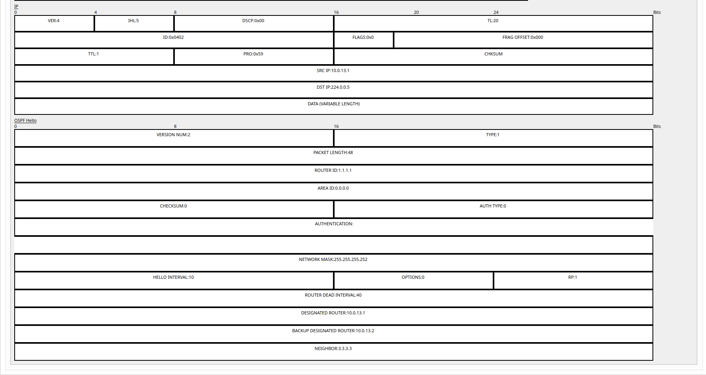

# OSPF (Part 2)

- **Date:** 2026-11-12
- **Topic area:** OSPF, interface-level OSPF config, passive interfaces, reference bandwidth, ASBR, Hello messages
- **Difficulty:** Medium

## Objective
Configure OSPF directly on the interfaces of four routers, set passive interfaces, change the reference bandwidth so a FastEthernet interface has a cost of 100, configure R1 as an ASBR that advertises a default route, check R4's default route, and look at an OSPF Hello message in simulation mode.

## Topology


The same topology and addressing as [OSPF (Part 1)](../21-ospf-part-1/notes.md). Four routers in a ring, with a LAN behind R4 and an ISP router, ISPR1, connected to R1. The link between ISPR1 and R1 shows a red marker at the start. I didn't configure ISPR1, PC1, or SW1.


## Key configuration

**Hostnames and addresses:**
```
Router(config)# hostname R1
R1(config)# interface gigabitethernet3/0
R1(config-if)# ip address 203.0.113.1 255.255.255.252
R1(config-if)# no shutdown
R1(config)# interface gigabitethernet0/0
R1(config-if)# ip address 10.0.12.1 255.255.255.252
R1(config-if)# no shutdown
R1(config)# interface fastethernet1/0
R1(config-if)# ip address 10.0.13.1 255.255.255.252
R1(config-if)# no shutdown

Router(config)# hostname R2
R2(config)# interface gigabitethernet0/0
R2(config-if)# ip address 10.0.12.2 255.255.255.252
R2(config-if)# no shutdown
R2(config)# interface fastethernet1/0
R2(config-if)# ip address 10.0.24.1 255.255.255.252
R2(config-if)# no shutdown

Router(config)# hostname R3
R3(config)# interface fastethernet1/0
R3(config-if)# ip address 10.0.13.2 255.255.255.252
R3(config-if)# no shutdown
R3(config)# interface fastethernet2/0
R3(config-if)# ip address 10.0.34.1 255.255.255.252
R3(config-if)# no shutdown

Router(config)# hostname R4
R4(config)# interface gigabitethernet0/0
R4(config-if)# ip address 192.168.4.254 255.255.255.0
R4(config-if)# no shutdown
R4(config)# interface fastethernet1/0
R4(config-if)# ip address 10.0.24.2 255.255.255.252
R4(config-if)# no shutdown
R4(config)# interface fastethernet2/0
R4(config-if)# ip address 10.0.34.2 255.255.255.252
R4(config-if)# no shutdown
```

**Loopback interfces:** The same on every router, with 2.2.2.2, 3.3.3.3 and 4.4.4.4 on R2, R3 and R4.
```
R1(config)# interface loopback0
R1(config-if)# ip address 1.1.1.1 255.255.255.255
```

**Direct OSPF config on the interfaces, and passive interface config:** 

I enabled OSPF in area 0 on each interface, made every interface passive by default, and then removed that on the interfaces that have OSPF neighbors. I didn't enable OSPF on R1's G3/0, the link to the internet.
```
R1(config)# interface range gigabitethernet0/0 , fastethernet1/0 , loopback0
R1(config-if-range)# ip ospf 1 area 0
R1(config-if-range)# exit
R1(config)# router ospf 1
R1(config-router)# passive-interface default
R1(config-router)# no passive-interface gigabitethernet0/0
R1(config-router)# no passive-interface fastethernet1/0

R2(config)# interface range gigabitethernet0/0 , fastethernet1/0 , loopback0
R2(config-if-range)# ip ospf 1 area 0
R2(config-if-range)# exit
R2(config)# router ospf 1
R2(config-router)# passive-interface default
R2(config-router)# no passive-interface gigabitethernet0/0
R2(config-router)# no passive-interface fastethernet1/0

R3(config)# interface range fastethernet1/0 , fastethernet2/0 , loopback0
R3(config-if-range)# ip ospf 1 area 0
R3(config-if-range)# exit
R3(config)# router ospf 1
R3(config-router)# passive-interface default
R3(config-router)# no passive-interface fastethernet1/0
R3(config-router)# no passive-interface fastethernet2/0

R4(config)# interface range fastethernet1/0 , fastethernet2/0 , gigabitethernet0/0 , loopback0
R4(config-if-range)# ip ospf 1 area 0
R4(config-if-range)# exit
R4(config)# router ospf 1
R4(config-router)# passive-interface default
R4(config-router)# no passive-interface fastethernet1/0
R4(config-router)# no passive-interface fastethernet2/0
```

**Reference bandwidth config, on all four routers:**
```
R1(config)# router ospf 1
R1(config-router)# auto-cost reference-bandwidth 10000
% OSPF: Reference bandwidth is changed.
        Please ensure reference bandwidth is consistent across all routers.
```

**R1 as an ASBR:** I gave R1 a static default route to ISPR1 first.
```
R1(config)# ip route 0.0.0.0 0.0.0.0 203.0.113.2
R1(config)# router ospf 1
R1(config-router)# default-information originate
```

## Verification

### Addresses, interfaces and loopbacks:

G3/0 on R1 came up as soon as I enabled it. The links between the routers only came up once the router at the other end was enabled, so R1, which I configured first, showed the line protocol down on both router links, and R4, which I configured last, had everything up. R2's F1/0 and R3's F2/0 were down for the same reason until R4 was configured. After the loopbacks were added, every router showed its loopback up. R1 and R4 as examples, and R2 and R3 matched.
```
R1# show ip interface brief
GigabitEthernet0/0     10.0.12.1       YES manual up                    up
FastEthernet1/0        10.0.13.1       YES manual up                    up
GigabitEthernet3/0     203.0.113.1     YES manual up                    up
Loopback0              1.1.1.1         YES manual up                    up
```
```
R4# show ip interface brief
GigabitEthernet0/0     192.168.4.254   YES manual up                    up
FastEthernet1/0        10.0.24.2       YES manual up                    up
FastEthernet2/0        10.0.34.2       YES manual up                    up
Loopback0              4.4.4.4         YES manual up                    up
```

### OSPF on the interfaces:

Before OSPF config, each router only had its own connected networks. R1 and R4 as examples, and R2 and R3 had only their loopback and their two links.
```
R1# show ip route
Gateway of last resort is not set

     1.0.0.0/32 is subnetted, 1 subnets
C       1.1.1.1 is directly connected, Loopback0
     10.0.0.0/30 is subnetted, 2 subnets
C       10.0.12.0 is directly connected, GigabitEthernet0/0
C       10.0.13.0 is directly connected, FastEthernet1/0
     203.0.113.0/30 is subnetted, 1 subnets
C       203.0.113.0 is directly connected, GigabitEthernet3/0
```
```
R4# show ip route
Gateway of last resort is not set

     4.0.0.0/32 is subnetted, 1 subnets
C       4.4.4.4 is directly connected, Loopback0
     10.0.0.0/30 is subnetted, 2 subnets
C       10.0.24.0 is directly connected, FastEthernet1/0
C       10.0.34.0 is directly connected, FastEthernet2/0
C    192.168.4.0/24 is directly connected, GigabitEthernet0/0
```

Because I enabled OSPF on the interfaces, `show ip protocols` has nothing under "Routing for Networks". I confirmed the interfaces with `show ip ospf interface brief` instead. R1's output was captured right after I configured R1, before the other routers, so it only lists itself as a routing information source.
```
R1# show ip protocols
Routing Protocol is "ospf 1"
  Router ID 1.1.1.1
  Number of areas in this router is 1. 1 normal 0 stub 0 nssa
  Routing for Networks:
  Passive Interface(s):
    FastEthernet2/0
    GigabitEthernet3/0
    Loopback0
  Routing Information Sources:
    Gateway         Distance      Last Update
    1.1.1.1              110      00:09:04
  Distance: (default is 110)
```
```
R4# show ip protocols
Routing Protocol is "ospf 1"
  Router ID 4.4.4.4
  Number of areas in this router is 1. 1 normal 0 stub 0 nssa
  Routing for Networks:
  Passive Interface(s):
    GigabitEthernet0/0
    Loopback0
  Routing Information Sources:
    Gateway         Distance      Last Update
    1.1.1.1              110      00:07:36
    2.2.2.2              110      00:03:22
    3.3.3.3              110      00:01:08
    4.4.4.4              110      00:01:08
  Distance: (default is 110)
```
```
R1# show ip ospf interface brief
Interface     PID   Area                     IP Address/Mask          Cost  State  Nbrs F/C
Gig0/0          1   0                      10.0.12.1/255.255.255.252   1       DR  0/0
Fa1/0           1   0                      10.0.13.1/255.255.255.252   1       DR  0/0
Lo0             1   0                        1.1.1.1/255.255.255.255   1     WAIT  0/0
```
```
R4# show ip ospf interface brief
Interface     PID   Area                     IP Address/Mask          Cost  State  Nbrs F/C
Fa1/0           1   0                      10.0.24.2/255.255.255.252   1      BDR  0/0
Fa2/0           1   0                      10.0.34.2/255.255.255.252   1       DR  0/0
Gig0/0          1   0                    192.168.4.254/255.255.255.0   1     WAIT  0/0
Lo0             1   0                        4.4.4.4/255.255.255.255   1     WAIT  0/0
```

After OSPF config, every router has an `O` route to every other router's loopback, to each link it isn't on, and to the LAN behind R4. At this point, every OSPF interface had a cost of 1. R1 and R4 as examples:
```
R1# show ip route
Gateway of last resort is not set

     1.0.0.0/32 is subnetted, 1 subnets
C       1.1.1.1 is directly connected, Loopback0
     2.0.0.0/32 is subnetted, 1 subnets
O       2.2.2.2 [110/2] via 10.0.12.2, 00:15:17, GigabitEthernet0/0
     3.0.0.0/32 is subnetted, 1 subnets
O       3.3.3.3 [110/2] via 10.0.13.2, 00:09:21, FastEthernet1/0
     4.0.0.0/32 is subnetted, 1 subnets
O       4.4.4.4 [110/3] via 10.0.12.2, 00:02:52, GigabitEthernet0/0
                [110/3] via 10.0.13.2, 00:02:52, FastEthernet1/0
     10.0.0.0/30 is subnetted, 4 subnets
C       10.0.12.0 is directly connected, GigabitEthernet0/0
C       10.0.13.0 is directly connected, FastEthernet1/0
O       10.0.24.0 [110/2] via 10.0.12.2, 00:05:04, GigabitEthernet0/0
O       10.0.34.0 [110/2] via 10.0.13.2, 00:02:52, FastEthernet1/0
O    192.168.4.0/24 [110/3] via 10.0.12.2, 00:02:52, GigabitEthernet0/0
                    [110/3] via 10.0.13.2, 00:02:52, FastEthernet1/0
     203.0.113.0/30 is subnetted, 1 subnets
C       203.0.113.0 is directly connected, GigabitEthernet3/0
```
```
R4# show ip route
Gateway of last resort is not set

     1.0.0.0/32 is subnetted, 1 subnets
O       1.1.1.1 [110/3] via 10.0.24.1, 00:06:18, FastEthernet1/0
                [110/3] via 10.0.34.1, 00:06:18, FastEthernet2/0
     2.0.0.0/32 is subnetted, 1 subnets
O       2.2.2.2 [110/2] via 10.0.24.1, 00:06:38, FastEthernet1/0
     3.0.0.0/32 is subnetted, 1 subnets
O       3.3.3.3 [110/2] via 10.0.34.1, 00:06:18, FastEthernet2/0
     4.0.0.0/32 is subnetted, 1 subnets
C       4.4.4.4 is directly connected, Loopback0
     10.0.0.0/30 is subnetted, 4 subnets
O       10.0.12.0 [110/2] via 10.0.24.1, 00:06:38, FastEthernet1/0
O       10.0.13.0 [110/2] via 10.0.34.1, 00:06:18, FastEthernet2/0
C       10.0.24.0 is directly connected, FastEthernet1/0
C       10.0.34.0 is directly connected, FastEthernet2/0
C    192.168.4.0/24 is directly connected, GigabitEthernet0/0
```

### Reference bandwidth:

Before the change, every OSPF interface had a cost of 1, whether it was FastEthernet or Gigabit. After `auto-cost reference-bandwidth 10000` on all four routers, FastEthernet interfaces cost 100, Gigabit interfaces cost 10, and the loopbacks stayed at 1.
```
R1# show ip ospf interface brief
Interface     PID   Area                     IP Address/Mask          Cost  State  Nbrs F/C
Gig0/0          1   0                      10.0.12.1/255.255.255.252   10      DR  0/0
Fa1/0           1   0                      10.0.13.1/255.255.255.252   100     DR  0/0
Lo0             1   0                        1.1.1.1/255.255.255.255   1     WAIT  0/0
```
```
R2# show ip ospf interface brief
Interface     PID   Area                     IP Address/Mask          Cost  State  Nbrs F/C
Gig0/0          1   0                      10.0.12.2/255.255.255.252   10     BDR  0/0
Fa1/0           1   0                      10.0.24.1/255.255.255.252   100     DR  0/0
Lo0             1   0                        2.2.2.2/255.255.255.255   1     WAIT  0/0
```
```
R3# show ip ospf interface brief
Interface     PID   Area                     IP Address/Mask          Cost  State  Nbrs F/C
Fa1/0           1   0                      10.0.13.2/255.255.255.252   100    BDR  0/0
Fa2/0           1   0                      10.0.34.1/255.255.255.252   100    BDR  0/0
Lo0             1   0                        3.3.3.3/255.255.255.255   1     WAIT  0/0
```
```
R4# show ip ospf interface brief
Interface     PID   Area                     IP Address/Mask          Cost  State  Nbrs F/C
Fa1/0           1   0                      10.0.24.2/255.255.255.252   100    BDR  0/0
Fa2/0           1   0                      10.0.34.2/255.255.255.252   100     DR  0/0
Gig0/0          1   0                    192.168.4.254/255.255.255.0   10    WAIT  0/0
Lo0             1   0                        4.4.4.4/255.255.255.255   1     WAIT  0/0
```

### The ASBR:

R1 had no default route at this point, so I gave it a static one to ISPR1 and then told OSPF to advertise it. R1's table now has a gateway of last resort. With the new costs, R1 has only one path to R4's loopback and to the LAN behind R4, where it had two before.
```
R1# show ip route
Gateway of last resort is 203.0.113.2 to network 0.0.0.0

     1.0.0.0/32 is subnetted, 1 subnets
C       1.1.1.1 is directly connected, Loopback0
     2.0.0.0/32 is subnetted, 1 subnets
O       2.2.2.2 [110/11] via 10.0.12.2, 00:08:47, GigabitEthernet0/0
     3.0.0.0/32 is subnetted, 1 subnets
O       3.3.3.3 [110/101] via 10.0.13.2, 00:06:01, FastEthernet1/0
     4.0.0.0/32 is subnetted, 1 subnets
O       4.4.4.4 [110/111] via 10.0.12.2, 00:04:40, GigabitEthernet0/0
     10.0.0.0/30 is subnetted, 4 subnets
C       10.0.12.0 is directly connected, GigabitEthernet0/0
C       10.0.13.0 is directly connected, FastEthernet1/0
O       10.0.24.0 [110/110] via 10.0.12.2, 00:04:40, GigabitEthernet0/0
O       10.0.34.0 [110/200] via 10.0.13.2, 00:03:47, FastEthernet1/0
O    192.168.4.0/24 [110/120] via 10.0.12.2, 00:03:37, GigabitEthernet0/0
     203.0.113.0/30 is subnetted, 1 subnets
C       203.0.113.0 is directly connected, GigabitEthernet3/0
S*   0.0.0.0/0 [1/0] via 203.0.113.2
```

### R4's default route:

**Prediction** = R4 would have a default route, but with only one entry, unlike the previous lab, where it had two. With the default reference bandwidth, every link faster than Ethernet had the same cost, which gave two equal paths. After changing the reference bandwidth, I expected R4 to choose the route through R2 because its cost is lower. R1's table already showed the effect, since it has only one route to the LAN behind R4 and to R4's loopback. I also expected R4 to have only one route to R1's loopback.

**Result** = The prediction matched. R4 has one default route, through R2, and one route to R1's loopback, also through R2. The default route is an OSPF external type 2 route (`O*E2`) with a metric of 1. R2 and R3 each have one default route, straight to R1, with the same metric. R1's table is the same as before.
```
R4# show ip route
Gateway of last resort is 10.0.24.1 to network 0.0.0.0

     1.0.0.0/32 is subnetted, 1 subnets
O       1.1.1.1 [110/111] via 10.0.24.1, 00:16:08, FastEthernet1/0
     2.0.0.0/32 is subnetted, 1 subnets
O       2.2.2.2 [110/101] via 10.0.24.1, 00:16:08, FastEthernet1/0
     3.0.0.0/32 is subnetted, 1 subnets
O       3.3.3.3 [110/101] via 10.0.34.1, 00:16:08, FastEthernet2/0
     4.0.0.0/32 is subnetted, 1 subnets
C       4.4.4.4 is directly connected, Loopback0
     10.0.0.0/30 is subnetted, 4 subnets
O       10.0.12.0 [110/110] via 10.0.24.1, 00:16:08, FastEthernet1/0
O       10.0.13.0 [110/200] via 10.0.34.1, 00:16:08, FastEthernet2/0
C       10.0.24.0 is directly connected, FastEthernet1/0
C       10.0.34.0 is directly connected, FastEthernet2/0
C    192.168.4.0/24 is directly connected, GigabitEthernet0/0
O*E2 0.0.0.0/0 [110/1] via 10.0.24.1, 00:13:44, FastEthernet1/0
```
```
R2# show ip route
Gateway of last resort is 10.0.12.1 to network 0.0.0.0

     1.0.0.0/32 is subnetted, 1 subnets
O       1.1.1.1 [110/11] via 10.0.12.1, 00:17:14, GigabitEthernet0/0
     2.0.0.0/32 is subnetted, 1 subnets
C       2.2.2.2 is directly connected, Loopback0
     3.0.0.0/32 is subnetted, 1 subnets
O       3.3.3.3 [110/111] via 10.0.12.1, 00:14:50, GigabitEthernet0/0
     4.0.0.0/32 is subnetted, 1 subnets
O       4.4.4.4 [110/101] via 10.0.24.2, 00:17:14, FastEthernet1/0
     10.0.0.0/30 is subnetted, 4 subnets
C       10.0.12.0 is directly connected, GigabitEthernet0/0
O       10.0.13.0 [110/110] via 10.0.12.1, 00:15:48, GigabitEthernet0/0
C       10.0.24.0 is directly connected, FastEthernet1/0
O       10.0.34.0 [110/200] via 10.0.24.2, 00:14:50, FastEthernet1/0
O    192.168.4.0/24 [110/110] via 10.0.24.2, 00:14:50, FastEthernet1/0
O*E2 0.0.0.0/0 [110/1] via 10.0.12.1, 00:12:31, GigabitEthernet0/0
```
```
R3# show ip route
Gateway of last resort is 10.0.13.1 to network 0.0.0.0

     1.0.0.0/32 is subnetted, 1 subnets
O       1.1.1.1 [110/101] via 10.0.13.1, 00:16:41, FastEthernet1/0
     2.0.0.0/32 is subnetted, 1 subnets
O       2.2.2.2 [110/111] via 10.0.13.1, 00:15:38, FastEthernet1/0
     3.0.0.0/32 is subnetted, 1 subnets
C       3.3.3.3 is directly connected, Loopback0
     4.0.0.0/32 is subnetted, 1 subnets
O       4.4.4.4 [110/101] via 10.0.34.2, 00:16:41, FastEthernet2/0
     10.0.0.0/30 is subnetted, 4 subnets
O       10.0.12.0 [110/110] via 10.0.13.1, 00:16:41, FastEthernet1/0
C       10.0.13.0 is directly connected, FastEthernet1/0
O       10.0.24.0 [110/200] via 10.0.34.2, 00:15:38, FastEthernet2/0
C       10.0.34.0 is directly connected, FastEthernet2/0
O    192.168.4.0/24 [110/110] via 10.0.34.2, 00:15:28, FastEthernet2/0
O*E2 0.0.0.0/0 [110/1] via 10.0.13.1, 00:13:19, FastEthernet1/0
```

### OSPF Hello messages in simulation mode:

In simulation mode, the event list shows R3 sending OSPF Hellos to both its neighbors and then R1 doing the same. The topology shows R2 receiving a Hello from R1. SW1's spanning tree traffic in the LAN appears between them, which I ignored since it has nothing to do with OSPF.



The PDU window for the Hello that R2 received from R1, at 4.111 s, showed:
- **Source and destination:** R1 to 224.0.0.5, the OSPF all-routers multicast address.
- **Layer 3:** source IP 10.0.12.1 (R1's G0/0), destination IP 224.0.0.5.
- **Layer 2:** Ethernet II, source MAC 0000.0C33.E391, destination MAC 0100.5E00.0005.
- **Layer 1:** port GigabitEthernet0/0.

The destination address is a multicast address, so R2 passed the packet up to its upper layer.




**IP Header Fields at R2:**

- Version (VER): 4
- Internet Header Length (IHL): 5
- Differentiated Services Code Point (DSCP): 0x00
- Total Length (TL): 20
- Identification (ID): 0x1d8b
- Flags: 0x0
- Fragment Offset: 0x000
- Time to Live (TTL): 1
- Protocol (PRO): 0x59
- Checksum: (Calculated field)
- Source IP: 10.0.12.1
- Destination IP: 224.0.0.5

**OSPF Hello Packet Fields at R2:**

- Version Number: 2
- Packet Type: 1 (Hello Packet)
- Packet Length: 48
- Router ID: 1.1.1.1
- Area ID: 0.0.0.0
- Checksum: 0
- Authentication Type: 0
- Authentication: (Blank / Not set)
- Network Mask: 255.255.255.252
- Hello Interval: 10
- Options: 0
- Router Priority (RP): 1
- Router Dead Interval: 40
- Designated Router (DR): 10.0.12.1
- Backup Designated Router (BDR): 10.0.12.2
- Neighbor: 2.2.2.2


## Things to note
- With interface-level OSPF, `ip ospf <process> area <area>` goes on each interface in place of `network` commands. `show ip protocols` has nothing under "Routing for Networks" this way, so I used `show ip ospf interface brief` to confirm the interfaces. The routers run IOS 12.2. This version doesn't list interface-level OSPF in `show ip protocols`, but I haven't checked which release added it.
- I made every interface passive by default (`passive-interface default`) and then removed that on the interfaces that have OSPF neighbors. The unused interfaces and R1's internet link ended up in the passive list without needing a command for each, and OSPF isn't enabled on the internet link either way.
- When I applied `passive-interface default` on R2, R3, and R4, their adjacencies dropped (`FULL to DOWN`), and they came back once I removed passive on the router links. Neighbors can only form on non-passive interfaces.
- Each router's router ID is its loopback address (1.1.1.1 to 4.4.4.4), since I didn't set one.
- An OSPF interface cost is the reference bandwidth divided by the interface bandwidth. With the default reference bandwidth, FastEthernet and Gigabit interfaces both cost 1. With a reference bandwidth of 10000, they cost 100 and 10. IOS warned that the reference bandwidth should be the same on all routers, and I set it on all four.
- Changing the costs removed the equal-cost paths. R1 and R4 each had two paths to some destinations before, and one path each after.
- The default route on R2, R3 and R4 is an `O*E2` route. Its metric stayed at 1 after the cost change, and it was 1 in the previous lab too.
- R4 now has one default route where it had two in [OSPF (Part 1)](../21-ospf-part-1/notes.md). Its cost to reach R1's links is 110 through R2 (10.0.12.0) and 200 through R3 (10.0.13.0). With equal external metrics, OSPF picks the route with the lower cost to the ASBR.
- OSPF Hellos go to the multicast address 224.0.0.5, and the Ethernet destination for it is 0100.5E00.0005.
