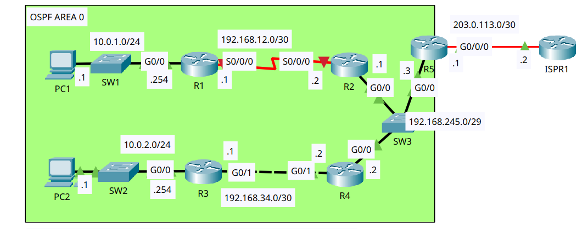

# OSPF (Part 3)

- **Date:** 2026-11-13
- **Topic area:** OSPF, troubleshooting, serial links, default route advertisement, the LSDB
- **Difficulty:** Hard

## Objective
Add a serial link between R1 and R2 and bring it into OSPF, then find and fix three problems in an otherwise preconfigured OSPF network: a route that only R3 has, two routers that won't become neighbors with R5, and PCs that can't reach an external server. Then look at the OSPF database.

## Topology


R1 and R3 each have a LAN, with PC1 and PC2 behind them. R2, R4 and R5 share a subnet through SW3, R3 connects to R4, and R1 connects to R2 over a serial link. R5 connects to ISPR1. The IP addresses were already configured, and so was OSPF on R3, R4 and R5. R1 and R2 had no OSPF configuration, and the PCs were already configured. The red markers on the serial link and on the link to ISPR1 are the starting state.


## Starting state

R1 and R2 had no OSPF configuration. R1's serial interface was unassigned and administratively down.

```
R1# show ip interface brief
GigabitEthernet0/0     10.0.1.254      YES manual up                    up
Serial0/0/0            unassigned      YES unset  administratively down down

R1# show ip route
Gateway of last resort is not set

     10.0.0.0/8 is variably subnetted, 2 subnets, 2 masks
C       10.0.1.0/24 is directly connected, GigabitEthernet0/0
L       10.0.1.254/32 is directly connected, GigabitEthernet0/0
```

R2 only knew the R3 to R4 link through OSPF:

```
R2# show ip route
Gateway of last resort is not set

     192.168.34.0/30 is subnetted, 1 subnets
O       192.168.34.0/30 [110/2] via 192.168.245.2, 00:46:21, GigabitEthernet0/0
     192.168.245.0/24 is variably subnetted, 2 subnets, 2 masks
C       192.168.245.0/29 is directly connected, GigabitEthernet0/0
L       192.168.245.1/32 is directly connected, GigabitEthernet0/0
```

R3 had OSPF with G0/0 passive. R4 had two neighbors. R5 had no neighbors, and its OSPF process only covered the 192.168.245.3 address:

```
R3# show ip ospf neighbor
Neighbor ID     Pri   State           Dead Time   Address         Interface
192.168.245.2     0   FULL/  -        00:00:39    192.168.34.2    GigabitEthernet0/1

R4# show ip ospf neighbor
Neighbor ID     Pri   State           Dead Time   Address         Interface
192.168.245.1     1   FULL/BDR        00:00:32    192.168.245.1   GigabitEthernet0/0
192.168.34.1      1   FULL/BDR        00:00:33    192.168.34.1    GigabitEthernet0/1

R5# show ip ospf neighbor
R5#

R5# show ip protocols
  Routing for Networks:
    192.168.245.3 0.0.0.0 area 0
```

R5's routing table had only connected routes, with no dynamic routes and no default route.

The starting LSDB, taken from R2:

```
R2# show ip ospf database
            OSPF Router with ID (192.168.245.1) (Process ID 1)

                Router Link States (Area 0)

Link ID         ADV Router      Age         Seq#       Checksum Link count
192.168.245.1   192.168.245.1   1036        0x80000003 0x00ce02 1
192.168.34.1    192.168.34.1    1032        0x80000005 0x009df6 3
192.168.245.2   192.168.245.2   1032        0x80000006 0x005847 2

                Net Link States (Area 0)
Link ID         ADV Router      Age         Seq#       Checksum
192.168.245.2   192.168.245.2   1037        0x80000003 0x00a813
192.168.34.2    192.168.245.2   1032        0x80000004 0x00b9a6
```

## Troubleshooting log

### Serial link between R1 and R2:

Before configuring, I checked which end of the cable was DCE:

```
R1# show controllers serial0/0/0
Hardware is PowerQUICC MPC860
DCE V.35, clock rate 2000000

R2# show controllers serial0/0/0
Hardware is PowerQUICC MPC860
DTE V.35 TX and RX clocks detected
```

R1 is the DCE end, so the clock rate went on R1. On both routers I put the interface into OSPF area 0 directly on the interface and set the network type to point-to-point.

```
R1(config)# interface serial0/0/0
R1(config-if)# ip address 192.168.12.1 255.255.255.252
R1(config-if)# no shutdown
%LINK-5-CHANGED: Interface Serial0/0/0, changed state to down
R1(config-if)# clock rate 128000
R1(config-if)# ip ospf 1 area 0
R1(config-if)# ip ospf network point-to-point
```

```
R2(config)# interface serial0/0/0
R2(config-if)# ip address 192.168.12.2 255.255.255.252
R2(config-if)# no shutdown
%LINK-5-CHANGED: Interface Serial0/0/0, changed state to up
%LINEPROTO-5-UPDOWN: Line protocol on Interface Serial0/0/0, changed state to up
R2(config-if)# ip ospf 1 area 0
%OSPF-5-ADJCHG: Process 1, Nbr 192.168.12.1 on Serial0/0/0 from LOADING to FULL, Loading Done
R2(config-if)# ip ospf network point-to-point
```

Confirmation on R1:

```
R1# show controllers serial0/0/0
Hardware is PowerQUICC MPC860
DCE V.35, clock rate 128000

R1# show ip interface brief
Serial0/0/0            192.168.12.1    YES manual up                    up

R1# show ip ospf neighbor
Neighbor ID     Pri   State           Dead Time   Address         Interface
192.168.245.1     0   FULL/  -        00:00:34    192.168.12.2    Serial0/0/0

R1# show ip ospf interface serial0/0/0
Serial0/0/0 is up, line protocol is up
  Internet address is 192.168.12.1/30, Area 0
  Process ID 1, Router ID 192.168.12.1, Network Type POINT-TO-POINT, Cost: 64
  Neighbor Count is 1 , Adjacent neighbor count is 1
    Adjacent with neighbor 192.168.245.1
```

R1 then learned the two networks that R2 knew about:

```
R1# show ip route
O       192.168.34.0/30 [110/66] via 192.168.12.2, 00:01:29, Serial0/0/0
O       192.168.245.0/29 [110/65] via 192.168.12.2, 00:01:29, Serial0/0/0
```

R2 showed both of its neighbors as FULL:

```
R2# show ip ospf neighbor
Neighbor ID     Pri   State           Dead Time   Address         Interface
192.168.245.2     1   FULL/DR         00:00:34    192.168.245.2   GigabitEthernet0/0
192.168.12.1      0   FULL/  -        00:00:36    192.168.12.1    Serial0/0/0
```

### The route that appears only on R3:

**Symptom** - R3 had no OSPF routes at all. Its only route to 10.0.2.0/24 was the connected one, and every other router had no route to it.

```
R3# show ip ospf neighbor
Neighbor ID     Pri   State           Dead Time   Address         Interface
192.168.245.2     0   EXSTART/  -     00:00:36    192.168.34.2    GigabitEthernet0/1
```

**What pointed to it** - Comparing the OSPF settings on the two ends of the R3 to R4 link:

```
R3# show ip ospf interface g0/1
GigabitEthernet0/1 is up, line protocol is up
  Process ID 1, Router ID 192.168.34.1, Network Type POINT-TO-POINT, Cost: 1

R4# show ip ospf interface g0/1
GigabitEthernet0/1 is up, line protocol is up
  Process ID 1, Router ID 192.168.245.2, Network Type BROADCAST, Cost: 1
  Transmit Delay is 1 sec, State WAITING, Priority 1
  No designated router on this network
```

R4 also listed R3 as `2WAY/DROTHER`.

**The fix** - I changed R4's network type to match R3's:

```diff
- R4 GigabitEthernet0/1: Network Type BROADCAST
+ R4 GigabitEthernet0/1: Network Type POINT-TO-POINT
```

```
R4(config)# interface gigabitethernet0/1
R4(config-if)# ip ospf network point-to-point
%OSPF-5-ADJCHG: Process 1, Nbr 192.168.34.1 on GigabitEthernet0/1 from 2WAY to DOWN, Neighbor Down: Interface down or detached
%OSPF-5-ADJCHG: Process 1, Nbr 192.168.34.1 on GigabitEthernet0/1 from LOADING to FULL, Loading Done
```

**Confirmation** - R4 showed R3 as FULL, and its routing table had a route to 10.0.2.0/24:

```
R4# show ip ospf neighbor
Neighbor ID     Pri   State           Dead Time   Address         Interface
192.168.245.1     1   FULL/BDR        00:00:38    192.168.245.1   GigabitEthernet0/0
192.168.34.1      0   FULL/  -        00:00:38    192.168.34.1    GigabitEthernet0/1

R4# show ip route
O       10.0.2.0/24 [110/2] via 192.168.34.1, 00:01:27, GigabitEthernet0/1
```

At this point, R4's table had no route to 192.168.12.0/30 even though R4 and R2 were neighbors, so R2 and R4 weren't receiving routes from each other. I suspected a Packet Tracer bug but haven't confirmed it. I closed Packet Tracer and opened it again, and carried on from there, since I couldn't go back to the start. After reopening Packet Tracer, R4 had both routes and the point-to-point adjacency with R3:

```
R4# show ip route
O       10.0.2.0/24 [110/2] via 192.168.34.1, 00:21:31, GigabitEthernet0/1
O       192.168.12.0/30 [110/65] via 192.168.245.1, 00:20:56, GigabitEthernet0/0

R4# show ip ospf neighbor
Neighbor ID     Pri   State           Dead Time   Address         Interface
192.168.245.1     1   FULL/BDR        00:00:31    192.168.245.1   GigabitEthernet0/0
192.168.34.1      0   FULL/  -        00:00:31    192.168.34.1    GigabitEthernet0/1
```

R2 and R1 now had a route to PC2's LAN. R5 still had no dynamic routes.

```
R2# show ip route
O       10.0.2.0/24 [110/3] via 192.168.245.2, 00:22:09, GigabitEthernet0/0

R1# show ip route
O       10.0.2.0/24 [110/67] via 192.168.12.2, 00:23:34, Serial0/0/0
```

**Conclusion** - Only R3 had a route to PC2's LAN because there was a network type mismatch with its only OSPF neighbor, R4.

### R2 and R4 won't become neighbors with R5:

**Symptom** - R5 was missing from the neighbor lists on both R2 and R4:

```
R2# show ip ospf neighbor
Neighbor ID     Pri   State           Dead Time   Address         Interface
192.168.245.2     1   FULL/DR         00:00:31    192.168.245.2   GigabitEthernet0/0
192.168.12.1      0   FULL/  -        00:00:31    192.168.12.1    Serial0/0/0

R4# show ip ospf neighbor
Neighbor ID     Pri   State           Dead Time   Address         Interface
192.168.245.1     1   FULL/BDR        00:00:39    192.168.245.1   GigabitEthernet0/0
192.168.34.1      0   FULL/  -        00:00:39    192.168.34.1    GigabitEthernet0/1
```

**What pointed to it** - On R5's G0/0:

```
R5# show ip ospf interface g0/0
GigabitEthernet0/0 is up, line protocol is up
  Internet address is 192.168.245.3/29, Area 0
  Process ID 1, Router ID 203.0.113.1, Network Type BROADCAST, Cost: 1
  Transmit Delay is 1 sec, State DR, Priority 1
  Designated Router (ID) 203.0.113.1, Interface address 192.168.245.3
  Timer intervals configured, Hello 5, Dead 20, Wait 20, Retransmit 5
  Neighbor Count is 0, Adjacent neighbor count is 0
```

R5 was on Hello 5 and Dead 20. The OSPF interfaces I captured on R2 (Serial0/0/0) and R4 (GigabitEthernet0/1) were on Hello 10 and Dead 40. I didn't capture their GigabitEthernet0/0 timers. Setting R5 to 10 and 40 brought both neighbors up, so I'm treating the timer mismatch as the cause.

**The fix:**

```diff
- R5 GigabitEthernet0/0: Hello 5, Dead 20
+ R5 GigabitEthernet0/0: Hello 10, Dead 40
```

```
R5(config)# interface gigabitethernet0/0
R5(config-if)# ip ospf hello-interval 10
R5(config-if)# ip ospf dead-interval 40
R5(config-if)# exit
%OSPF-5-ADJCHG: Process 1, Nbr 192.168.245.2 on GigabitEthernet0/0 from LOADING to FULL, Loading Done
%OSPF-5-ADJCHG: Process 1, Nbr 192.168.245.1 on GigabitEthernet0/0 from LOADING to FULL, Loading Done
```

**Confirmation** - R5 got dynamic routes and showed both neighbors as FULL. R2 and R4 showed R5 as a FULL neighbor.

```
R5# show ip route
O       10.0.2.0/24 [110/3] via 192.168.245.2, 00:00:58, GigabitEthernet0/0
O       192.168.12.0/30 [110/65] via 192.168.245.1, 00:00:58, GigabitEthernet0/0
O       192.168.34.0/30 [110/2] via 192.168.245.2, 00:00:58, GigabitEthernet0/0

R5# show ip ospf neighbor
Neighbor ID     Pri   State           Dead Time   Address         Interface
192.168.245.2     1   FULL/DROTHER    00:00:37    192.168.245.2   GigabitEthernet0/0
192.168.245.1     1   FULL/BDR        00:00:37    192.168.245.1   GigabitEthernet0/0

R2# show ip ospf neighbor
Neighbor ID     Pri   State           Dead Time   Address         Interface
192.168.245.2     1   FULL/DROTHER    00:00:36    192.168.245.2   GigabitEthernet0/0
203.0.113.1       1   FULL/DR         00:00:32    192.168.245.3   GigabitEthernet0/0
192.168.12.1      0   FULL/  -        00:00:36    192.168.12.1    Serial0/0/0

R4# show ip ospf neighbor
Neighbor ID     Pri   State           Dead Time   Address         Interface
192.168.245.1     1   FULL/BDR        00:00:36    192.168.245.1   GigabitEthernet0/0
203.0.113.1       1   FULL/DR         00:00:32    192.168.245.3   GigabitEthernet0/0
192.168.34.1      0   FULL/  -        00:00:36    192.168.34.1    GigabitEthernet0/1
```

### PC1 and PC2 can't ping 8.8.8.8:

This turned out to be two separate problems.

**Symptom** - Both PCs got `Destination host unreachable` from their own gateway:

```
C:\> ping 8.8.8.8
Reply from 10.0.1.254: Destination host unreachable.
Reply from 10.0.1.254: Destination host unreachable.
Reply from 10.0.1.254: Destination host unreachable.
Reply from 10.0.1.254: Destination host unreachable.
```

PC2 showed the same thing from 10.0.2.254.

**Problem 1: R1's LAN wasn't in OSPF** 

While testing, I found that PC1 couldn't reach anything past 192.168.12.1. R2 could ping R1's serial address but not R1's LAN interface:

```
C:\> ping 192.168.12.2
Request timed out.   (x4)

R2# ping 192.168.12.1
!!!!!
Success rate is 100 percent (5/5)

R2# ping 10.0.1.254
.....
Success rate is 0 percent (0/5)
```

R1 only had its serial interface in OSPF:

```
R1# show ip ospf interface brief
Interface     PID   Area                     IP Address/Mask          Cost  State  Nbrs F/C
Se0/0/0         1   0                   192.168.12.1/255.255.255.252   64   POINT  0/0
```

I added G0/0 to OSPF and made it passive, since there is nothing to peer with on a PC LAN.

```diff
- R1: GigabitEthernet0/0 not in OSPF
+ R1: GigabitEthernet0/0 in OSPF area 0, passive
```

```
R1(config)# interface gigabitethernet0/0
R1(config-if)# ip ospf 1 area 0
R1(config-if)# exit
R1(config)# router ospf 1
R1(config-router)# passive-interface gigabitethernet0/0
```

```
R1# show ip ospf interface brief
Interface     PID   Area                     IP Address/Mask          Cost  State  Nbrs F/C
Se0/0/0         1   0                   192.168.12.1/255.255.255.252   64   POINT  0/0
Gig0/0          1   0                       10.0.1.254/255.255.255.0   1     WAIT  0/0

R1# show ip protocols
  Passive Interface(s):
    GigabitEthernet0/0
```

| From | To | Result | TTL |
|------|----|--------|-----|
| R2 | 10.0.1.254 (R1 G0/0) | 5/5 | n/a |
| R2 | 10.0.1.1 (PC1) | 5/5 | n/a |
| PC1 | 10.0.2.1 (PC2) | 4/4 | 124 |

```
C:\> ping 10.0.2.1
Reply from 10.0.2.1: bytes=32 time=1ms TTL=124
Reply from 10.0.2.1: bytes=32 time=1ms TTL=124
Reply from 10.0.2.1: bytes=32 time=1ms TTL=124
Reply from 10.0.2.1: bytes=32 time=1ms TTL=124
```

**Problem 2: no route to the outside**

With the OSPF side working, the pings to 8.8.8.8 still failed. R5 had `Gateway of last resort is not set`, no static default route, and nothing external in OSPF. R5 needed a default route toward ISPR1 and had to advertise it into OSPF.

```diff
- R5: no default route, nothing external advertised into OSPF
+ R5: static default route to 203.0.113.2, advertised into OSPF
```

```
R5(config)# ip route 0.0.0.0 0.0.0.0 203.0.113.2
R5(config)# router ospf 1
R5(config-router)# default-information originate
```

**Confirmation** - R5 got the static default route, and the other four routers learned it as an OSPF external route:

```
R5# show ip route
Gateway of last resort is 203.0.113.2 to network 0.0.0.0
S*   0.0.0.0/0 [1/0] via 203.0.113.2

R1# show ip route
Gateway of last resort is 192.168.12.2 to network 0.0.0.0
O*E2 0.0.0.0/0 [110/1] via 192.168.12.2, 00:01:13, Serial0/0/0

R3# show ip route
Gateway of last resort is 192.168.34.2 to network 0.0.0.0
O*E2 0.0.0.0/0 [110/1] via 192.168.34.2, 00:03:47, GigabitEthernet0/1
```

R2 and R4 showed the same `O*E2` route, via 192.168.245.3.

| From | To | Result | TTL | Notes |
|------|----|--------|-----|-------|
| PC1 | 8.8.8.8 | 3/4 | 252 | First request timed out |
| PC1 | 8.8.8.8 (rerun) | 4/4 | 252 | |
| PC2 | 8.8.8.8 | 4/4 | 252 | |

```
C:\> tracert 8.8.8.8
  1   0 ms      0 ms      0 ms      10.0.1.254
  2   0 ms      1 ms      0 ms      192.168.12.2
  3   29 ms     25 ms     1 ms      192.168.245.3
  4   0 ms      0 ms      1 ms      8.8.8.8
```

PC2's trace went 10.0.2.254, 192.168.34.2, 192.168.245.3, then 8.8.8.8. There was no OSPF external route before this fix, which is why both PCs got `Destination host unreachable` from their gateways.

## Verification

### The LSDB:

I captured this last, after all the fixes, on R5.

```
R5# show ip ospf database
            OSPF Router with ID (203.0.113.1) (Process ID 1)

                Router Link States (Area 0)

Link ID         ADV Router      Age         Seq#       Checksum Link count
203.0.113.1     203.0.113.1     1155        0x80000004 0x00848a 1
192.168.12.1    192.168.12.1    1778        0x80000003 0x00f081 3
192.168.34.1    192.168.34.1    1185        0x80000005 0x009df6 3
192.168.245.1   192.168.245.1   1156        0x80000006 0x004a83 3
192.168.245.2   192.168.245.2   1150        0x80000006 0x004fb7 3

                Net Link States (Area 0)
Link ID         ADV Router      Age         Seq#       Checksum
192.168.245.3   203.0.113.1     1150        0x80000003 0x00db26

                Summary ASB Link States (Area 0)
Link ID         ADV Router      Age         Seq#       Checksum
203.0.113.1     192.168.245.2   292         0x80000001 0x006658
203.0.113.1     192.168.245.1   292         0x80000001 0x006c53
203.0.113.1     192.168.34.1    292         0x80000001 0x00375c
203.0.113.1     192.168.12.1    292         0x80000001 0x00d1d7

                Type-5 AS External Link States
Link ID         ADV Router      Age         Seq#       Checksum Tag
0.0.0.0         203.0.113.1     281         0x80000001 0x00d2c1 1
```

| LSA type | Section in the output | Entries |
|----------|-----------------------|---------|
| Type 1 | Router Link States | 5, one per router |
| Type 2 | Net Link States | 1, for 192.168.245.3, advertised by R5 |
| Type 4 | Summary ASB Link States | 4, all for 203.0.113.1 (R5), advertised by R4, R2, R3 and R1 |
| Type 5 | AS External Link States | 1, the default route 0.0.0.0, advertised by R5 |

## Where I struggled
This lab was tough in general because it involved real troubleshooting. I caught myself googling commands, though I always do that the first time I do these labs. The lab was also a bit buggy, as with the R4 and R2 behavior with OSPF. I had the most trouble working out why nothing outside PC1's LAN could reach it. I happened to see the cause in the YouTube video comments, which was that R1's G0/0 wasn't in OSPF. It would have taken me much longer to find it myself.

## Things to note
- On R1 and R2, I put interfaces into OSPF with `ip ospf 1 area 0` on the interface. On R1, `show ip protocols` listed nothing under "Routing for Networks". On R3, R4, and R5, which were preconfigured, the same output listed their addresses there.
- Right after I added R1's G0/0 to OSPF, `show ip ospf interface brief` showed its state as `WAIT`. I didn't check it again afterwards.
- My starting-state captures showed R3 and R4 as FULL neighbors on their link. Later, the same link showed EXSTART on R3 and 2WAY on R4. I don't know why those captures differ.
- The starting LSDB (taken from R2) had two Network LSAs, for 192.168.245.2 and 192.168.34.2. The final LSDB has one, for 192.168.245.3.
