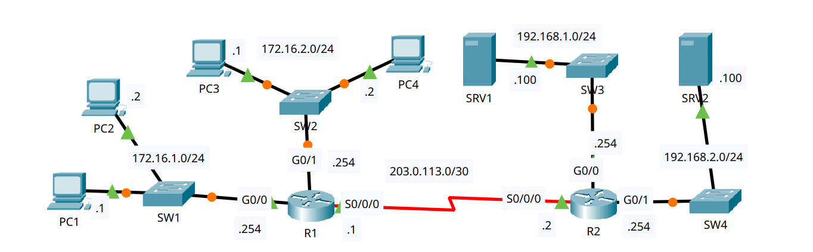

# Standard ACLs

- **Date:** 2026-11-23
- **Topic area:** Basic network security, access control lists
- **Difficulty:** Easy

## Objective
Configure OSPF on two routers so every PC and server can reach every other one. Then use standard numbered ACLs on R1 and standard named ACLs on R2 to enforce these policies:

- Only PC1 and PC3 can access 192.168.1.0/24
- Hosts in 172.16.2.0/24 can't access 192.168.2.0/24
- 172.16.1.0/24 can't access 172.16.2.0/24
- 172.16.2.0/24 can't access 172.16.1.0/24

## Topology


R1 serves two PC subnets, and R2 serves two server subnets. The routers are joined by a serial link.


## Starting state
Outputs are cropped to the lines that matter.

The IP addresses were already configured on both routers and every host, and each host's default gateway was already set to its router's `.254` address. The serial link was up. R1 is the DCE end with clock rate 128000.

```
R1# show ip interface brief
Interface              IP-Address      OK? Method Status                Protocol
GigabitEthernet0/0     172.16.1.254    YES manual up                    up
GigabitEthernet0/1     172.16.2.254    YES manual up                    up
Serial0/0/0            203.0.113.1     YES manual up                    up
```

```
R2# show ip interface brief
Interface              IP-Address      OK? Method Status                Protocol
GigabitEthernet0/0     192.168.1.254   YES manual up                    up
GigabitEthernet0/1     192.168.2.254   YES manual up                    up
Serial0/0/0            203.0.113.2     YES manual up                    up
```

```
R1# show controllers serial0/0/0
Hardware is PowerQUICC MPC860
DCE V.35, clock rate 128000
```

```
R2# show controllers serial0/0/0
Hardware is PowerQUICC MPC860
DTE V.35 TX and RX clocks detected
```

Before OSPF config, both routers' routing tables had only connected and local routes, with nothing for the other side's subnets. `show ip ospf neighbor` and `show ip access-lists` printed nothing on either router.

A host's configuration, cropped (PC1 shown; the others matched the addressing table with the gateway on `.254`):

```
PC1> ipconfig /all
IPv4 Address....................: 172.16.1.1
Subnet Mask.....................: 255.255.255.0
Default Gateway.................: 172.16.1.254
```

Pings before config:

| Test | Result | TTL | Notes |
|---|---|---|---|
| PC1 to PC2 (same LAN) | 4/4 | 128 | |
| PC3 to PC4 (same LAN) | 4/4 | 128 | |
| PC1 to R1 G0/0 | 4/4 | 255 | |
| PC1 to PC3 and PC4 | 3/4 | 127 | First request timed out |
| PC2 to PC3 and PC4 | 4/4 | 127 | |
| PC3 to PC1 and PC2 | 4/4 | 127 | |
| PC4 to PC1 and PC2 | 4/4 | 127 | |
| SRV1 to SRV2 | 3/4 | 127 | First request timed out |
| SRV2 to SRV1 | 4/4 | 127 | |
| Every PC to R2 S0/0/0 (203.0.113.2) | 0/4 | | All timed out |
| Both servers to R1 S0/0/0 (203.0.113.1) | 0/4 | | All timed out |

## Key configuration

### OSPF config:

OSPF is enabled per interface on both routers, with every interface in area 0.

On R1:

```
R1# configure terminal
R1(config)# interface gigabitethernet0/1
R1(config-if)# ip ospf 1 area 0
R1(config-if)# interface gigabitethernet0/0
R1(config-if)# ip ospf 1 area 0
R1(config-if)# interface serial0/0/0
R1(config-if)# ip ospf 1 area 0
```

On R2:

```
R2# configure terminal
R2(config)# interface gigabitethernet0/0
R2(config-if)# ip ospf 1 area 0
R2(config-if)# interface gigabitethernet0/1
R2(config-if)# ip ospf 1 area 0
R2(config-if)# interface serial0/0/0
R2(config-if)# ip ospf 1 area 0
```

### ACL configs:

Each ACL goes on the router interface facing the subnet it protects, in the outbound direction.

| Router | ACL | Rules | Applied to | Policy |
|---|---|---|---|---|
| R1 | `1` (numbered) | deny 172.16.2.0/24, permit any | G0/0 out | 172.16.2.0/24 can't access 172.16.1.0/24 |
| R1 | `2` (numbered) | deny 172.16.1.0/24, permit any | G0/1 out | 172.16.1.0/24 can't access 172.16.2.0/24 |
| R2 | `PERMIT_PC1&PC3` (named) | permit 172.16.1.1, permit 172.16.2.1 | G0/0 out | Only PC1 and PC3 can access 192.168.1.0/24 |
| R2 | `BLOCK_172.16.2.0/24` (named) | deny 172.16.2.0/24, permit any | G0/1 out | 172.16.2.0/24 can't access 192.168.2.0/24 |

On R1:

```
R1# configure terminal
R1(config)# access-list 1 deny 172.16.2.0 0.0.0.255
R1(config)# access-list 1 permit 0.0.0.0 255.255.255.255
R1(config)# access-list 1 remark ##To 172.16.1.0/24##
R1(config)# interface gigabitethernet0/0
R1(config-if)# ip access-group 1 out
R1(config-if)# exit
R1(config)# access-list 2 deny 172.16.1.0 0.0.0.255
R1(config)# access-list 2 permit 0.0.0.0 255.255.255.255
R1(config)# access-list 2 remark ##To 172.16.2.0/24##
R1(config)# interface gigabitethernet0/1
R1(config-if)# ip access-group 2 out
```

On R2:

```
R2# configure terminal
R2(config)# ip access-list standard PERMIT_PC1&PC3
R2(config-std-nacl)# permit 172.16.1.1 0.0.0.0
R2(config-std-nacl)# permit 172.16.2.1 0.0.0.0
R2(config-std-nacl)# remark ##To 192.168.1.0/24##
R2(config-std-nacl)# interface gigabitethernet0/0
R2(config-if)# ip access-group PERMIT_PC1&PC3 out
R2(config-if)# exit
R2(config)# ip access-list standard BLOCK_172.16.2.0/24
R2(config-std-nacl)# deny 172.16.2.0 0.0.0.255
R2(config-std-nacl)# permit 0.0.0.0 255.255.255.255
R2(config-std-nacl)# remark ##To 192.168.2.0/24##
R2(config-std-nacl)# interface gigabitethernet0/1
R2(config-if)# ip access-group BLOCK_172.16.2.0/24 out
```

## Verification

### OSPF:

On R1:

```
R1# show ip protocols
Routing Protocol is "ospf 1"
  Router ID 203.0.113.1
  Number of areas in this router is 1. 1 normal 0 stub 0 nssa
  Routing for Networks:
```

```
R1# show ip ospf interface brief
Interface     PID   Area                     IP Address/Mask          Cost  State  Nbrs F/C
Gig0/1          1   0                     172.16.2.254/255.255.255.0   1       DR  0/0
Gig0/0          1   0                     172.16.1.254/255.255.255.0   1       DR  0/0
Se0/0/0         1   0                    203.0.113.1/255.255.255.252   64   POINT  0/0
```

```
R1# show ip ospf neighbor
Neighbor ID     Pri   State           Dead Time   Address         Interface
203.0.113.2       0   FULL/  -        00:00:31    203.0.113.2     Serial0/0/0
```

```
R1# show ip route
Gateway of last resort is not set

     172.16.0.0/16 is variably subnetted, 4 subnets, 2 masks
C       172.16.1.0/24 is directly connected, GigabitEthernet0/0
L       172.16.1.254/32 is directly connected, GigabitEthernet0/0
C       172.16.2.0/24 is directly connected, GigabitEthernet0/1
L       172.16.2.254/32 is directly connected, GigabitEthernet0/1
O    192.168.1.0/24 [110/65] via 203.0.113.2, 00:06:47, Serial0/0/0
O    192.168.2.0/24 [110/65] via 203.0.113.2, 00:06:47, Serial0/0/0
     203.0.113.0/24 is variably subnetted, 2 subnets, 2 masks
C       203.0.113.0/30 is directly connected, Serial0/0/0
L       203.0.113.1/32 is directly connected, Serial0/0/0
```

On R2 (the router ID was 203.0.113.2 and the neighbor output mirrored R1's):

```
R2# show ip ospf neighbor
Neighbor ID     Pri   State           Dead Time   Address         Interface
203.0.113.1       0   FULL/  -        00:00:32    203.0.113.1     Serial0/0/0
```

```
R2# show ip route
Gateway of last resort is not set

     172.16.0.0/24 is subnetted, 2 subnets
O       172.16.1.0/24 [110/65] via 203.0.113.1, 00:07:40, Serial0/0/0
O       172.16.2.0/24 [110/65] via 203.0.113.1, 00:07:40, Serial0/0/0
     192.168.1.0/24 is variably subnetted, 2 subnets, 2 masks
C       192.168.1.0/24 is directly connected, GigabitEthernet0/0
L       192.168.1.254/32 is directly connected, GigabitEthernet0/0
     192.168.2.0/24 is variably subnetted, 2 subnets, 2 masks
C       192.168.2.0/24 is directly connected, GigabitEthernet0/1
L       192.168.2.254/32 is directly connected, GigabitEthernet0/1
     203.0.113.0/24 is variably subnetted, 2 subnets, 2 masks
C       203.0.113.0/30 is directly connected, Serial0/0/0
L       203.0.113.2/32 is directly connected, Serial0/0/0
```

Each router now has OSPF routes to the other router's two LANs. I only tested these pings after OSPF, before any ACLs:

| Test | Result | TTL | Notes |
|---|---|---|---|
| PC1 to SRV1 | 4/4 | 126 | |
| PC1 to SRV2 | 4/4 | 126 | First reply 82 ms |
| PC3 to SRV1 | 4/4 | 126 | |
| PC3 to SRV2 | 4/4 | 126 | |

I didn't ping every pair at this point.

### ACLs:

On R1:

```
R1# show running-config | section interface GigabitEthernet0/0
interface GigabitEthernet0/0
 ip address 172.16.1.254 255.255.255.0
 ip ospf 1 area 0
 ip access-group 1 out
```

```
R1# show running-config | section interface GigabitEthernet0/1
interface GigabitEthernet0/1
 ip address 172.16.2.254 255.255.255.0
 ip ospf 1 area 0
 ip access-group 2 out
```

```
R1# show running-config | include access-list
access-list 1 deny 172.16.2.0 0.0.0.255
access-list 1 permit any
access-list 1 remark ##To 172.16.1.0/24##
access-list 2 deny 172.16.1.0 0.0.0.255
access-list 2 permit any
access-list 2 remark ##To 172.16.2.0/24##
```

```
R1# show ip access-lists
Standard IP access list 1
    10 deny 172.16.2.0 0.0.0.255
    20 permit any
Standard IP access list 2
    10 deny 172.16.1.0 0.0.0.255
    20 permit any
```

On R2:

```
R2# show running-config | section interface GigabitEthernet0/0
interface GigabitEthernet0/0
 ip address 192.168.1.254 255.255.255.0
 ip ospf 1 area 0
 ip access-group PERMIT_PC1&PC3 out
```

```
R2# show running-config | section interface GigabitEthernet0/1
interface GigabitEthernet0/1
 ip address 192.168.2.254 255.255.255.0
 ip ospf 1 area 0
 ip access-group BLOCK_172.16.2.0/24 out
```

```
R2# show running-config | section ip access-list
ip access-list standard PERMIT_PC1&PC3
 permit host 172.16.1.1
 permit host 172.16.2.1
 remark ##To 192.168.1.0/24##
ip access-list standard BLOCK_172.16.2.0/24
 deny 172.16.2.0 0.0.0.255
 permit any
 remark ##To 192.168.2.0/24##
```

```
R2# show ip access-lists
Standard IP access list PERMIT_PC1&PC3
    10 permit host 172.16.1.1
    20 permit host 172.16.2.1
Standard IP access list BLOCK_172.16.2.0/24
    10 deny 172.16.2.0 0.0.0.255
    20 permit any
```

Testing each policy. These are the only pairs I tested:

| Policy | Test | Result | Reply came from |
|---|---|---|---|
| 1 | PC1 to SRV1 | 4/4, TTL 126 | |
| 1 | PC3 to SRV1 | 4/4, TTL 126 | |
| 1 | PC2 to SRV1 | 0/4, host unreachable | 203.0.113.2 |
| 1 | PC4 to SRV1 | 0/4, host unreachable | 203.0.113.2 |
| 1 | SRV2 to SRV1 | 0/4, host unreachable | 192.168.2.254 |
| 2 | PC3 to SRV2 | 0/4, host unreachable | 203.0.113.2 |
| 2 | PC4 to SRV2 | 0/4, host unreachable | 203.0.113.2 |
| 3 | PC1 to PC3, PC1 to PC4, PC2 to PC3, PC2 to PC4 | 0/4, host unreachable | 172.16.1.254 |
| 4 | PC3 to PC1, PC3 to PC2, PC4 to PC1, PC4 to PC2 | 0/4, host unreachable | 172.16.2.254 |

A pass (PC1 to SRV1) and a block (PC2 to SRV1):

```
PC1> ping 192.168.1.100
Reply from 192.168.1.100: bytes=32 time=1ms TTL=126
Reply from 192.168.1.100: bytes=32 time=1ms TTL=126
Reply from 192.168.1.100: bytes=32 time=1ms TTL=126
Reply from 192.168.1.100: bytes=32 time=1ms TTL=126

Ping statistics for 192.168.1.100:
    Packets: Sent = 4, Received = 4, Lost = 0 (0% loss),
```

```
PC2> ping 192.168.1.100
Reply from 203.0.113.2: Destination host unreachable.
Reply from 203.0.113.2: Destination host unreachable.
Reply from 203.0.113.2: Destination host unreachable.
Reply from 203.0.113.2: Destination host unreachable.

Ping statistics for 192.168.1.100:
    Packets: Sent = 4, Received = 0, Lost = 4 (100% loss),
```

## Things to note
- I never typed `router ospf 1`. The OSPF process was created by `ip ospf 1 area 0` on the first interface, and `show ip protocols` lists it as `ospf 1` with nothing under "Routing for Networks".
- `show ip ospf interface brief` shows 0/0 in the Nbrs F/C column on Se0/0/0, even though `show ip ospf neighbor` lists the other router as FULL. I didn't look into why.
- I typed `permit 0.0.0.0 255.255.255.255` and `permit 172.16.1.1 0.0.0.0`. The router displays them as `permit any` and `permit host 172.16.1.1`.
- The `remark` lines show up in `show running-config` but not in `show ip access-lists`.
- Blocked pings come back as "Destination host unreachable" replies, not timeouts. Each reply came from the address of the router that has the ACL in the path: R2's serial address for the server networks, and R1's G0/0 or G0/1 address for the 172.16 networks.
- SRV2 to SRV1 is also blocked, because SRV2 isn't one of the two hosts permitted by `PERMIT_PC1&PC3`.
