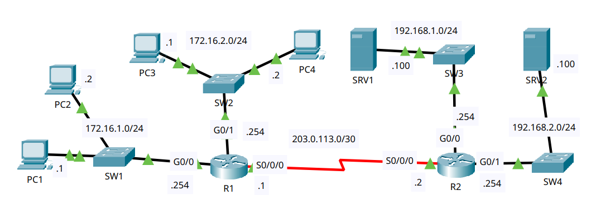
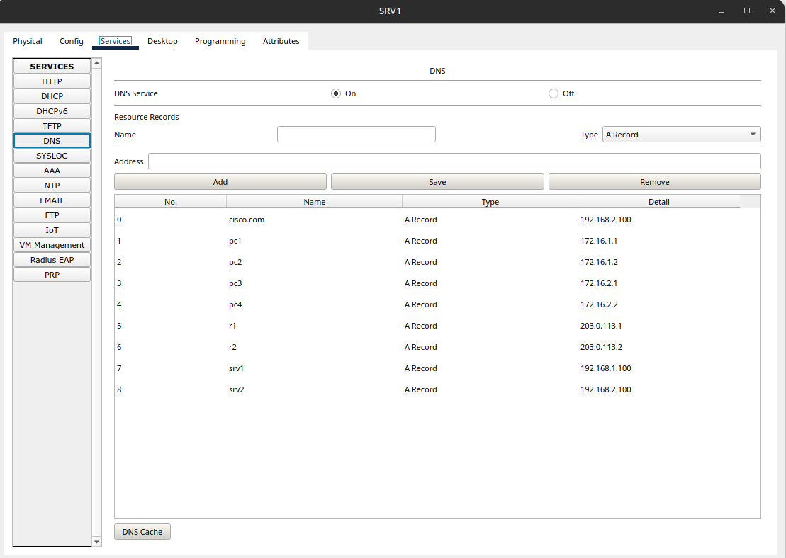
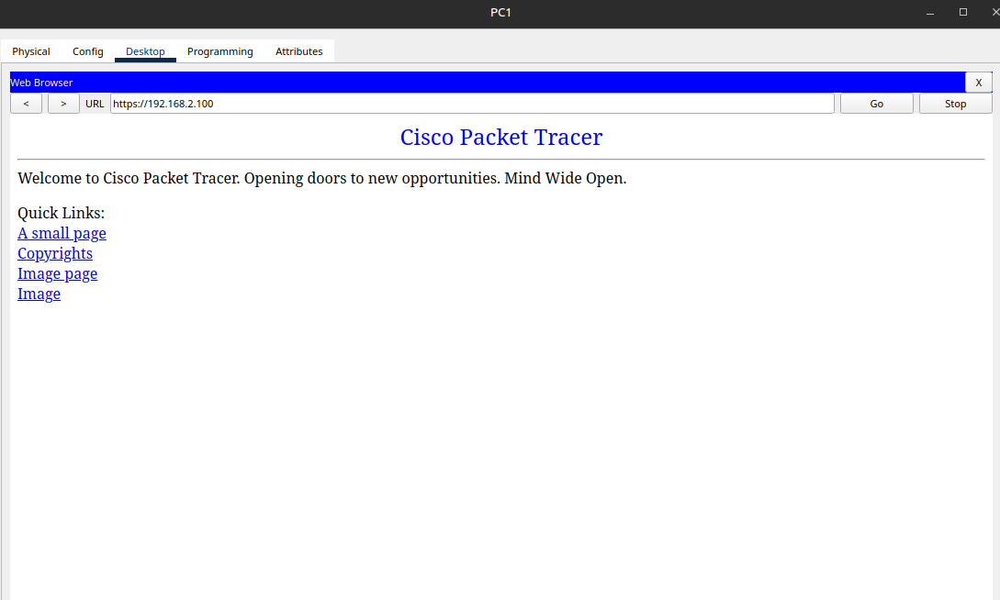
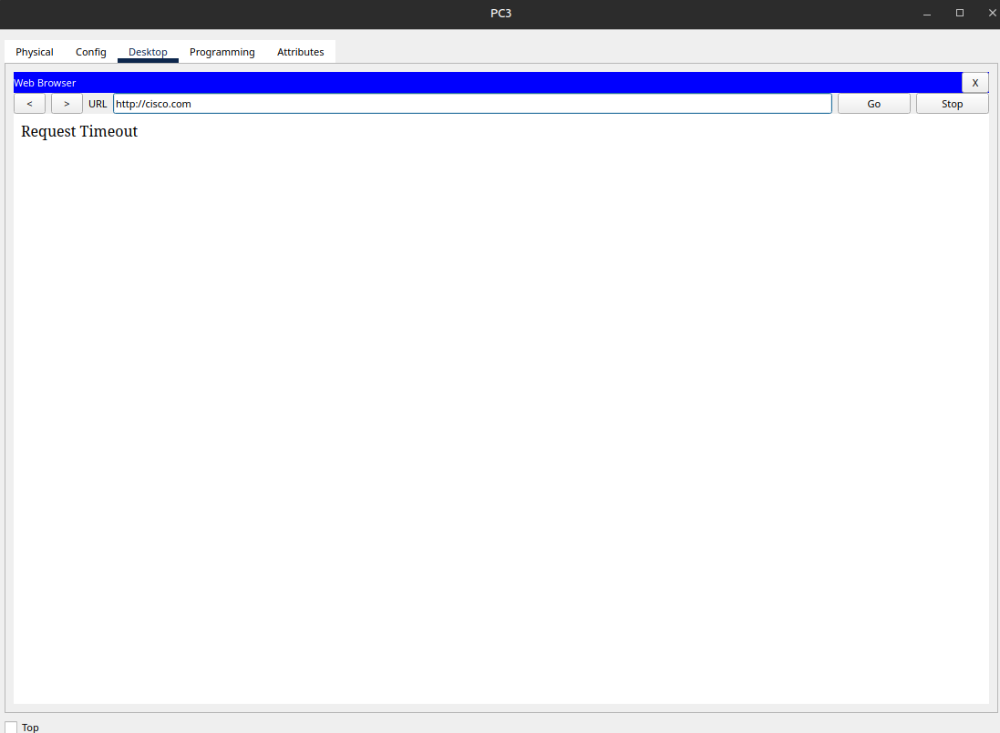

# Extended ACLs

- **Date:** 2026-11-24
- **Topic area:** Basic network security, extended ACLs
- **Difficulty:** Medium

## Objective
Use extended ACLs on R1 to enforce these policies:

- Hosts in 172.16.2.0/24 can't communicate with PC1
- Hosts in 172.16.1.0/24 can't access the DNS service on SRV1
- Hosts in 172.16.2.0/24 can't access the HTTP or HTTPS services on SRV2

## Topology


R1 serves two PC subnets, and R2 serves two server subnets. The routers are joined by a serial link.

SRV1 is the DNS server. SRV2 is the web server, with HTTP and HTTPS enabled.

## Starting state
Outputs are cropped to the lines that matter.

Both routers were already running OSPF and had `ip name-server 192.168.1.100` in their configs. All hosts could already reach each other, and there were no ACLs yet.

```
R1# show ip access-lists
R1#
```

```
R2# show ip access-lists
R2#
```

```
R1# show ip interface gigabitethernet0/0
GigabitEthernet0/0 is up, line protocol is up (connected)
  Internet address is 172.16.1.254/24
  Outgoing access list is not set
  Inbound  access list is not set
```

The other interfaces I checked (R1 G0/1 and S0/0/0, R2 G0/0, G0/1 and S0/0/0) matched: no inbound or outbound ACL.

Each router had OSPF routes to the other router's LANs:

```
R1# show ip route
O    192.168.1.0/24 [110/65] via 203.0.113.2, 00:12:20, Serial0/0/0
O    192.168.2.0/24 [110/65] via 203.0.113.2, 00:12:20, Serial0/0/0
```

```
R2# show ip route
O       172.16.1.0/24 [110/65] via 203.0.113.1, 00:14:39, Serial0/0/0
O       172.16.2.0/24 [110/65] via 203.0.113.1, 00:14:39, Serial0/0/0
```

Every host had its router's `.254` address as the default gateway and 192.168.1.100 (SRV1) as the DNS server. PC1 as an example:

```
PC1> ipconfig /all
IPv4 Address....................: 172.16.1.1
Subnet Mask.....................: 255.255.255.0
Default Gateway.................: ::
                                  172.16.1.254
DNS Servers.....................: ::
                                  192.168.1.100
```

SRV1's DNS window (Services > DNS) shows the DNS records for the devices in the network:



`cisco.com` resolves to 192.168.2.100, which is SRV2's address. Before any ACL, every PC could resolve it and reach SRV2:

| Host | `ping cisco.com` | TTL | `nslookup cisco.com` |
|---|---|---|---|
| PC1 | 4/4 | 126 | 192.168.2.100 |
| PC2 | 4/4 | 126 | 192.168.2.100 |
| PC3 | 4/4 | 126 | 192.168.2.100 |
| PC4 | 4/4 | 126 | 192.168.2.100 |

```
PC1> ping cisco.com
Pinging 192.168.2.100 with 32 bytes of data:

Reply from 192.168.2.100: bytes=32 time=10ms TTL=126
Reply from 192.168.2.100: bytes=32 time=1ms TTL=126
Reply from 192.168.2.100: bytes=32 time=1ms TTL=126
Reply from 192.168.2.100: bytes=32 time=1ms TTL=126

Ping statistics for 192.168.2.100:
    Packets: Sent = 4, Received = 4, Lost = 0 (0% loss),
```

```
PC1> nslookup cisco.com
Server: [192.168.1.100]
Address:  192.168.1.100

Non-authoritative answer:
Name:   cisco.com
Address:   192.168.2.100
```

`http://cisco.com` and `https://cisco.com` also loaded in each PC's web browser.

## Key configuration

### Extended ACL configs:

Both ACLs are named, extended, and applied inbound on R1's interfaces facing the PCs.

| ACL | Applied to | Rules | Policy |
|---|---|---|---|
| `CANT_SEE_PC1_&_CANT_HTTP(S)_ON_SRV2` | G0/1 in | deny all IP from 172.16.2.0/24 to PC1; deny TCP 80 and 443 from 172.16.2.0/24 to SRV2; permit everything else | Hosts in 172.16.2.0/24 can't communicate with PC1, and can't access HTTP or HTTPS on SRV2 |
| `CANT_DNS_SRV1` | G0/0 in | deny TCP 53 and UDP 53 from 172.16.1.0/24 to SRV1; permit everything else | Hosts in 172.16.1.0/24 can't access DNS on SRV1 |

```
R1# configure terminal
R1(config)# ip access-list extended CANT_SEE_PC1_&_CANT_HTTP(S)_ON_SRV2
R1(config-ext-nacl)# deny ip 172.16.2.0 0.0.0.255 host 172.16.1.1
R1(config-ext-nacl)# deny tcp 172.16.2.0 0.0.0.255 host 192.168.2.100 eq 80
R1(config-ext-nacl)# deny tcp 172.16.2.0 0.0.0.255 host 192.168.2.100 eq 443
R1(config-ext-nacl)# permit ip any any
R1(config-ext-nacl)# interface gigabitethernet0/1
R1(config-if)# ip access-group CANT_SEE_PC1_&_CANT_HTTP(S)_ON_SRV2 in
R1(config-if)# exit
R1(config)# ip access-list extended CANT_DNS_SRV1
R1(config-ext-nacl)# deny tcp 172.16.1.0 0.0.0.255 host 192.168.1.100 eq 53
R1(config-ext-nacl)# deny udp 172.16.1.0 0.0.0.255 host 192.168.1.100 eq 53
R1(config-ext-nacl)# permit ip any any
R1(config-ext-nacl)# interface gigabitethernet0/0
R1(config-if)# ip access-group CANT_DNS_SRV1 in
```

## Verification

### ACLs applied:
```
R1# show running-config | section interface GigabitEthernet0/0
interface GigabitEthernet0/0
 ip address 172.16.1.254 255.255.255.0
 ip access-group CANT_DNS_SRV1 in
```

```
R1# show running-config | section interface GigabitEthernet0/1
interface GigabitEthernet0/1
 ip address 172.16.2.254 255.255.255.0
 ip access-group CANT_SEE_PC1_&_CANT_HTTP(S)_ON_SRV2 in
```

```
R1# show ip access-lists
Extended IP access list CANT_SEE_PC1_&_CANT_HTTP(S)_ON_SRV2
    10 deny ip 172.16.2.0 0.0.0.255 host 172.16.1.1
    20 deny tcp 172.16.2.0 0.0.0.255 host 192.168.2.100 eq www
    30 deny tcp 172.16.2.0 0.0.0.255 host 192.168.2.100 eq 443
    40 permit ip any any
Extended IP access list CANT_DNS_SRV1
    10 deny tcp 172.16.1.0 0.0.0.255 host 192.168.1.100 eq domain
    20 deny udp 172.16.1.0 0.0.0.255 host 192.168.1.100 eq domain
    30 permit ip any any
```

```
R1# show ip interface gigabitethernet0/0
  Outgoing access list is not set
  Inbound  access list is CANT_DNS_SRV1
```

```
R1# show ip interface gigabitethernet0/1
  Outgoing access list is not set
  Inbound  access list is CANT_SEE_PC1_&_CANT_HTTP(S)_ON_SRV2
```

### Policy 1: hosts in 172.16.2.0/24 can't communicate with PC1

| Test | Result | Notes |
|---|---|---|
| PC3 to PC1 | 0/4 | Destination host unreachable, from 172.16.2.254 |
| PC3 to PC2 | 4/4 | TTL 127 |
| PC4 to PC1 | 0/4 | Destination host unreachable, from 172.16.2.254 |
| PC4 to PC2 | 4/4 | TTL 127 |

```
PC3> ping 172.16.1.1
Reply from 172.16.2.254: Destination host unreachable.
Reply from 172.16.2.254: Destination host unreachable.
Reply from 172.16.2.254: Destination host unreachable.
Reply from 172.16.2.254: Destination host unreachable.

Ping statistics for 172.16.1.1:
    Packets: Sent = 4, Received = 0, Lost = 4 (100% loss),
```

PC3 and PC4 can reach PC2 but not PC1. I only tested pings from the 172.16.2.0/24 side.

### Policy 2: hosts in 172.16.1.0/24 can't access DNS on SRV1

| Host | `ping 192.168.1.100` | `ping cisco.com` | `nslookup cisco.com` |
|---|---|---|---|
| PC1 | 4/4, TTL 126 | Could not find host | Timed out |
| PC2 | 4/4, TTL 126 | Could not find host | Timed out |
| PC3 | 4/4, TTL 126 | 4/4, TTL 126 | 192.168.2.100 |
| PC4 | 4/4, TTL 126 | 4/4, TTL 126 | 192.168.2.100 |

PC1 can reach SRV1 but can't use it for DNS:

```
PC1> ping cisco.com
Ping request could not find host cisco.com. Please check the name and try again.
```

```
PC1> nslookup cisco.com
Server: [192.168.1.100]
Address:  192.168.1.100
DNS request timed out.
	timeout was 15000 milli seconds.
DNS request timed out.
	timeout was 15000 milli seconds.
DNS request timed out.
	timeout was 15000 milli seconds.
*** Request to 192.168.1.100 timed-out
```

PC3 and PC4 still got answers from SRV1:

```
PC3> nslookup cisco.com
Server: [192.168.1.100]
Address:  192.168.1.100

Non-authoritative answer:
Name:   cisco.com
Address:   192.168.2.100
```

### Policy 3: hosts in 172.16.2.0/24 can't access HTTP or HTTPS on SRV2

All four PCs could still ping SRV2 (4/4, TTL 126). I only tested the web services in the browser.

On PC1 and PC2, `http://192.168.2.100` and `https://192.168.2.100` loaded. `http://cisco.com` and `https://cisco.com` showed "Host Name Unresolved". I think that's because these hosts can't use DNS (policy 2), but I didn't test that separately.



On PC3 and PC4, `http://cisco.com` and `https://cisco.com` did not load. The browser showed "Request Timeout". `cisco.com` resolves to 192.168.2.100 for these hosts (see policy 2).



## Things to note
- Packet Tracer accepted `&`, `(` and `)` in the ACL name.
- I typed `eq 80` and `eq 53`. The router displays them as `eq www` and `eq domain`. `eq 443` stays as typed.
- The blocked pings from PC3 came back from 172.16.2.254, which is the R1 interface the ACL is applied to.
- PC1 can still ping SRV1 even though its DNS is blocked, because the ACL only denies TCP and UDP port 53.
