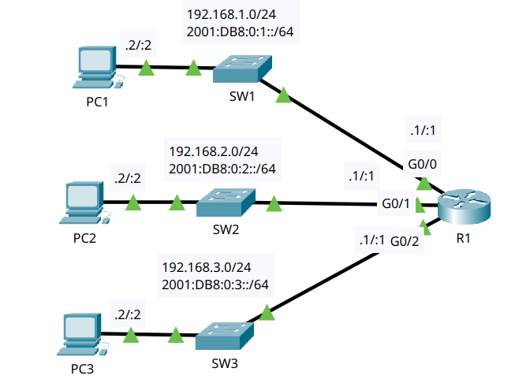

# IPv6 Configuration (Part 1)

- **Date:** 2026-11-19
- **Topic area:** IPv6, dual-stack, IPv6 routing
- **Difficulty:** Easy

## Objective
Add IPv6 to a network that already has working IPv4, so every device is dual-stack. Enable IPv6 routing on R1, address its interfaces, address the PCs and their gateways, and test connectivity between the PCs over both IPv4 and IPv6.

## Topology


R1 connects to three LAN segments, each through its own switch and with one PC. The IPv4 configuration was already complete at the start, and all the links showed as active.


## Starting state
R1 had IPv4 only. None of its interfaces had an IPv6 address, and the IPv6 routing table was empty.

```
R1# show ip interface brief
GigabitEthernet0/0     192.168.1.1     YES manual up                    up
GigabitEthernet0/1     192.168.2.1     YES manual up                    up
GigabitEthernet0/2     192.168.3.1     YES manual up                    up

R1# show ipv6 interface brief
GigabitEthernet0/0         [up/up]
    unassigned
GigabitEthernet0/1         [up/up]
    unassigned
GigabitEthernet0/2         [up/up]
    unassigned

R1# show ipv6 route
IPv6 Routing Table - 0 entries
```

The running configuration had no IPv6 routing line:

```
R1# show running-config
ip cef
no ipv6 cef
```

The PCs had an IPv4 address and gateway and no global IPv6 address. They already had a link-local address. PC1:

```
C:\> ipconfig /all
   Link-local IPv6 Address.........: FE80::200:CFF:FE44:7047
   IPv6 Address....................: ::
   IPv4 Address....................: 192.168.1.2
   Subnet Mask.....................: 255.255.255.0
   Default Gateway.................: ::
                                     192.168.1.1
```

PC2 and PC3 matched, each with their own IPv4 address and gateway and no global IPv6 address.

## Key configuration

### IPv6 routing on R1:
```
R1(config)# ipv6 unicast-routing
```

### IPv6 addresses on R1:

The same pattern on each interface, with the subnet number changing (1, 2, 3):

```
R1(config)# interface gigabitethernet0/0
R1(config-if)# ipv6 address 2001:db8:0:1::1/64
R1(config-if)# no shutdown
R1(config-if)# interface gigabitethernet0/1
R1(config-if)# ipv6 address 2001:db8:0:2::1/64
R1(config-if)# no shutdown
R1(config-if)# interface gigabitethernet0/2
R1(config-if)# ipv6 address 2001:db8:0:3::1/64
R1(config-if)# no shutdown
```

### IPv6 addresses and gateways on the PCs:

I configured an IPv6 address and an IPv6 default gateway on each PC. The gateway is R1's address on that PC's segment.

| PC | IPv6 address | IPv6 default gateway |
|----|--------------|----------------------|
| PC1 | 2001:DB8:0:1::2 | 2001:DB8:0:1::1 |
| PC2 | 2001:DB8:0:2::2 | 2001:DB8:0:2::1 |
| PC3 | 2001:DB8:0:3::2 | 2001:DB8:0:3::1 |

## Verification

### IPv6 routing enabled
```
R1# show running-config
ip cef
ipv6 unicast-routing
!
no ipv6 cef
```

### The IPv6 addresses on R1:

Each interface has two IPv6 addresses: the global address I configured, and a link-local address (starting `FE80`) that I didn't configure.

```
R1# show ipv6 interface brief
GigabitEthernet0/0         [up/up]
    FE80::201:97FF:FE9A:AC01
    2001:DB8:0:1::1
GigabitEthernet0/1         [up/up]
    FE80::201:97FF:FE9A:AC02
    2001:DB8:0:2::1
GigabitEthernet0/2         [up/up]
    FE80::201:97FF:FE9A:AC03
    2001:DB8:0:3::1
```

The IPv6 routing table went from 0 entries to 7. Each connected subnet has a connected route (`C`) and a local route (`L`) for R1's own address, plus one multicast route:

```
R1# show ipv6 route
IPv6 Routing Table - 7 entries
C   2001:DB8:0:1::/64 [0/0]
     via GigabitEthernet0/0, directly connected
L   2001:DB8:0:1::1/128 [0/0]
     via GigabitEthernet0/0, receive
C   2001:DB8:0:2::/64 [0/0]
     via GigabitEthernet0/1, directly connected
L   2001:DB8:0:2::1/128 [0/0]
     via GigabitEthernet0/1, receive
C   2001:DB8:0:3::/64 [0/0]
     via GigabitEthernet0/2, directly connected
L   2001:DB8:0:3::1/128 [0/0]
     via GigabitEthernet0/2, receive
L   FF00::/8 [0/0]
     via Null0, receive
```

### The PCs:

PC1 after configuration. PC2 and PC3 showed their own matching addresses and gateways from the table above.

```
C:\> ipconfig /all
   Link-local IPv6 Address.........: FE80::200:CFF:FE44:7047
   IPv6 Address....................: 2001:DB8:0:1::2
   IPv4 Address....................: 192.168.1.2
   Subnet Mask.....................: 255.255.255.0
   Default Gateway.................: 2001:DB8:0:1::1
                                     192.168.1.1
```

### Pings between the PCs:

Before I configured any IPv6 addresses, I pinged between the PCs over IPv4. The first ping of two pairs lost one packet.

| From | To | Result | TTL | Notes |
|------|----|--------|-----|-------|
| PC1 | PC3 (192.168.3.2) | 3/4 | 127 | First request timed out |
| PC1 | PC2 (192.168.2.2) | 3/4 | 127 | First request timed out |
| PC2 | PC3 (192.168.3.2) | 4/4 | 127 | |

After the IPv6 configuration, every pair worked over both protocols with no loss:

| From | To | Protocol | Result | TTL | Notes |
|------|----|----------|--------|-----|-------|
| PC1 | PC2 | IPv4 | 4/4 | 127 | |
| PC1 | PC2 | IPv6 | 4/4 | 127 | |
| PC1 | PC3 | IPv4 | 4/4 | 127 | |
| PC1 | PC3 | IPv6 | 4/4 | 127 | First reply 54 ms |
| PC2 | PC3 | IPv4 | 4/4 | 127 | |
| PC2 | PC3 | IPv6 | 4/4 | 127 | |

```
C:\> ping 2001:DB8:0:3::2
Reply from 2001:DB8:0:3::2: bytes=32 time=54ms TTL=127
Reply from 2001:DB8:0:3::2: bytes=32 time<1ms TTL=127
Reply from 2001:DB8:0:3::2: bytes=32 time<1ms TTL=127
Reply from 2001:DB8:0:3::2: bytes=32 time<1ms TTL=127
```

The network is dual-stack: the PCs reach each other over IPv4 and over IPv6, through R1.

## Things to note
- I typed the addresses in lowercase (`2001:db8:0:1::1`), and the router displays them in uppercase (`2001:DB8:0:1::1`).
- R1's interfaces were already up/up before I typed `no shutdown`, because they were up for IPv4 already.
- The link-local addresses on R1 weren't configured by me. My reading is that they are generated automatically from each interface's MAC address. The PCs show this: PC1's MAC is `0000.0C44.7047,` and its link-local address is `FE80::200:CFF:FE44:7047`, which is that MAC with `FF:FE` inserted in the middle and the first byte changed from `00` to `02`. PC2 matches too. I didn't capture R1's MAC addresses, so I haven't checked it on R1.
- `no ipv6 cef` is in R1's running configuration before and after I enabled IPv6 routing. I didn't change it, and I haven't looked into what it does.
- Packet Tracer shows `TTL=127` for the IPv6 replies, the same as for IPv4, one router away from the PCs.
- `ipconfig` on the PCs lists the IPv6 gateway and the IPv4 gateway together under Default Gateway.
