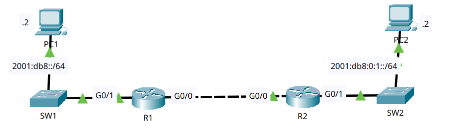
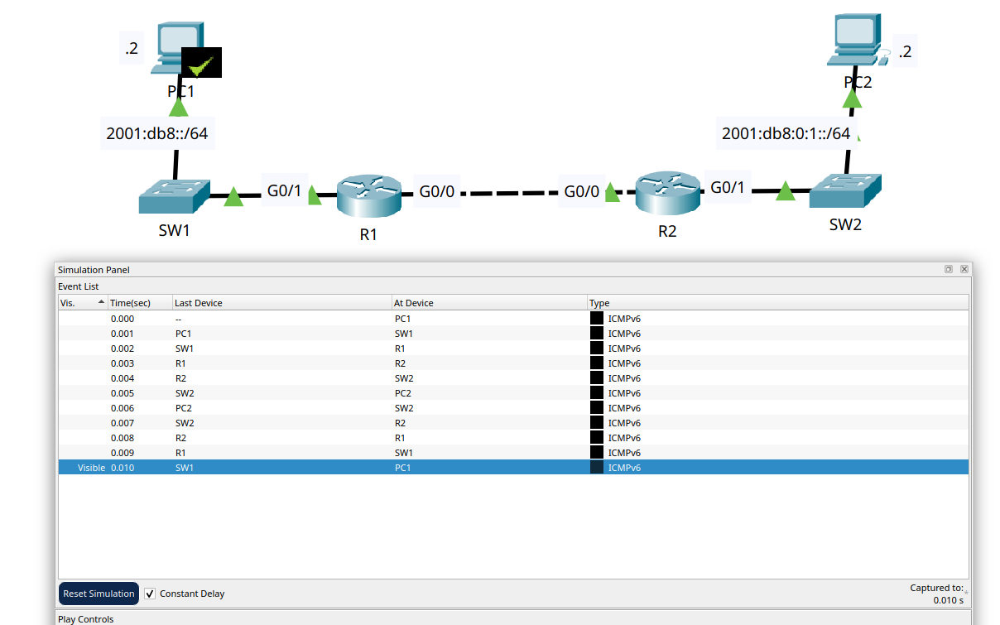

# IPv6 Configuration (Part 2)

- **Date:** 2026-11-20
- **Topic area:** IPv6, EUI-64, link-local addressing, IPv6 static routes
- **Difficulty:** Easy

## Objective
Configure IPv6 on two routers using EUI-64 addresses on the LAN-facing interfaces, enable IPv6 on the link between the routers without giving it an address, then add static routes so PC1 can reach PC2.

## Topology


PC1 connects through SW1 to R1 G0/1. PC2 connects through SW2 to R2 G0/1. R1 G0/0 connects directly to R2 G0/0. IPv4 was already configured, and the interfaces were enabled at the start.


## Starting state
R1 and R2 had IPv4 only. No interface had an IPv6 address, and the IPv6 routing table was empty on both. Each router also had an IPv4 static route to the other's LAN. R1:

```
R1# show running-config
ip cef
no ipv6 cef
interface GigabitEthernet0/0
 ip address 192.168.1.1 255.255.255.252
interface GigabitEthernet0/1
 ip address 10.0.1.254 255.255.255.0
ip route 10.0.2.0 255.255.255.0 192.168.1.2

R1# show ipv6 interface brief
GigabitEthernet0/0         [up/up]
    unassigned
GigabitEthernet0/1         [up/up]
    unassigned

R1# show ipv6 route
IPv6 Routing Table - 0 entries
```

R2 matched, with 192.168.1.2/30 on G0/0, 10.0.2.254/24 on G0/1, `ip route 10.0.1.0 255.255.255.0 192.168.1.1` and the same empty IPv6 output.

The PCs had an IPv4 address and gateway and a link-local IPv6 address, but no global IPv6 address. PC1:

```
C:\> ipconfig /all
   Link-local IPv6 Address.........: FE80::260:70FF:FE35:C92E
   IPv6 Address....................: ::
   IPv4 Address....................: 10.0.1.2
   Default Gateway.................: ::
                                     10.0.1.254
```

PC2 matched, with 10.0.2.2 and gateway 10.0.2.254.

## Key configuration

### My EUI-64 calculation, before configuration:

I worked out the interface ID for each G0/1 before configuring anything. First, each interface's MAC address:

```
R1# show interfaces gigabitethernet0/1
GigabitEthernet0/1 is up, line protocol is up (connected)
  Hardware is CN Gigabit Ethernet, address is 0030.f236.4502 (bia 0030.f236.4502)

R2# show interfaces gigabitethernet0/1
GigabitEthernet0/1 is up, line protocol is up (connected)
  Hardware is CN Gigabit Ethernet, address is 0001.63b0.b802 (bia 0001.63b0.b802)
```

**R1 G0/1**, prefix 2001:db8::/64:

```
MAC address:                       0030.f236.4502
Insert ff:fe in the middle:        0030:f2ff:fe36:4502
Flip the 7th bit of the first byte:
  first byte 00 = 0000 0000
  flip bit 7    = 0000 0010 = 02
Interface ID:                      0230:f2ff:fe36:4502
Full address:                      2001:0db8:0000:0000:0230:f2ff:fe36:4502
Shortened:                         2001:db8::230:f2ff:fe36:4502
```

**R2 G0/1**, prefix 2001:db8:0:1::/64:

```
MAC address:                       0001.63b0.b802
Insert ff:fe in the middle:        0001:63ff:feb0:b802
Flip the 7th bit of the first byte:
  first byte 00 = 0000 0000
  flip bit 7    = 0000 0010 = 02
Interface ID:                      0201:63ff:feb0:b802
Full address:                      2001:0db8:0000:0001:0201:63ff:feb0:b802
Shortened:                         2001:db8:0:1:201:63ff:feb0:b802
```

### EUI-64 IPv6 addresse config on R1 and R2 G0/1:
```
R1(config)# interface gigabitethernet0/1
R1(config-if)# ipv6 address 2001:db8::/64 eui-64
```

```
R2(config)# interface gigabitethernet0/1
R2(config-if)# ipv6 address 2001:db8:0:1::/64 eui-64
```

### Addresses and gateways on the PCs:

I configured an IPv6 address and an IPv6 default gateway on each PC. The gateway is the router's global EUI-64 address on that segment.

| PC | IPv6 address | IPv6 default gateway |
|----|--------------|----------------------|
| PC1 | 2001:DB8::2 | 2001:DB8::230:F2FF:FE36:4502 |
| PC2 | 2001:DB8:0:1::2 | 2001:DB8:0:1:201:63FF:FEB0:B802 |


### IPv6 on G0/0 of R1 and R2:

Same command on both routers, with no address:

```
R1(config)# interface gigabitethernet0/0
R1(config-if)# ipv6 enable
```

```
R2(config)# interface gigabitethernet0/0
R2(config-if)# ipv6 enable
```

### IPv6 routing and static routes:

I enabled IPv6 routing on both routers first, then added a static route on each to the other's LAN. Each route gives the exit interface and the neighbor's link-local address on G0/0

```
R1(config)# ipv6 unicast-routing
R1(config)# ipv6 route 2001:DB8:0:1::/64 gigabitethernet0/0 FE80::201:63FF:FEB0:B801
```

```
R2(config)# ipv6 unicast-routing
R2(config)# ipv6 route 2001:DB8::/64 gigabitethernet0/0 FE80::230:F2FF:FE36:4501
```

## Verification

### Calculated vs actual:
```
R1# show ipv6 interface brief
GigabitEthernet0/1         [up/up]
    FE80::230:F2FF:FE36:4502
    2001:DB8::230:F2FF:FE36:4502

R2# show ipv6 interface brief
GigabitEthernet0/1         [up/up]
    FE80::201:63FF:FEB0:B802
    2001:DB8:0:1:201:63FF:FEB0:B802
```

| Interface | I calculated | The router generated | Match |
|-----------|--------------|----------------------|-------|
| R1 G0/1 | 2001:db8::230:f2ff:fe36:4502 | 2001:DB8::230:F2FF:FE36:4502 | Yes |
| R2 G0/1 | 2001:db8:0:1:201:63ff:feb0:b802 | 2001:DB8:0:1:201:63FF:FEB0:B802 | Yes |

The routing table on each router had 3 entries: a connected route for the LAN, a local route for the interface address, and the multicast route.

```
R1# show ipv6 route
IPv6 Routing Table - 3 entries
C   2001:DB8::/64 [0/0]
     via GigabitEthernet0/1, directly connected
L   2001:DB8::230:F2FF:FE36:4502/128 [0/0]
     via GigabitEthernet0/1, receive
L   FF00::/8 [0/0]
     via Null0, receive
```

R2 had the same, with 2001:DB8:0:1::/64 and its own address.

### The PCs:

PC1 after configuration. PC2 showed its own matching address and gateway from the table above.

```
C:\> ipconfig /all
   Link-local IPv6 Address.........: FE80::260:70FF:FE35:C92E
   IPv6 Address....................: 2001:DB8::2
   IPv4 Address....................: 10.0.1.2
   Default Gateway.................: 2001:DB8::230:F2FF:FE36:4502
                                     10.0.1.254
```

### IPv6 on each G0/0 interface:

`ipv6 enable` gave each G0/0 a link-local address and no global address:

```
R1# show ipv6 interface brief
GigabitEthernet0/0         [up/up]
    FE80::230:F2FF:FE36:4501
GigabitEthernet0/1         [up/up]
    FE80::230:F2FF:FE36:4502
    2001:DB8::230:F2FF:FE36:4502

R2# show ipv6 interface brief
GigabitEthernet0/0         [up/up]
    FE80::201:63FF:FEB0:B801
GigabitEthernet0/1         [up/up]
    FE80::201:63FF:FEB0:B802
    2001:DB8:0:1:201:63FF:FEB0:B802
```

The command shows in the running configuration under G0/0, and the IPv6 routing table stayed at 3 entries on both routers:

```
R1# show running-config
interface GigabitEthernet0/0
 ip address 192.168.1.1 255.255.255.252
 ipv6 enable
```

### Static routes and connectivity test:

Each router has a static route (`S`) to the other's LAN, with the other router's link-local address as the next hop:

```
R1# show ipv6 route
IPv6 Routing Table - 4 entries
C   2001:DB8::/64 [0/0]
     via GigabitEthernet0/1, directly connected
L   2001:DB8::230:F2FF:FE36:4502/128 [0/0]
     via GigabitEthernet0/1, receive
S   2001:DB8:0:1::/64 [1/0]
     via FE80::201:63FF:FEB0:B801, GigabitEthernet0/0
L   FF00::/8 [0/0]
     via Null0, receive

R2# show ipv6 route
IPv6 Routing Table - 4 entries
S   2001:DB8::/64 [1/0]
     via FE80::230:F2FF:FE36:4501, GigabitEthernet0/0
C   2001:DB8:0:1::/64 [0/0]
     via GigabitEthernet0/1, directly connected
L   2001:DB8:0:1:201:63FF:FEB0:B802/128 [0/0]
     via GigabitEthernet0/1, receive
L   FF00::/8 [0/0]
     via Null0, receive
```

PC1 can now ping PC2:

| From | To | Result | TTL | Notes |
|------|----|--------|-----|-------|
| PC1 | PC2 (2001:DB8:0:1::2) | 4/4 | 126 | First reply 26 ms |

```
C:\> ping 2001:DB8:0:1::2
Reply from 2001:DB8:0:1::2: bytes=32 time=26ms TTL=126
Reply from 2001:DB8:0:1::2: bytes=32 time<1ms TTL=126
Reply from 2001:DB8:0:1::2: bytes=32 time<1ms TTL=126
Reply from 2001:DB8:0:1::2: bytes=32 time<1ms TTL=126
```



## Where I struggled
When I first configured the IPv6 static routes, I only specified the exit interface, and PC1 couldn't reach PC2. I fixed it by giving both the exit interface and the neighbor's link-local address, which makes it a fully specified static route. What I've read is that both are needed on Ethernet interfaces whenever the next hop is a link-local address. I didn't capture the failed attempt.

## Things to note
- The addresses I calculated by hand matched what the routers generated on both G0/1 interfaces.
- On R1 G0/1, the link-local address (`FE80::230:F2FF:FE36:4502`) ends in the same interface ID as the global EUI-64 address. On R1 G0/0 and R2 G0/0, the link-local addresses end in `4501` and `B801`, one below their G0/1 counterparts.
- The PCs' IPv6 gateway is the router's global EUI-64 address on that segment, not its link-local address.
- `ipv6 enable` on G0/0 gave the interface a link-local address and nothing else, and it added no entry to the IPv6 routing table.
- The ping reply from PC2 came back, so both static routes work in practice. I only pinged from PC1 to PC2, and I didn't test the other direction on its own.
