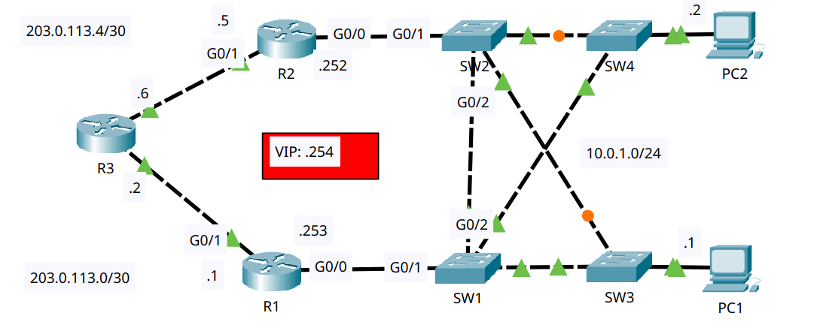
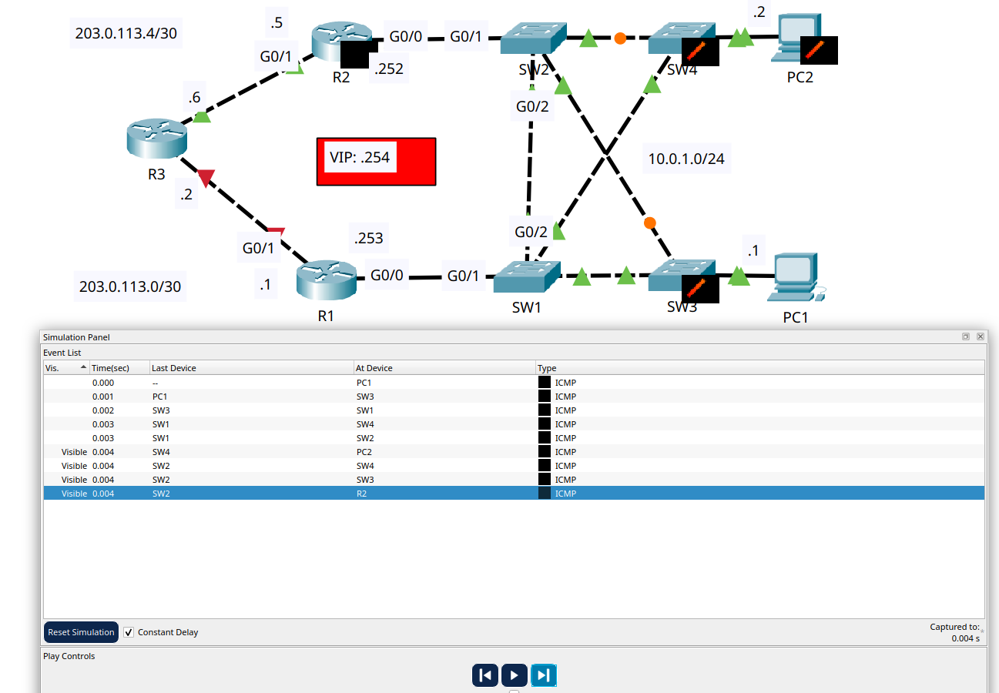

# HSRP Configuration

- **Date:** 2026-11-16
- **Topic area:** First-hop redundancy, HSRPv2, gateway failover
- **Difficulty:** Easy

## Objective
Configure HSRP on two gateway routers so the PCs keep a working default gateway when one router fails, then test what happens when R1 is turned off and back on.

## Topology


R1 and R2 both connect to the 10.0.1.0/24 LAN, R1 through SW1 and R2 through SW2. SW1 connects to SW4 and SW2 connects to SW3 over cross-links, and the four switches are interconnected. PC1 sits behind SW3 and PC2 behind SW4. R1 and R2 each connect to R3, which is the upstream router. R3 has a loopback interface with the address 8.8.8.8, which simulates the internet. The IP addresses on the routers and the PCs' gateways were already configured, and the switches were on default settings.


## Starting state
Both PCs were pre-configured with the same default gateway, 10.0.1.253, which is R1's own G0/0 address.

```
C:\> ipconfig /all
   IPv4 Address....................: 10.0.1.1
   Subnet Mask.....................: 255.255.255.0
   Default Gateway.................: ::
                                     10.0.1.253
```

PC2 showed the same gateway. Both PCs could already reach 8.8.8.8, and the trace shows R1 as the first hop. I used traceroute for the first hop, since the ping output doesn't show it.

```
C:\> ping 8.8.8.8
Reply from 8.8.8.8: bytes=32 time=6ms TTL=254
Reply from 8.8.8.8: bytes=32 time<1ms TTL=254
Reply from 8.8.8.8: bytes=32 time<1ms TTL=254
Reply from 8.8.8.8: bytes=32 time<1ms TTL=254

C:\> tracert 8.8.8.8
  1   0 ms      0 ms      0 ms      10.0.1.253
  2   0 ms      0 ms      0 ms      8.8.8.8
```

| From | To | Result | TTL | First hop |
|------|----|--------|-----|-----------|
| PC1 | 8.8.8.8 | 4/4 | 254 | 10.0.1.253 (R1) |
| PC2 | 8.8.8.8 | 4/4 | 254 | 10.0.1.253 (R1) |

Neither router had any HSRP configuration yet:

```
R1# show ip interface brief
GigabitEthernet0/0     10.0.1.253      YES manual up                    up
GigabitEthernet0/1     203.0.113.1     YES manual up                    up

R1# show standby brief
                     P indicates configured to preempt.
                     |
Interface   Grp  Pri P State    Active          Standby         Virtual IP
R1#
```

R2 matched, with 10.0.1.252 on G0/0, 203.0.113.5 on G0/1, and the same empty `show standby brief`.

## Key configuration

### HSRPv2 on R1 and R2:

R1 has a priority above the default, and R2 has one below it, and both have preemption on. The virtual IP is 10.0.1.254.

```
R1(config)# interface gigabitethernet0/0
R1(config-if)# standby version 2
R1(config-if)# standby 1 ip 10.0.1.254
%HSRP-6-STATECHANGE: GigabitEthernet0/0 Grp 1 state Init -> Init
%HSRP-6-STATECHANGE: GigabitEthernet0/0 Grp 1 state Speak -> Standby
%HSRP-6-STATECHANGE: GigabitEthernet0/0 Grp 1 state Standby -> Active
R1(config-if)# standby 1 priority 150
R1(config-if)# standby 1 preempt
```

```
R2(config)# interface gigabitethernet0/0
R2(config-if)# standby version 2
R2(config-if)# standby 1 ip 10.0.1.254
%HSRP-6-STATECHANGE: GigabitEthernet0/0 Grp 1 state Init -> Init
%HSRP-6-STATECHANGE: GigabitEthernet0/0 Grp 1 state Speak -> Standby
R2(config-if)# standby 1 priority 80
R2(config-if)# standby 1 preempt
```

R1 went to Active as soon as I set the virtual IP, before I had set its priority or configured R2.

```
R1# show standby
GigabitEthernet0/0 - Group 1 (version 2)
  State is Active
  Virtual IP address is 10.0.1.254
  Active virtual MAC address is 0000.0C9F.F001
    Local virtual MAC address is 0000.0C9F.F001 (v2 default)
  Hello time 3 sec, hold time 10 sec
  Preemption enabled
  Active router is local
  Standby router is unknown
  Priority 150 (configured 150)

R2# show standby
GigabitEthernet0/0 - Group 1 (version 2)
  State is Standby
  Virtual IP address is 10.0.1.254
  Active virtual MAC address is 0000.0C9F.F001
    Local virtual MAC address is 0000.0C9F.F001 (v2 default)
  Hello time 3 sec, hold time 10 sec
  Preemption enabled
  Active router is 10.0.1.253
  Standby router is local
  Priority 80 (configured 80)
```

### The VIP as the default gateway:

I changed the default gateway on both PCs from 10.0.1.253 to the VIP, 10.0.1.254, by editing it in each PC's IP configuration window.

```
C:\> ipconfig /all
   IPv4 Address....................: 10.0.1.1
   Subnet Mask.....................: 255.255.255.0
   Default Gateway.................: ::
                                     10.0.1.254
```

PC2 showed 10.0.1.254 as well.


## Verification

### The default gateway:

With the VIP as the default gateway, the first hop was still R1, since R1 was the active router at that point.

### Pings and the ARP table:

**Prediction** = the MAC address mapped to the gateway has to change, because the new gateway is a virtual IP address that I configured.

Before the gateway change, each PC's ARP table held R1's own interface address:

```
C:\> arp -a
  Internet Address      Physical Address      Type
  10.0.1.253            00d0.585b.7501        dynamic
```

After the change, the ARP table was empty until I pinged:

```
C:\> arp -a
No ARP Entries Found

C:\> ping 8.8.8.8
Reply from 8.8.8.8: bytes=32 time=55ms TTL=254
Reply from 8.8.8.8: bytes=32 time=33ms TTL=254
Reply from 8.8.8.8: bytes=32 time<1ms TTL=254
Reply from 8.8.8.8: bytes=32 time<1ms TTL=254

C:\> arp -a
  Internet Address      Physical Address      Type
  10.0.1.254            0000.0c9f.f001        dynamic
```

| From | To | Result | TTL | Notes |
|------|----|--------|-----|-------|
| PC1 | 8.8.8.8 | 4/4 | 254 | First two replies slower (55 ms, 33 ms) |
| PC2 | 8.8.8.8 | 4/4 | 254 | First reply slower (37 ms) |

PC2's ARP table showed the same entry for 10.0.1.254. The MAC address mapped to the VIP is **0000.0c9f.f001**, which is the active virtual MAC address on both routers in `show standby`. It is different from the MAC that was mapped to 10.0.1.253 before, so the prediction held.


### R1 turned off:

I saved R1's configuration, then turned it off. R2 moved from Standby to Active:

```
R2#
%HSRP-6-STATECHANGE: GigabitEthernet0/0 Grp 1 state Standby -> Active
%OSPF-5-ADJCHG: Process 1, Nbr 203.0.113.1 on GigabitEthernet0/0 from FULL to DOWN, Neighbor Down: Dead timer expired
%OSPF-5-ADJCHG: Process 1, Nbr 203.0.113.1 on GigabitEthernet0/0 from FULL to DOWN, Neighbor Down: Interface down or detached

R2# show standby
GigabitEthernet0/0 - Group 1 (version 2)
  State is Active
  Virtual IP address is 10.0.1.254
  Active virtual MAC address is 0000.0C9F.F001
  Preemption enabled
  Active router is local
  Standby router is unknown
  Priority 80 (configured 80)
```

The OSPF messages show R2 losing its OSPF neighbor when R1 went off.

I traced from PC1 to 8.8.8.8 because the trace shows the first hop, and the ping doesn't. The first hop is now R2's own interface, 10.0.1.252. PC2 behaved the same.

```
C:\> tracert 8.8.8.8
  1   15 ms     0 ms      0 ms      10.0.1.252
  2   0 ms      0 ms      0 ms      8.8.8.8
```

So yes, R2 is used as the default gateway while R1 is off. The default gateway on the PCs is still the VIP, 10.0.1.254, and it didn't change. What changed is the router answering for it. Before, the first hop was R1's own interface (10.0.1.253). Now it is R2's own interface (10.0.1.252). The trace shows each router's own address, not the VIP.




### R1 turned back on:

**Prediction** = R1 will become the active router again.

After R1 came back, it still had its priority and preemption configured and went back to Active. R2 went back to Standby:

```
R1#
%HSRP-6-STATECHANGE: GigabitEthernet0/0 Grp 1 state Speak -> Standby
%HSRP-6-STATECHANGE: GigabitEthernet0/0 Grp 1 state Standby -> Active

R1# show standby
GigabitEthernet0/0 - Group 1 (version 2)
  State is Active
  Preemption enabled
  Active router is local
  Standby router is unknown
  Priority 150 (configured 150)
```

```
R2#
%OSPF-5-ADJCHG: Process 1, Nbr 10.0.1.253 on GigabitEthernet0/0 from LOADING to FULL, Loading Done
%HSRP-6-STATECHANGE: GigabitEthernet0/0 Grp 1 state Speak -> Standby

R2# show standby
GigabitEthernet0/0 - Group 1 (version 2)
  State is Standby
  Preemption enabled
  Active router is 10.0.1.253, priority 150 (expires in 7 sec)
    MAC address is 0000.0C9F.F001
  Standby router is local
  Priority 80 (configured 80)
```

A trace from PC1 shows R1 as the first hop again. The first probe timed out. PC2 behaved the same.

```
C:\> tracert 8.8.8.8
  1   *         0 ms      0 ms      10.0.1.253
  2   0 ms      0 ms      0 ms      8.8.8.8
```

So yes, R1 became the active router again, and the prediction held.

## Things to note
- The default gateway before HSRP was R1's own address, so the PCs were tied to R1. Pointing them at the VIP is what lets R2 take over without touching the PCs.
- R1 only took the Active role back because both its higher priority and preemption were on, and that without preemption R2 would have stayed Active.
- PCs' ARP tables were empty after the gateway change because the aging timer for the old entry expired and the PCs hadn't learned the new MAC address yet.
- After R1 came back in step 5, `show standby` on R1 still said `Standby router is unknown`, while R2 had already gone to Standby. My reading is that R1 hadn't learned about R2 yet when I captured it, 27 seconds after its last state change. I didn't check again.
- I didn't record how long R2 took to take over after R1 went off.
