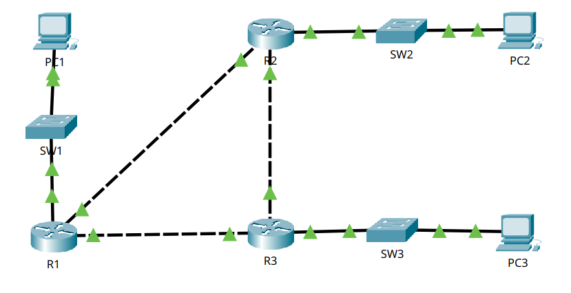
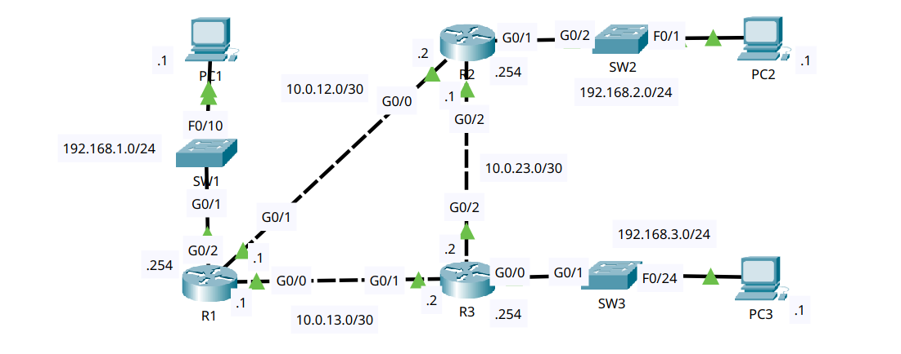

# CDP & LLDP

- **Date:** 2026-11-25
- **Topic area:** Network fundamentals, device discovery (CDP and LLDP)
- **Difficulty:** Medium

## Objective
Use CDP and other commands to find the interface names and IP addresses missing from the topology. Then disable CDP on the switch ports facing the PCs and on every device, and enable LLDP globally, with transmit and receive turned on for the interfaces that connect to other network devices (LLDP transmit and receive started disabled on every interface).

## Topology


Three routers (R1, R2, R3) are joined in a triangle. Each router has one switch (SW1, SW2, SW3) and one PC (PC1, PC2, PC3) behind it. The diagram came with no interface names, IP addresses, or subnets printed on it.

## Starting state
- **Switches:** default settings apart from the hostnames, with LLDP receive and transmit disabled on every interface.
- **Routers:** default settings apart from the hostnames, IPv4 addresses, and EIGRP (`router eigrp 1`, `network 0.0.0.0`), with LLDP receive and transmit disabled on every interface.
- **PCs:** only an IPv4 address and default gateway.

CDP was running on every device with its default settings.

The PC addresses come from `ipconfig /all`. `FastEthernet0` is the only interface on each PC with an address. PC1 for example:

```
PC1> ipconfig /all
FastEthernet0 Connection:(default port)
IPv4 Address....................: 192.168.1.1
Subnet Mask.....................: 255.255.255.0
Default Gateway.................: ::
                                  192.168.1.254
```

| PC | IPv4 address | Subnet mask | Default gateway |
|---|---|---|---|
| PC1 | 192.168.1.1 | 255.255.255.0 | 192.168.1.254 |
| PC2 | 192.168.2.1 | 255.255.255.0 | 192.168.2.254 |
| PC3 | 192.168.3.1 | 255.255.255.0 | 192.168.3.254 |

## Discovering the network:

On all six devices, I ran `show cdp`, `show cdp neighbors` and `show cdp neighbors detail`. Outputs are cropped.

```
R1# show cdp
Global CDP information:
    Sending CDP packets every 60 seconds
    Sending a holdtime value of 180 seconds
    Sending CDPv2 advertisements is enabled
```

```
R1# show cdp neighbors
Capability Codes: R - Router, T - Trans Bridge, B - Source Route Bridge
                  S - Switch, H - Host, I - IGMP, r - Repeater, P - Phone
Device ID    Local Intrfce   Holdtme    Capability   Platform    Port ID
R2           Gig 0/1          125            R       C2900       Gig 0/0
SW1          Gig 0/2          125            S       2960        Gig 0/1
R3           Gig 0/0          125            R       C2900       Gig 0/1
```

The detail output gives the neighbor's IP address. Two entries from R1:

```
R1# show cdp neighbors detail
Device ID: R2
Entry address(es):
  IP address : 10.0.12.2
Platform: cisco C2900, Capabilities: Router
Interface: GigabitEthernet0/1, Port ID (outgoing port): GigabitEthernet0/0

Device ID: SW1
Entry address(es):
Platform: cisco 2960, Capabilities: Switch
Interface: GigabitEthernet0/2, Port ID (outgoing port): GigabitEthernet0/1
```

The switches have no IP address, so SW1's entry is empty. From the switch side, SW1 sees only R1:

```
SW1# show cdp neighbors detail
Device ID: R1
Entry address(es):
  IP address : 192.168.1.254
Platform: cisco C2900, Capabilities: Router
Interface: GigabitEthernet0/1, Port ID (outgoing port): GigabitEthernet0/2
```

The other devices gave the same kind of output. Each link showed up from both ends, and both ends agreed. Putting it together:

| Link | Subnet | One end | Other end |
|---|---|---|---|
| R1 to R2 | 10.0.12.0/30 | R1 G0/1 `10.0.12.1` | R2 G0/0 `10.0.12.2` |
| R1 to R3 | 10.0.13.0/30 | R1 G0/0 `10.0.13.1` | R3 G0/1 `10.0.13.2` |
| R2 to R3 | 10.0.23.0/30 | R2 G0/2 `10.0.23.1` | R3 G0/2 `10.0.23.2` |
| R1 LAN | 192.168.1.0/24 | R1 G0/2 `192.168.1.254` | SW1 G0/1 |
| R2 LAN | 192.168.2.0/24 | R2 G0/1 `192.168.2.254` | SW2 G0/2 |
| R3 LAN | 192.168.3.0/24 | R3 G0/0 `192.168.3.254` | SW3 G0/1 |

**Prefix lengths:** 

CDP doesn't show the subnet mask. The LAN masks came from the PCs' `ipconfig` output. For the router links, I ran `show interface`. R1 covers the R1 to R2 and R1 to R3 links, and R2 covers the R2 to R3 link:

```
R1# show interface gigabitethernet0/0
  Internet address is 10.0.13.1/30
```

```
R1# show interface gigabitethernet0/1
  Internet address is 10.0.12.1/30
```

```
R2# show interface gigabitethernet0/2
  Internet address is 10.0.23.1/30
```

**Ports connected to PCs:** 

No PC showed up in any CDP neighbor table, even though CDP was enabled on the PC-facing ports, so I used `show interface status` to find them. Each switch has only two connections, so the connected port that isn't the uplink should be the one the PC is on. Cropped to the connected ports:

```
SW1# show interface status
Port      Name               Status       Vlan       Duplex  Speed Type
Fa0/10                       connected    1          a-full  a-100 10/100BaseTX
Gig0/1                       connected    1          a-full  a-100 10/100/1000BaseTX
```

```
SW2# show interface status
Port      Name               Status       Vlan       Duplex  Speed Type
Fa0/1                        connected    1          a-full  a-100 10/100BaseTX
Gig0/2                       connected    1          a-full  a-100 10/100/1000BaseTX
```

```
SW3# show interface status
Port      Name               Status       Vlan       Duplex  Speed Type
Fa0/24                       connected    1          a-full  a-100 10/100BaseTX
Gig0/1                       connected    1          a-full  a-100 10/100/1000BaseTX
```

| Switch | Port to the PC | Uplink to the router |
|---|---|---|
| SW1 | Fa0/10 (PC1) | Gig0/1 |
| SW2 | Fa0/1 (PC2) | Gig0/2 |
| SW3 | Fa0/24 (PC3) | Gig0/1 |

I used all of this to label the topology with the interface names, IP addresses, and subnets:



## Key configuration

### Disable CDP on the interfaces connected to PCs:

On each switch, only the port facing the PC. SW1 shown, SW2 used `interface fastethernet0/1` and SW3 used `interface fastethernet0/24`.

```
SW1# configure terminal
SW1(config)# interface fastethernet0/10
SW1(config-if)# no cdp enable
```

### Disable CDP globally:

Run on all six devices. R1 shown.

```
R1# configure terminal
R1(config)# no cdp run
```

### Enable LLDP:

`lldp run` goes on every device. Transmit and receive go only on the interfaces connected to other network devices, so the PC-facing switch ports stay disabled.

| Device | Transmit and receive enabled on |
|---|---|
| SW1 | Gig0/1 |
| SW2 | Gig0/2 |
| SW3 | Gig0/1 |
| R1, R2, R3 | G0/0, G0/1, G0/2 (all three connect to another network device) |

On a switch (SW1 shown):

```
SW1# configure terminal
SW1(config)# lldp run
SW1(config)# interface gigabitethernet0/1
SW1(config-if)# lldp transmit
SW1(config-if)# lldp receive
```

On a router (R1 shown):

```
R1# configure terminal
R1(config)# lldp run
R1(config)# interface range gigabitethernet0/0 - 2
R1(config-if-range)# lldp transmit
R1(config-if-range)# lldp receive
```

## Verification

### PC-facing ports no longer in CDP:

`show cdp interface` lists every port with CDP enabled, including ports that are down. Before the change, the PC port was listed on each switch:

```
SW1# show cdp interface
FastEthernet0/10 is up, line protocol is up
  Sending CDP packets every 60 seconds
  Holdtime is 180 seconds
```

SW2 listed Fa0/1 and SW3 listed Fa0/24 the same way. Afterwards, the PC port is missing from the list:

```
SW1# show cdp interface
FastEthernet0/9 is down, line protocol is down
  Sending CDP packets every 60 seconds
  Holdtime is 180 seconds
FastEthernet0/11 is down, line protocol is down
  Sending CDP packets every 60 seconds
  Holdtime is 180 seconds
```

On SW2, the list now starts at Fa0/2, and on SW3 it goes from Fa0/23 straight to Gig0/1.

### CDP disabled globally:

On every device, `show cdp` now says CDP is off. R1 as an example:

```
R1# show cdp
% CDP is not enabled
```

```
R1# show running-config
no cdp run
```

On the switches, the `no cdp enable` line on the PC port stays in the running config next to `no cdp run`:

```
SW1# show running-config
interface FastEthernet0/10
 no lldp receive
 no lldp transmit
 no cdp enable

no cdp run
```

These running configs also show the LLDP state before configuration. Every interface still had LLDP transmit and receive disabled:

```
SW1# show running-config
interface GigabitEthernet0/1
 no lldp receive
 no lldp transmit
```

```
R1# show running-config
interface GigabitEthernet0/0
 ip address 10.0.13.1 255.255.255.252
 no lldp receive
 no lldp transmit
```

### LLDP enabled:
```
SW1# show lldp
Global LLDP Information:
    Status: ACTIVE
    LLDP advertisements are sent every 30 seconds
    LLDP hold time advertised is 120 seconds
    LLDP interface reinitialisation delay is 2 seconds
```

```
R1# show lldp neighbors
Capability codes:
    (R) Router, (B) Bridge, (T) Telephone, (C) DOCSIS Cable Device
    (W) WLAN Access Point, (P) Repeater, (S) Station, (O) Other
Device ID           Local Intf     Hold-time  Capability      Port ID
R3                  Gig0/0         120        R               Gig0/1
SW1                 Gig0/2         120        B               Gig0/1
R2                  Gig0/1         120        R               Gig0/0

Total entries displayed: 3
```

The other devices matched what CDP already discovered. Same neighbors on the same ports:

| Device | Neighbors (local interface, neighbor, neighbor port) |
|---|---|
| SW1 | Gig0/1, R1, Gig0/2 |
| SW2 | Gig0/2, R2, Gig0/1 |
| SW3 | Gig0/1, R3, Gig0/0 |
| R2 | Gig0/2, R3, Gig0/2; Gig0/0, R1, Gig0/1; Gig0/1, SW2, Gig0/2 |
| R3 | Gig0/0, SW3, Gig0/1; Gig0/1, R1, Gig0/0; Gig0/2, R2, Gig0/2 |

The running config changed as well (cropped). On SW1, the uplink no longer has the `no lldp` lines, and the PC port still does:

```
SW1# show running-config
lldp run

interface FastEthernet0/10
 no lldp receive
 no lldp transmit
 no cdp enable

interface GigabitEthernet0/1
!
```

On R1, all three interfaces lost their `no lldp` lines:

```
R1# show running-config
lldp run

interface GigabitEthernet0/0
 ip address 10.0.13.1 255.255.255.252
 duplex auto
 speed auto
```

## Where I struggled
Mapping out the topology from CDP output and other commands alone was a little challenging, especially working out the subnet masks of each network. They're usually shown on these lab topologies. It's nice to be aware of such workarounds in case conditions aren't ideal when doing the actual work.

## Things to note
- The IP address CDP lists for a router is the one on the interface facing the device asking. R1 saw R2 as 10.0.12.2, while R3 saw R2 as 10.0.23.1.
- `show cdp neighbors detail` also gives the neighbor's platform and IOS version. The routers showed C2900 on 15.1(4)M4 and the switches 2960 on 12.2(25)FX.
- No PC appeared in any CDP neighbor table. I left LLDP off on the PC-facing switch ports, so I didn't test whether a PC shows up in LLDP.
- `no cdp run` doesn't remove the `no cdp enable` line from a port.
- `show lldp neighbors` has no platform or IP address column. It also lists the switches with capability `B` (bridge), where CDP listed them as `S` (switch).
- The default timers differ. CDP sends every 60 seconds with a holdtime of 180. LLDP sends every 30 seconds with a hold time of 120.
- Once transmit and receive are enabled on an interface, its `no lldp receive` and `no lldp transmit` lines disappear from the running config.
