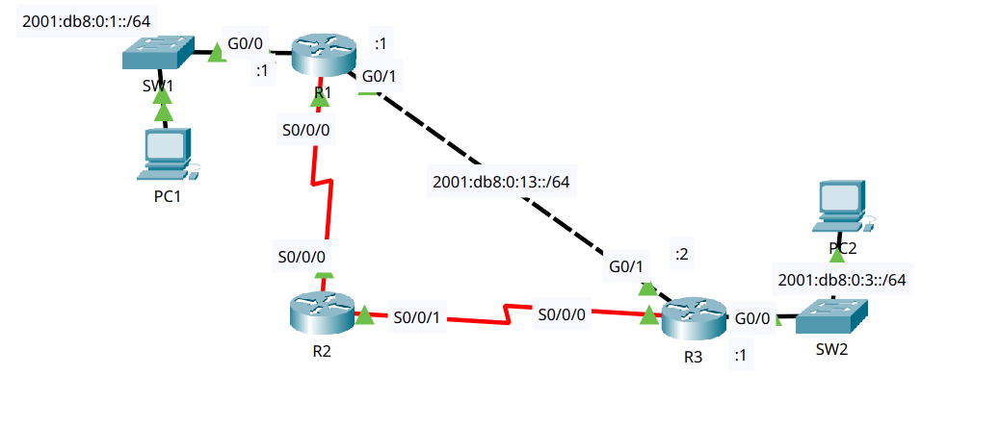
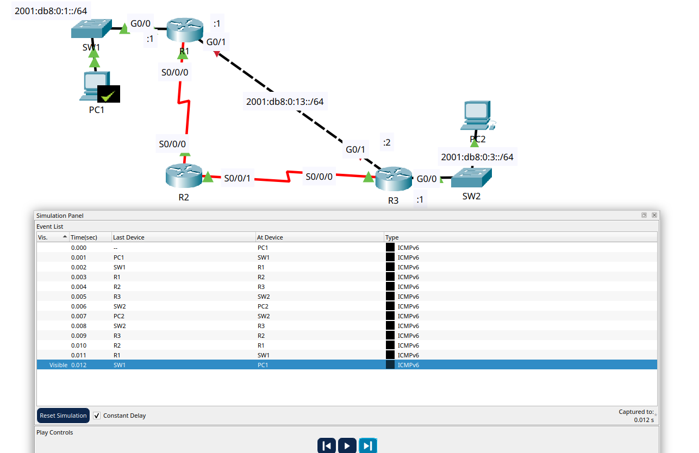

# IPv6 Static Routes

- **Date:** 2026-11-21
- **Topic area:** Static routing, IPv6
- **Difficulty:** Easy

## Objective
Turn on IPv6 routing on three routers, get addresses on the two PCs with SLAAC, and add static routes so PC1 and PC2 can ping each other. The path through R2 should only be used as a backup.

## Topology


R1 and R3 are joined by a Gigabit link. R2 sits between them on two serial links. PC1 and PC2 are on separate LANs behind R1 and R3.


The global addresses on the routers were preconfigured. The serial links have no global addresses.

## Starting state
All outputs are cropped to the interfaces and lines that matter.

On R1:

```
R1# show ipv6 interface brief
GigabitEthernet0/0         [up/up]
    FE80::202:4AFF:FE23:E201
    2001:DB8:0:1::1
GigabitEthernet0/1         [up/up]
    FE80::202:4AFF:FE23:E202
    2001:DB8:0:13::1
Serial0/0/0                [up/up]
    FE80::202:4AFF:FE23:E201
```

On R2:

```
R2# show ipv6 interface brief
Serial0/0/0                [up/up]
    FE80::20B:BEFF:FED7:4901
Serial0/0/1                [up/up]
    FE80::20B:BEFF:FED7:4901
```

On R3:

```
R3# show ipv6 interface brief
GigabitEthernet0/0         [up/up]
    FE80::290:2BFF:FECC:A101
    2001:DB8:0:3::1
GigabitEthernet0/1         [up/up]
    FE80::290:2BFF:FECC:A102
    2001:DB8:0:13::2
Serial0/0/0                [up/up]
    FE80::290:2BFF:FECC:A101
```

The IPv6 routing tables before any configuration. R1 had five entries, and R3 had the same five for its own addresses:

```
R1# show ipv6 route
IPv6 Routing Table - 5 entries
C   2001:DB8:0:1::/64 [0/0]
     via GigabitEthernet0/0, directly connected
L   2001:DB8:0:1::1/128 [0/0]
     via GigabitEthernet0/0, receive
C   2001:DB8:0:13::/64 [0/0]
     via GigabitEthernet0/1, directly connected
L   2001:DB8:0:13::1/128 [0/0]
     via GigabitEthernet0/1, receive
L   FF00::/8 [0/0]
     via Null0, receive
```

R2 had only the multicast entry:

```
R2# show ipv6 route
IPv6 Routing Table - 1 entries
L   FF00::/8 [0/0]
     via Null0, receive
```

The PCs (IPv6 lines only):

```
PC1> ipconfig /all
Link-local IPv6 Address.........: ::
IPv6 Address....................: ::
Default Gateway.................: ::
```

```
PC2> ipconfig /all
Link-local IPv6 Address.........: FE80::240:BFF:FE69:9B18
IPv6 Address....................: ::
Default Gateway.................: ::
```

PC2 already had a link-local address at the start and PC1 did not. I didn't look into why.

## Key configuration

### Enable IPv6 routing:

Run on all three routers. R1 shown; R2 and R3 were identical.

```
R1# configure terminal
R1(config)# ipv6 unicast-routing
```

### SLAAC addresses on the PCs:

On each PC, I opened the IP Configuration window and selected Automatic under the IPv6 configuration. No addresses were typed in.

### Static routes:

Each of R1 and R3 gets two routes to the far LAN. The route via the R1 to R3 link uses the default distance. The route via R2 has an administrative distance of 2, so it is only used when the first one is gone.

On R1:

```
R1# configure terminal
R1(config)# ipv6 route 2001:db8:0:3::/64 gigabitethernet0/1 2001:db8:0:13::2
R1(config)# ipv6 route 2001:db8:0:3::/64 serial0/0/0 2
```

On R3:

```
R3# configure terminal
R3(config)# ipv6 route 2001:db8:0:1::/64 gigabitethernet0/1 2001:db8:0:13::1
R3(config)# ipv6 route 2001:db8:0:1::/64 serial0/0/0 2
```

R2 only needs to pass traffic along, so it has one route to each LAN, out of the serial interface facing that side:

```
R2# configure terminal
R2(config)# ipv6 route 2001:db8:0:1::/64 serial0/0/0
R2(config)# ipv6 route 2001:db8:0:3::/64 serial0/0/1
```

## Verification

### IPv6 routing enabled:

On R1 (R2 and R3 matched):

```
R1# show running-config
no ip cef
ipv6 unicast-routing
!
no ipv6 cef
```

### SLAAC addresses:

The address configured on each PC:

| PC | Link-local | Global address | Default gateway |
|---|---|---|---|
| PC1 | FE80::20A:41FF:FE4D:1BBC | 2001:DB8:0:1:20A:41FF:FE4D:1BBC | FE80::202:4AFF:FE23:E201 |
| PC2 | FE80::240:BFF:FE69:9B18 | 2001:DB8:0:3:240:BFF:FE69:9B18 | FE80::290:2BFF:FECC:A101 |

The address, link-local, and gateway fields on each PC are filled in as soon as I select Automatic. Each default gateway is the link-local address of the router interface facing that PC: PC1's gateway is R1 G0/0 and PC2's is R3 G0/0 (compare with the `show ipv6 interface brief` output above).

Connectivity test to the connected router:

| Test | Result | TTL | Notes |
|---|---|---|---|
| PC1 to R1 (2001:DB8:0:1::1) | 4/4 | 255 | First reply 11 ms |
| PC2 to R3 (2001:DB8:0:3::1) | 4/4 | 255 | |

```
PC1> ping 2001:DB8:0:1::1
Reply from 2001:DB8:0:1::1: bytes=32 time=11ms TTL=255
Reply from 2001:DB8:0:1::1: bytes=32 time<1ms TTL=255
Reply from 2001:DB8:0:1::1: bytes=32 time<1ms TTL=255
Reply from 2001:DB8:0:1::1: bytes=32 time<1ms TTL=255

Ping statistics for 2001:DB8:0:1::1:
    Packets: Sent = 4, Received = 4, Lost = 0 (0% loss),
```

### Static routes:

On R1:

```
R1# show ipv6 route
IPv6 Routing Table - 6 entries
C   2001:DB8:0:1::/64 [0/0]
     via GigabitEthernet0/0, directly connected
L   2001:DB8:0:1::1/128 [0/0]
     via GigabitEthernet0/0, receive
S   2001:DB8:0:3::/64 [1/0]
     via 2001:DB8:0:13::2, GigabitEthernet0/1
C   2001:DB8:0:13::/64 [0/0]
     via GigabitEthernet0/1, directly connected
L   2001:DB8:0:13::1/128 [0/0]
     via GigabitEthernet0/1, receive
L   FF00::/8 [0/0]
     via Null0, receive
```

On R2:

```
R2# show ipv6 route
IPv6 Routing Table - 3 entries
S   2001:DB8:0:1::/64 [1/0]
     via Serial0/0/0, directly connected
S   2001:DB8:0:3::/64 [1/0]
     via Serial0/0/1, directly connected
L   FF00::/8 [0/0]
     via Null0, receive
```

On R3, the static route line (the rest matched R1 with R3's own addresses):

```
R3# show ipv6 route
IPv6 Routing Table - 6 entries
S   2001:DB8:0:1::/64 [1/0]
     via 2001:DB8:0:13::1, GigabitEthernet0/1
```

R1 reaches PC2's LAN through R3, and R3 reaches PC1's LAN through R1, as the tables show. The backup routes via R2 don't appear while the main route is up.

**Main path:** PC1 to PC2:

| Test | Result | TTL | Notes |
|---|---|---|---|
| PC1 to PC2 | 4/4 | 126 | No loss on the first attempt |

```
PC1> tracert 2001:DB8:0:3:240:BFF:FE69:9B18
Tracing route to 2001:DB8:0:3:240:BFF:FE69:9B18 over a maximum of 30 hops:

  1   0 ms      0 ms      0 ms      2001:DB8:0:1::1
  2   0 ms      0 ms      0 ms      2001:DB8:0:13::2
  3   0 ms      0 ms      0 ms      2001:DB8:0:3:240:BFF:FE69:9B18

Trace complete.
```

The path goes R1, then R3, then PC2.

**Backup path:** I tested it by shutting down R1's G0/1 interface.

**Prediction =** the routing tables on R1 and R3 will change and add entries for their static routes via R2, and a ping from PC1 to PC2 will take the path via R2.

```
R1# configure terminal
R1(config)# interface gigabitethernet0/1
R1(config-if)# shutdown
%LINK-5-CHANGED: Interface GigabitEthernet0/1, changed state to administratively down
%LINEPROTO-5-UPDOWN: Line protocol on Interface GigabitEthernet0/1, changed state to down
```

R1's routing table afterwards:

```
R1# show ipv6 route
IPv6 Routing Table - 4 entries
C   2001:DB8:0:1::/64 [0/0]
     via GigabitEthernet0/0, directly connected
L   2001:DB8:0:1::1/128 [0/0]
     via GigabitEthernet0/0, receive
S   2001:DB8:0:3::/64 [2/0]
     via Serial0/0/0, directly connected
L   FF00::/8 [0/0]
     via Null0, receive
```

R3's routing table afterwards (cropped):

```
R3# show ipv6 route
IPv6 Routing Table - 4 entries
S   2001:DB8:0:1::/64 [2/0]
     via Serial0/0/0, directly connected
```

The routing tables changed as predicted, with one difference. Each router still has a single static route to the far LAN. The route via R3 was replaced by the route via R2 (distance 2), not added next to it, and the connected and local entries for the 2001:DB8:0:13::/64 link disappeared with the interface.

PC1 to PC2 with the R1 to R3 link down:

| Test | Result | TTL | Notes |
|---|---|---|---|
| PC1 to PC2 | 4/4 | 125 | First reply 3 ms |

```
PC1> ping 2001:DB8:0:3:240:BFF:FE69:9B18
Reply from 2001:DB8:0:3:240:BFF:FE69:9B18: bytes=32 time=3ms TTL=125
Reply from 2001:DB8:0:3:240:BFF:FE69:9B18: bytes=32 time=2ms TTL=125
Reply from 2001:DB8:0:3:240:BFF:FE69:9B18: bytes=32 time=2ms TTL=125
Reply from 2001:DB8:0:3:240:BFF:FE69:9B18: bytes=32 time=2ms TTL=125

Ping statistics for 2001:DB8:0:3:240:BFF:FE69:9B18:
    Packets: Sent = 4, Received = 4, Lost = 0 (0% loss),
```

```
PC1> tracert 2001:DB8:0:3:240:BFF:FE69:9B18
Tracing route to 2001:DB8:0:3:240:BFF:FE69:9B18 over a maximum of 30 hops:

  1   0 ms      0 ms      0 ms      2001:DB8:0:1::1
  2   *         *         *         Request timed out.
  3   0 ms      1 ms      1 ms      2001:DB8:0:3::1
  4   1 ms      0 ms      1 ms      2001:DB8:0:3:240:BFF:FE69:9B18

Trace complete.
```

The TTL dropped from 126 to 125, so the packet crossed one more router. In simulation mode, the request and reply both travel through R2 with the R1 to R3 link down:



## Things to note
- The PCs' global addresses and link-locals share the same last 64 bits, which are the PC's MAC address with `FFFE` in the middle and the first byte changed from 00 to 02 (PC1: `000A.414D.1BBC` became `20A:41FF:FE4D:1BBC`). PC2 matched the same way.
- The PCs got their addresses and gateways after I enabled IPv6 routing. I think the routers send the prefix and gateway out in router advertisements and need `ipv6 unicast-routing` to do that.
- Each router's serial interfaces show the same link-local address as one of its Gigabit interfaces (R1 and R3 share it with G0/0, and R2's two serials share one). I didn't look into why.
- The routes on R2 give only an exit interface and no next hop, and they work. In the second [IPv6 Configuration](../../ip-addressing-and-subnetting/26-ipv6-configuration-part-2/notes.md) lab, a route with only an exit interface did not get PC1 to PC2. I think it's because a serial link has only one device on the other end, so no next hop is needed.
- In the backup-path traceroute, hop 2 timed out on every attempt, and each run took a while to finish. By the TTL of 125 and the simulation capture, hop 2 should be R2. I think R2 doesn't answer because it has no global IPv6 address, only link-local addresses, and that the slow finish is the wait on the three timed-out probes. I haven't confirmed either. PC2 was still reachable. Hop 3 shows R3's LAN address, 2001:DB8:0:3::1.

